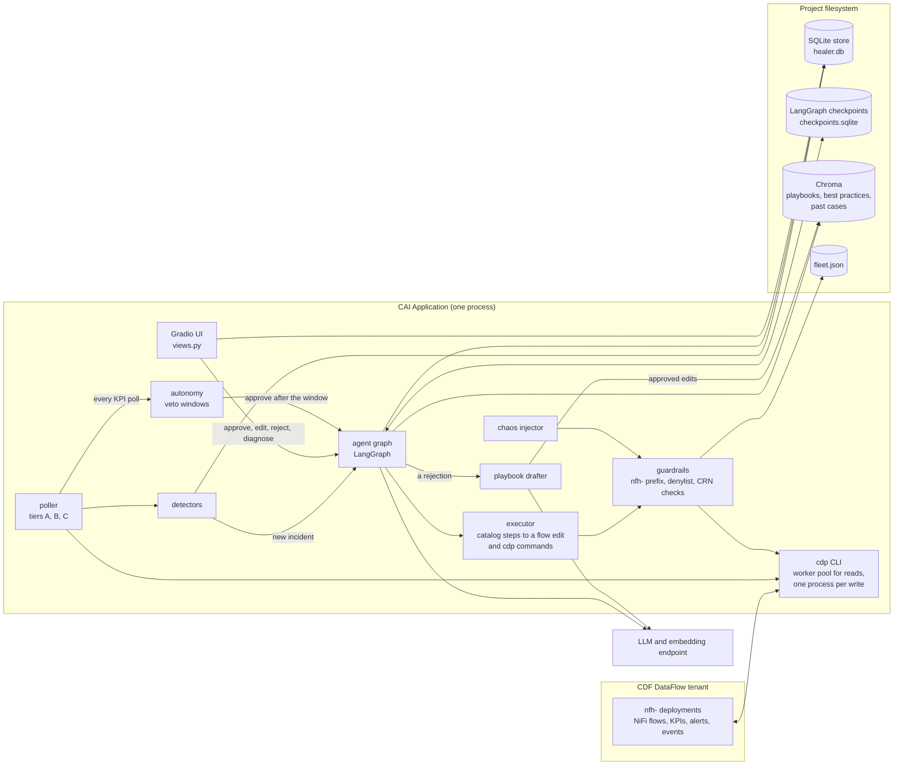
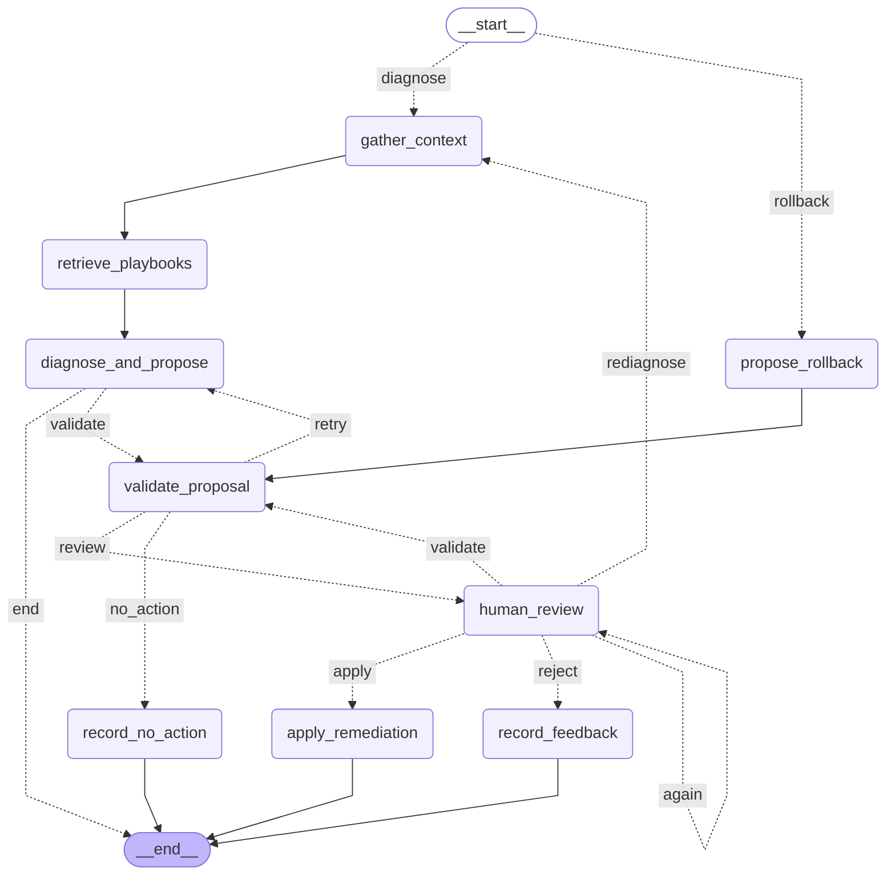
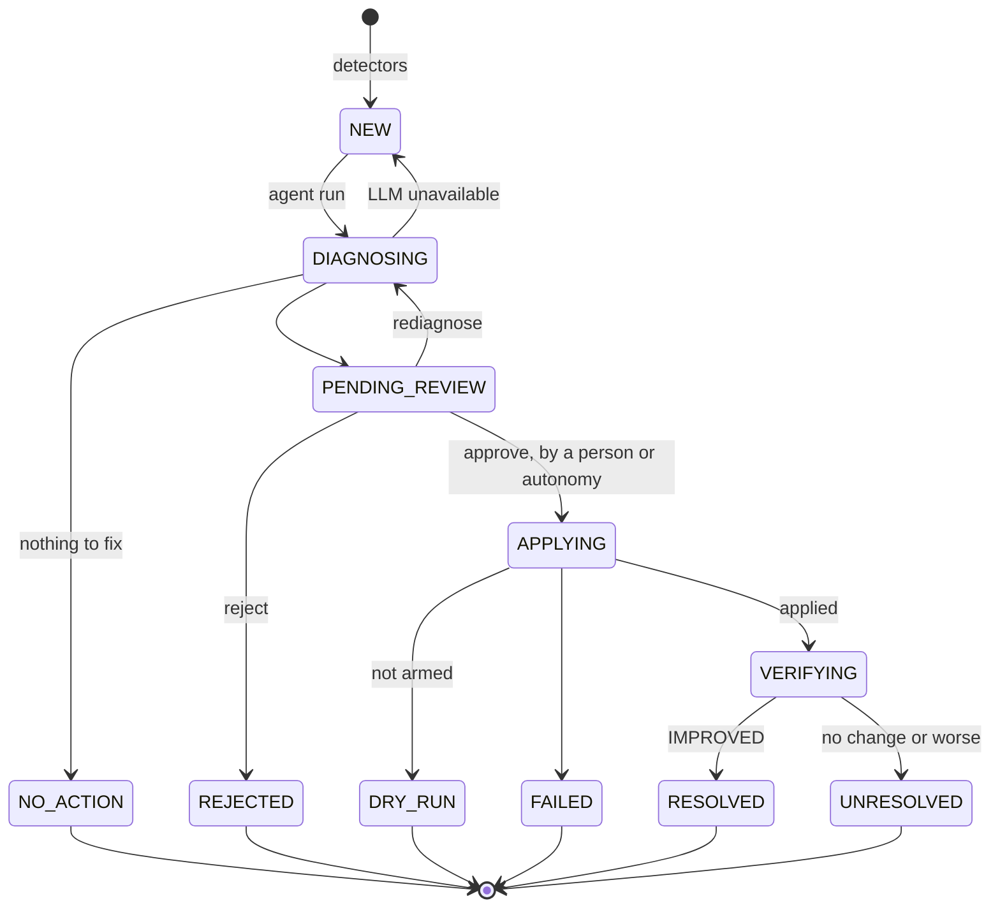

# Architecture

How the agent application is put together: its parts, the LangGraph graph that diagnoses and fixes an incident,
where each piece runs, and what it keeps. The work that changes it is ticketed in [TRACKER.md](TRACKER.md); the
[change log](#change-log) at the bottom records each change to the architecture by its ticket.

## The parts

One CAI Application process runs everything: the UI, the poller, the agent and the chaos injector. It reaches the
DataFlow tenant only through the `cdp` CLI, and the LLM and embedding endpoint over HTTPS.

- **The LLM never writes flow JSON.** It picks steps from the action catalog (`actions/catalog.py`); the executor turns
  them into a flow edit, a diff and the exact `cdp` commands.
- **Every write passes the guardrails** (`cdp/guardrails.py`), checked against `fleet.json`, the independent record of
  which deployments this app owns.
- **Nothing is applied while `SELFHEAL_ARMED` is off.** An approval is recorded as a dry run.

## The agent graph

Drawn from the compiled graph by `python -m nifi_healer.agent.diagram`; a test fails when it is out of date. A solid
arrow always runs; a dotted one is a route its node's router chose, labelled with the route's name. Each incident is
its own thread (thread id = incident id), checkpointed after every node.

<!-- agent-graph:begin (python -m nifi_healer.agent.diagram) -->

<!-- agent-graph:end -->

### The nodes

| Node | What it does | Reads | LLM |
|---|---|---|---|
| entry (router) | A rollback incident skips the diagnosis | store | no |
| propose_rollback | Proposes undoing the one action a rollback incident is for | store | no |
| gather_context | The deployed flow's inventory of the incident's process group, its parameters, sizing and version | CDF: flow facts, flow definition, flow configuration, deployment configuration | no |
| retrieve_playbooks | Playbook sections for the signals and the parameters used, the most similar past cases, and the fixes' track records (for the reviewer only) | Chroma, store | embeddings |
| diagnose_and_propose | Asks for a diagnosis and a proposal, with one repair turn on an unusable reply. Ends the run if the LLM is unavailable, leaving the incident NEW | prompt | yes |
| validate_proposal | Checks the proposal against the catalog, its bounds and the flow, and builds the diff and commands. Marks the incident's older proposals SUPERSEDED | CDF flow definition, executor | no |
| human_review | Pauses for a decision: approve, edit, reject or rediagnose. An invalid decision asks again | the reviewer | no |
| apply_remediation | Applies the change and waits for the deployment to settle (a dry run unless armed) | CDF writes, through the guardrails | no |
| record_feedback | Closes the incident as REJECTED and queues the reason for the playbook drafter | store | no |
| record_no_action | Closes the incident as NO_ACTION | store | no |

Routes out of validate_proposal: a proposal that failed validation goes back to the agent with the problems, up to
`MAX_ATTEMPTS` (3) proposals; a valid "no action" closes the incident; anything else goes to review. A proposal edited
by a reviewer is validated again but never sent back to the agent.

### What the graph carries

The state (`agent/state.py`) is plain JSON, so a run paused at review survives a restart. The store keeps the durable
record; the state carries only what the next node needs.

| Field | Set by | Holds |
|---|---|---|
| incident_id, incident | start, gather_context | The incident row, with its signals |
| context | gather_context | Inventory text, parameters, sizing, flow version, a read error |
| playbooks, memory, priors | retrieve_playbooks | Retrieved sections, past cases, track records |
| proposal, attempts, agent_version, source | diagnose_and_propose, human_review | The reply, how many tries, prompt and model version, agent or review |
| plan, proposal_id, feedback | validate_proposal | The validation report, its store row, the problems for a retry |
| review, review_error | human_review | The decision, or why it was refused |
| result | apply_remediation | The action's status and flow versions |
| error | diagnose_and_propose | Why the run stopped |

## Where it runs

| Thread or pool | Size | Runs |
|---|---|---|
| poller | 1 thread | The tier schedule, outcome checks, retention, chaos ticks, telemetry |
| poll | `POLL_WORKERS`, default max(4, deployments ÷ 2) | The tier reads, never two of one pack and tier at once |
| cdp CLI workers | `SELFHEAL_CDP_WORKERS`, default 6 | Long-lived cdpcli processes for reads; each write is its own process |
| agent | `SELFHEAL_AGENT_WORKERS`, default 2 | Graph runs up to review: diagnoses, re-diagnoses |
| apply | 4 | Approvals, which wait minutes for their deployment |
| drafter | 1 | Playbook edits drafted from rejections |
| Gradio handlers | Gradio's | Every decision but an armed approval: edits (validated there), rejections, dry-run approvals |
| playbook-rebuild, rag-warm | 1 thread each, on demand | Re-indexing playbooks after an approved edit; warming Chroma at start |

Every tier is due per pack (A health every `POLL_HEALTH_SECONDS`, B KPI charts and detectors every `POLL_KPI_SECONDS`,
C deployment events every `POLL_EVENTS_SECONDS`). Autonomy's veto windows are checked on every KPI poll.

## What it keeps

| Where | What |
|---|---|
| `healer.db` (SQLite) | deployments, flow_versions, kpi_samples, changes, incidents, proposals, reviews, actions, outcomes, superseded_outcomes, action_labels, playbook_edits, auto_approvals, settings, health_samples, chaos_injections |
| `checkpoints.sqlite` | The graph's checkpoints, one thread per incident; pruned 7 days after an incident closes |
| Chroma | `nifi_playbooks` and `nifi_best_practices`, one document per playbook section with approved edits laid over; `remediation_memory`, one document per decided case |
| `fleet.json` | The deployments this app owns, written by provisioning |
| `playbooks/*.md` | The playbooks as written; edits stay in the store until a person approves them |

## An incident's life

An outcome is judged at 15 minutes, 1 hour and 12 hours after a fix. A fix measured worse gets a rollback incident,
which enters the graph at propose_rollback. A proposal's own status is VALID, INVALID, NO_ACTION, or SUPERSEDED once a
newer one replaces it.

## Change log

Append only: one entry per change to the architecture, newest last, named by its ticket.

| Date | Ticket | Change |
|---|---|---|
| 2026-10-11 | NFH-1 | The graph: gather_context, retrieve_playbooks, diagnose_and_propose, validate_proposal, human_review (interrupt), apply_remediation, record_feedback, record_no_action. SqliteSaver checkpoints; one thread per incident. The poller's incidents are diagnosed on the agent pool |
| 2026-10-12 | NFH-7 | Armed approvals run on their own apply pool, so a decision returns at once |
| 2026-10-12 | NFH-12 | human_review gains the rediagnose route back to gather_context, for a review drafted on a flow version no longer deployed |
| 2026-10-13 | NFH-17 | entry router and propose_rollback: a rollback incident skips the diagnosis and the LLM |
| 2026-10-13 | NFH-19 | retrieve_playbooks also recalls past cases from `remediation_memory` |
| 2026-10-13 | NFH-20 | retrieve_playbooks also reads the fixes' track records; validate_proposal warns on a fix that keeps failing |
| 2026-10-14 | NFH-21 | record_feedback queues the playbook drafter; approved edits are laid over the playbooks when indexed |
| 2026-10-14 | NFH-22 | Autonomy: a run paused at review may approve itself after a veto window, checked on every KPI poll |
| 2026-10-14 | NFH-23 | Reads go through long-lived cdp CLI workers; telemetry and retention join the poller |
| 2026-10-16 | NFH-25 | The chaos injector, a poller tier that re-plants faults through the guardrails |
| 2026-10-21 | NFH-67 | This guide; the graph drawing is generated from the code |
