# Test scenarios

<!-- Generated by `python flows/scenario_docs.py`. The walkthroughs are written by hand in
flows/scenario_walkthroughs.py, and everything else comes from flows/scenarios/*.py. Edit those, not this file. -->

This page describes every test scenario we use for the self-healing agent: what each flow is meant to do, what we
broke in it, how the numbers work out, and which fixes we count as right or wrong. It's written for people reviewing
the scenarios. None of it is shown to the agent.

The description of each scenario is written by hand, in `flows/scenario_walkthroughs.py`. The diagrams, the grading
summary and the settings tables are generated from the scenario definitions by `python flows/scenario_docs.py`, so
they always match what gets deployed.

## How the scenarios are built

The scenarios are grouped into 20 packs. Each pack is one NiFi flow definition and one CDF DataFlow
deployment, named `nfh-<pack>`, running NiFi 2.6.0 on a single EXTRA_SMALL node unless the pack is about sizing.
Inside the flow, each of the 45 scenarios gets its own process group, named after the scenario (for
example `S22 Order Merge Deadlock`). The agent works on one process group at a time, so incidents, fixes and grading
are all per scenario.

We only use processors that ship with NiFi, and nothing talks to a real outside system. Most of the work in a
pipeline is done by UpdateAttribute processors that pass FlowFiles straight through, and a sink is usually an
UpdateAttribute with its success relationship auto-terminated. Where we need something to fail we use a DebugFlow,
which cycles through a fixed number of successes and failures, so a validator set to 19 and 1 fails exactly one
FlowFile in 20. Dead-letter queues are LogAttribute processors logging at WARN. When nothing is routed to a DLQ yet we
leave it disabled, because NiFi treats an enabled processor that needs input but has no incoming connection as
invalid.

For HTTP failures we point InvokeHTTP at one of two addresses. `10.255.255.1` isn't routable, so a connection attempt
just hangs until the timeout. Nothing listens on `localhost:9999`, so calls there are refused straight away. S17's
partner is a ListenHTTP running in the same group.

Every fault is part of the flow as it's deployed. Nothing breaks a flow while it runs. The group is simply built with
a slow schedule, a disabled processor, a self-loop, a low threshold or a wrong parameter. Once the agent has fixed a
scenario, the chaos injector can plant the fault again by restoring just that one group from the original definition
as a new flow version, resetting its parameters, or sizing the deployment back.

Load that follows the clock, like bursts, nightly batches and the working day, comes from GenerateFlowFile
processors on a CRON schedule. These use Quartz expressions and run in UTC. For example, `* 0-19 */2 * * ?` fires
every second during the first 20 minutes of every second hour.

## How a scenario is judged

Each scenario defines a few KPIs, which are set up as CDF DataFlow KPIs on its deployment. Some of them raise an
alert when their condition holds for long enough (a minute, unless the scenario says otherwise). Others are only
charted, and the app reads them to spot things like FlowFiles going in and not coming out. A few are marked as the
ones that decide whether a fix worked. On top of what a scenario lists, we also chart how many FlowFiles enter and
leave each group, so data loss shows up even when no queue grows.

Every scenario has a design fix, which is the change the scenario was built around, and usually a short list of
other fixes that clear it just as well. A proposal that makes the design fix is graded as expected, and one that
makes any of the accepted fixes is graded as acceptable. Where the value decides whether a fix can work, it has to go
at least as far: as many concurrent tasks or more, a run schedule as short or shorter (as long or longer where the
fix slows a stage down, as in S08), a resize as far or further. The right fix with too little of it, such as 2 tasks where 4 are needed, is graded as the right lever with the value
short, which doesn't count as the design fix. The tests also apply the tempting wrong fixes listed under
each scenario and check that the fault is still there afterwards. A compound scenario has more than one fault, and
its KPIs don't clear until every one of them has been fixed, which usually takes more than one proposal.

## Reading the diagrams and tables

Each scenario has a diagram of its process group. The boxes are processors, with their type, their schedule and the
settings that matter, and the arrows are connections, labelled with their name and anything that isn't a default.
Whatever the design fix changes is drawn in orange. A grey dashed box is a disabled processor, and a dashed arrow to
"dropped" is an auto-terminated relationship, so whatever goes that way is thrown away.

Under each diagram there's a collapsed section with every processor and connection setting. Unless a table says
otherwise, a connection back-pressures at 10,000 FlowFiles or 1 GB, has no expiration and doesn't load balance, and a
processor has a run duration of 0 ms, a 30 second penalty, a 1 second yield, bulletins at WARN, and runs on all
nodes. Anything that differs from those defaults is in bold.

Most of the arithmetic comes down to one rule of thumb. A timer-driven processor runs each of its concurrent tasks
once per run schedule, and the stages we use handle one FlowFile per run, so the most it can move is its number of
tasks divided by its run schedule. One task every 100 ms is ten a second, four tasks every second is four a second,
and a schedule of 0 sec means as fast as the node allows. Most of the faults are a stage whose limit is lower than
what's arriving.

## What we assume about NiFi

The scenarios depend on the behaviour below. If live NiFi behaves differently, the numbers for the affected
scenarios, and possibly their fixes, would change.

1. UpdateAttribute, LogAttribute and DebugFlow take one FlowFile each time they run, with a run duration of 0 ms.
   That's what makes the rule of thumb above hold, and most scenarios rely on it.
2. FlowFiles waiting in a MergeContent bin still count towards back pressure on the connection in front of it. S22
   relies on this, since a minimum of 20,000 entries behind a threshold of 10,000 can never be reached.
3. ControlRate's limit applies per node, and it runs one task at a time, so giving it more concurrent tasks lets
   nothing more through (S23, S32).
4. In round robin mode, DistributeLoad skips a relationship whose connection is back-pressured. In S28 that's why the
   healthy lanes pick up the slack while whatever was already sent to the stopped lane stays stuck there.
5. Connecting to `10.255.255.1` hangs until the timeout, while `localhost:9999` is refused immediately (S10, S17,
   S26). If the cluster network rejected the unroutable address quickly instead, S10 and S17 would behave like S26.
6. With the YIELD_PROCESSOR backoff, a retry yields the whole processor, so in S12 the 30% of FlowFiles that fail hold
   up the 70% that would have succeeded. PENALIZE_FLOWFILE only delays the FlowFile that failed.
7. When a FlowFile expires, NiFi records an EXPIRE provenance event and doesn't raise a bulletin, so expiration loses
   data silently (S13, S25).
8. For the CPU scenarios (S20, S29, S34, S39, S45) we assume gzip on GenerateFlowFile's random bytes runs at about
   8 MB a second per core at level 9, 25 at level 6 and 60 at level 1, and that EXTRA_SMALL has 2 cores, SMALL 3 and
   MEDIUM 6. These are estimates, and the live CPU charts are the place to check them.
9. Fixing a parameter updates the deployment's parameter context without creating a new flow version. Editing the
   property in the flow instead would replace its `#{…}` reference (S17, S18, S32, S33).

## Packs

| Pack | Deployment | Size | Scenarios |
|---|---|---|---|
| p1-throughput | `nfh-p1-throughput` | EXTRA_SMALL × 1 | [S01 Slow Consumer](#s01-slow-consumer), [S02 Slow Run Schedule](#s02-slow-run-schedule), [S03 Pipeline Bottleneck](#s03-pipeline-bottleneck), [S04 Bursty Oscillator](#s04-bursty-oscillator) |
| p2-backpressure | `nfh-p2-backpressure` | EXTRA_SMALL × 1 | [S05 Object Threshold Too Low](#s05-object-threshold-too-low), [S06 Data Size Threshold Too Low](#s06-data-size-threshold-too-low), [S07 Fan-out Flood](#s07-fan-out-flood), [S08 Runaway Producer](#s08-runaway-producer) |
| p3-errors | `nfh-p3-errors` | EXTRA_SMALL × 1 | [S09 Failure Self-Loop](#s09-failure-self-loop), [S10 Unreachable Endpoint](#s10-unreachable-endpoint), [S11 Wrong JSON Path](#s11-wrong-json-path), [S12 Processor-wide Backoff](#s12-processor-wide-backoff) |
| p4-dataloss-latency | `nfh-p4-dataloss-latency` | EXTRA_SMALL × 1 | [S13 Silent Expiration](#s13-silent-expiration), [S14 Auto-terminated Failures](#s14-auto-terminated-failures), [S15 Bin Never Fills](#s15-bin-never-fills), [S16 Disabled Processor](#s16-disabled-processor) |
| p5-parameters | `nfh-p5-parameters` | EXTRA_SMALL × 1 | [S17 Wrong Endpoint Parameter](#s17-wrong-endpoint-parameter), [S18 Load-test Parameter Left On](#s18-load-test-parameter-left-on), [S19 Healthy Control](#s19-healthy-control) |
| p6-sizing-cpu | `nfh-p6-sizing-cpu` | EXTRA_SMALL × 1 | [S20 CPU Saturated](#s20-cpu-saturated) |
| p7-sizing-overprov | `nfh-p7-sizing-overprov` | MEDIUM × 2 | [S21 Over-provisioned](#s21-over-provisioned) |
| p8-orders | `nfh-p8-orders` | EXTRA_SMALL × 1 | [S22 Order Merge Deadlock](#s22-order-merge-deadlock), [S23 Throttled Fulfilment](#s23-throttled-fulfilment) |
| p9-clickstream | `nfh-p9-clickstream` | EXTRA_SMALL × 1 | [S24 Fan-out Into One Task](#s24-fan-out-into-one-task), [S25 Expiring Session Buffer](#s25-expiring-session-buffer) |
| p10-iot | `nfh-p10-iot` | EXTRA_SMALL × 1 | [S26 Retry Storm On Dead Endpoint](#s26-retry-storm-on-dead-endpoint), [S27 Silent Drop In Validation](#s27-silent-drop-in-validation) |
| p11-payments | `nfh-p11-payments` | EXTRA_SMALL × 1 | [S28 Lane Stopped Behind Load Balancer](#s28-lane-stopped-behind-load-balancer), [S29 Compression Level Bottleneck](#s29-compression-level-bottleneck) |
| p12-warehouse | `nfh-p12-warehouse` | EXTRA_SMALL × 1 | [S30 Two Slow Stages In Series](#s30-two-slow-stages-in-series), [S31 Masked Failure Behind A Stall](#s31-masked-failure-behind-a-stall) |
| p13-billing | `nfh-p13-billing` | EXTRA_SMALL × 1 | [S32 Throttle Parameter And Slow Poster](#s32-throttle-parameter-and-slow-poster), [S33 Masked Copy Flood](#s33-masked-copy-flood) |
| p14-capacity | `nfh-p14-capacity` | EXTRA_SMALL × 1 | [S34 CPU Starved And Slow Sender](#s34-cpu-starved-and-slow-sender) |
| p15-bursts | `nfh-p15-bursts` | EXTRA_SMALL × 1 | [S35 Bursts Overwhelm The Loader](#s35-bursts-overwhelm-the-loader), [S36 Hourly Bad Partner Records](#s36-hourly-bad-partner-records) |
| p16-slow-burn | `nfh-p16-slow-burn` | EXTRA_SMALL × 1 | [S37 Producer Just Over Capacity](#s37-producer-just-over-capacity), [S38 Forgotten Retry Queue](#s38-forgotten-retry-queue) |
| p17-nightly-batch | `nfh-p17-nightly-batch` | EXTRA_SMALL × 1 | [S39 Nightly Batch Starves The CPU](#s39-nightly-batch-starves-the-cpu) |
| p18-noisy-bursts | `nfh-p18-noisy-bursts` | EXTRA_SMALL × 1 | [S40 Bursts Within Capacity](#s40-bursts-within-capacity), [S41 Expected Rejects In The DLQ](#s41-expected-rejects-in-the-dlq) |
| p19-daily-cycle | `nfh-p19-daily-cycle` | EXTRA_SMALL × 1 | [S42 Daily Cycle Load](#s42-daily-cycle-load), [S43 Long Idle Periods](#s43-long-idle-periods) |
| p20-big-healthy | `nfh-p20-big-healthy` | EXTRA_SMALL × 1 | [S44 Thirty-Stage Healthy Pipeline](#s44-thirty-stage-healthy-pipeline), [S45 Busy But Sized Right](#s45-busy-but-sized-right) |

## p1-throughput: Throughput

Deployed as `nfh-p1-throughput` on EXTRA_SMALL × 1, in rollout wave 1.

The first pack is about the most common problem there is, a flow that can't keep up. Each scenario is a small flow where one processor is slower than what's arriving, and what differs is the reason it's slow. That reason decides which setting is the right one to change.

### S01 Slow Consumer

*A classic scenario with one fault, fixed with a flow edit. We expect it to be detected within 30 minutes and its KPIs to be healthy within 15 minutes of the last fix.*

This is the simplest scenario we have, and the others build on it. A source creates three small FlowFiles every second and hands them to S01 Consumer, an UpdateAttribute that stands in for some real processing step. The consumer has a single concurrent task and runs once a second, so it moves one FlowFile a second while three arrive.

That leaves two FlowFiles a second behind, 120 a minute, and `s01-backlog` passes the alert threshold of 500 roughly four minutes after the flow starts. It never levels off, because nothing about the imbalance changes.

The fix is to give the consumer more capacity. Four concurrent tasks gives it four a second, and a 250 ms run schedule does the same thing with a single task, so we accept either one. Raising the back pressure threshold on `s01-backlog` is the tempting wrong answer, since it makes the alert go away for a while, but the queue just grows bigger. Restarting the deployment doesn't drain anything either.

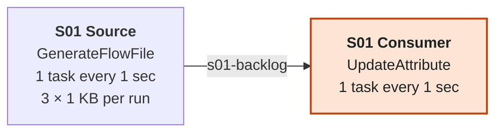

**How it's graded.** The alert fires when the queue `s01-backlog` holds more than 500 FlowFiles for a minute. We also chart FlowFiles into S01 Consumer. Whether a fix worked is decided by the size of the queue `s01-backlog`. The fix we grade as correct is setting the concurrent tasks on S01 Consumer to 4 or more. We also accept setting the run schedule of S01 Consumer to 250 ms or shorter. The right fix at less than that is graded as the right lever with the value short.

<details>
<summary>Settings: 2 processors, 1 connection</summary>

| Processor | Type | Schedule | Tasks | State | Auto-terminated | Settings |
|---|---|---|---|---|---|---|
| S01 Source | GenerateFlowFile | 1 sec | 1 | enabled |  | Batch Size: `3`<br>Data Format: `Text`<br>File Size: `1 KB`<br>Unique FlowFiles: `false` |
| S01 Consumer | UpdateAttribute | 1 sec | 1 | enabled | success |  |

| Connection | From | To | Relationships | Back pressure | Notes |
|---|---|---|---|---|---|
| s01-backlog | S01 Source | S01 Consumer | success | 10,000 / 1 GB |  |

</details>

### S02 Slow Run Schedule

*A classic scenario with one fault, fixed with a flow edit. We expect it to be detected within 30 minutes and its KPIs to be healthy within 15 minutes of the last fix.*

Here the drain already has four concurrent tasks, which looks like plenty, but it's scheduled to run only every ten seconds. Each task wakes up, takes one FlowFile and goes back to sleep, so the drain manages four FlowFiles every ten seconds, 0.4 a second, against one a second arriving.

Concurrency can't fix this one. Even at eight tasks, the most the agent is allowed to set, the drain would reach 0.8 a second and the queue would still grow. The setting that's actually wrong is the run schedule. Changing it to 1 sec gives four a second, and 0 sec is accepted too.

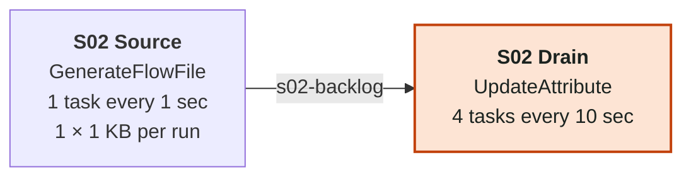

**How it's graded.** The alert fires when the queue `s02-backlog` holds more than 500 FlowFiles for a minute. We also chart FlowFiles into S02 Drain. Whether a fix worked is decided by the size of the queue `s02-backlog`. The fix we grade as correct is setting the run schedule of S02 Drain to 1 sec or shorter. We also accept setting the run schedule of S02 Drain to 0 sec. The right fix at less than that is graded as the right lever with the value short.

<details>
<summary>Settings: 2 processors, 1 connection</summary>

| Processor | Type | Schedule | Tasks | State | Auto-terminated | Settings |
|---|---|---|---|---|---|---|
| S02 Source | GenerateFlowFile | 1 sec | 1 | enabled |  | Batch Size: `1`<br>Data Format: `Text`<br>File Size: `1 KB`<br>Unique FlowFiles: `false` |
| S02 Drain | UpdateAttribute | 10 sec | 4 | enabled | success |  |

| Connection | From | To | Relationships | Back pressure | Notes |
|---|---|---|---|---|---|
| s02-backlog | S02 Source | S02 Drain | success | 10,000 / 1 GB |  |

</details>

### S03 Pipeline Bottleneck

*A classic scenario with one fault, fixed with a flow edit. We expect it to be detected within 30 minutes and its KPIs to be healthy within 15 minutes of the last fix.*

A three-stage pipeline with a weak middle. Two FlowFiles arrive each second. S03 Enrich and S03 Publish each have four tasks on a one second schedule, so they can do four a second, but S03 Transform, between them, has only one task and does one a second.

All three connections have an alert at 300, but only `s03-to-transform`, the queue in front of the slow stage, ever grows. The queue in front of Enrich stays empty, and so does the one in front of Publish, which only ever sees what Transform lets through.

The test is whether the agent finds the right stage. Four tasks on Transform, or a 250 ms schedule, fixes it. Adding tasks to Enrich or Publish changes nothing, because neither of them has a backlog.

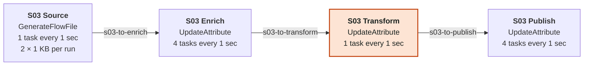

**How it's graded.** The alert fires when the queue `s03-to-enrich` holds more than 300 FlowFiles for a minute or when the queue `s03-to-transform` holds more than 300 FlowFiles for a minute or when the queue `s03-to-publish` holds more than 300 FlowFiles for a minute. Whether a fix worked is decided by the size of the queue `s03-to-transform`. The fix we grade as correct is setting the concurrent tasks on S03 Transform to 4 or more. We also accept setting the run schedule of S03 Transform to 250 ms or shorter. The right fix at less than that is graded as the right lever with the value short.

<details>
<summary>Settings: 4 processors, 3 connections</summary>

| Processor | Type | Schedule | Tasks | State | Auto-terminated | Settings |
|---|---|---|---|---|---|---|
| S03 Source | GenerateFlowFile | 1 sec | 1 | enabled |  | Batch Size: `2`<br>Data Format: `Text`<br>File Size: `1 KB`<br>Unique FlowFiles: `false` |
| S03 Enrich | UpdateAttribute | 1 sec | 4 | enabled |  |  |
| S03 Transform | UpdateAttribute | 1 sec | 1 | enabled |  |  |
| S03 Publish | UpdateAttribute | 1 sec | 4 | enabled | success |  |

| Connection | From | To | Relationships | Back pressure | Notes |
|---|---|---|---|---|---|
| s03-to-enrich | S03 Source | S03 Enrich | success | 10,000 / 1 GB |  |
| s03-to-transform | S03 Enrich | S03 Transform | success | 10,000 / 1 GB |  |
| s03-to-publish | S03 Transform | S03 Publish | success | 10,000 / 1 GB |  |

</details>

### S04 Bursty Oscillator

*A classic scenario with one fault, fixed with a flow edit. We expect it to be detected within 30 minutes and its KPIs to be healthy within 15 minutes of the last fix.*

This one comes from an oscillator pattern used in some of the SIB examples. Every ten minutes the source drops a burst of 600 FlowFiles, and the drain takes them at one a second. A burst takes the whole ten minutes to clear, so the queue saws between 600 and zero and sits above the alert threshold of 300 for about half of every cycle.

The fix is a faster drain. Four tasks or a 250 ms schedule clears a burst in two and a half minutes. What makes it worth testing is the verdict afterwards. A sawtooth isn't a leak, and a single good or bad sample doesn't tell you much, so a fix has to be judged on how high the peaks go and how fast they drain.

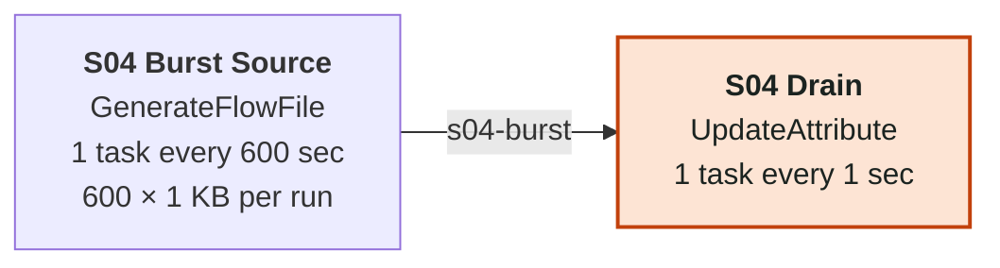

**How it's graded.** The alert fires when the queue `s04-burst` holds more than 300 FlowFiles for a minute. Whether a fix worked is decided by the size of the queue `s04-burst`. The fix we grade as correct is setting the concurrent tasks on S04 Drain to 4 or more. We also accept setting the run schedule of S04 Drain to 250 ms or shorter. The right fix at less than that is graded as the right lever with the value short.

<details>
<summary>Settings: 2 processors, 1 connection</summary>

| Processor | Type | Schedule | Tasks | State | Auto-terminated | Settings |
|---|---|---|---|---|---|---|
| S04 Burst Source | GenerateFlowFile | 600 sec | 1 | enabled |  | Batch Size: `600`<br>Data Format: `Text`<br>File Size: `1 KB`<br>Unique FlowFiles: `false` |
| S04 Drain | UpdateAttribute | 1 sec | 1 | enabled | success |  |

| Connection | From | To | Relationships | Back pressure | Notes |
|---|---|---|---|---|---|
| s04-burst | S04 Burst Source | S04 Drain | success | 10,000 / 1 GB |  |

</details>

## p2-backpressure: Back pressure

Deployed as `nfh-p2-backpressure` on EXTRA_SMALL × 1, in rollout wave 1.

These scenarios are all about back pressure. In two of them the threshold is simply set too low for the traffic. In the other two the threshold is fine and something is producing far more than it should, so raising the threshold would only hide the problem.

### S05 Object Threshold Too Low

*A classic scenario with one fault, fixed with a flow edit. We expect it to be detected within 30 minutes and its KPIs to be healthy within 15 minutes of the last fix.*

Every 30 seconds the source sends a burst of 50 FlowFiles into `s05-buffer`, and S05 Writer takes them at two a second. On average the writer has more than enough capacity, since a burst is gone in 25 seconds. The problem is that the buffer back-pressures at just ten FlowFiles, so it can't even hold one burst. The source gets blocked for most of each cycle and the queue keeps hitting 100% of its limit.

The fix is a sensible threshold. We grade 1,000 objects as the design fix and accept the NiFi default of 10,000 as well. More writer tasks would drain each burst faster, but the next burst would still run into a ten-FlowFile limit.

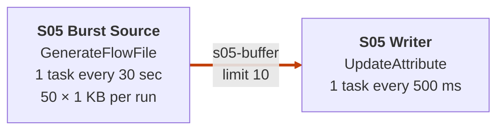

**How it's graded.** The alert fires when `s05-buffer` is more than 80% full for a minute. We also chart the size of the queue `s05-buffer`. Whether a fix worked is decided by how full `s05-buffer` is. The fix we grade as correct is setting the back pressure on `s05-buffer` to 1,000 objects. We also accept setting the back pressure on `s05-buffer` to 10,000 objects.

<details>
<summary>Settings: 2 processors, 1 connection</summary>

| Processor | Type | Schedule | Tasks | State | Auto-terminated | Settings |
|---|---|---|---|---|---|---|
| S05 Burst Source | GenerateFlowFile | 30 sec | 1 | enabled |  | Batch Size: `50`<br>Data Format: `Text`<br>File Size: `1 KB`<br>Unique FlowFiles: `false` |
| S05 Writer | UpdateAttribute | 500 ms | 1 | enabled | success |  |

| Connection | From | To | Relationships | Back pressure | Notes |
|---|---|---|---|---|---|
| s05-buffer | S05 Burst Source | S05 Writer | success | **10** / 1 GB |  |

</details>

### S06 Data Size Threshold Too Low

*A classic scenario with one fault, fixed with a flow edit. We expect it to be detected within 30 minutes and its KPIs to be healthy within 15 minutes of the last fix.*

This is the size-based version of S05. Every ten seconds the source produces ten files of 1 MB each, and the queue in front of the consumer is limited to 2 MB, so two files fill it. The consumer handles one file a second, which matches the average rate, but the queue is pinned at its limit and the source is blocked again and again.

The fix is to raise the data size threshold, to 1 GB (the NiFi default) or at least 100 MB. Raising the object threshold does nothing here, because the limit being hit is the size, not the count, and the scenario checks that the agent notices the difference.

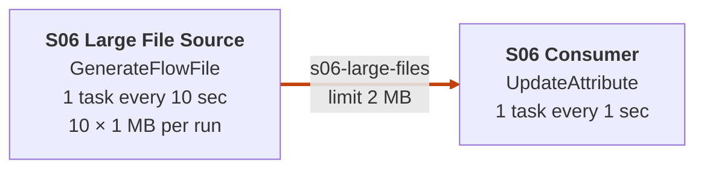

**How it's graded.** The alert fires when `s06-large-files` is more than 80% full for a minute. We also chart the bytes queued on `s06-large-files`. Whether a fix worked is decided by how full `s06-large-files` is. The fix we grade as correct is setting the back pressure on `s06-large-files` to 1 GB. We also accept setting the back pressure on `s06-large-files` to 100 MB.

<details>
<summary>Settings: 2 processors, 1 connection</summary>

| Processor | Type | Schedule | Tasks | State | Auto-terminated | Settings |
|---|---|---|---|---|---|---|
| S06 Large File Source | GenerateFlowFile | 10 sec | 1 | enabled |  | Batch Size: `10`<br>Data Format: `Text`<br>File Size: `1 MB`<br>Unique FlowFiles: `false` |
| S06 Consumer | UpdateAttribute | 1 sec | 1 | enabled | success |  |

| Connection | From | To | Relationships | Back pressure | Notes |
|---|---|---|---|---|---|
| s06-large-files | S06 Large File Source | S06 Consumer | success | 10,000 / **2 MB** |  |

</details>

### S07 Fan-out Flood

*A classic scenario with one fault, fixed with a flow edit. We expect it to be detected within 30 minutes and its KPIs to be healthy within 15 minutes of the last fix.*

A source sends one FlowFile every ten seconds to S07 Fan Out, a DuplicateFlowFile that makes 100 copies of each one. That's 101 FlowFiles every ten seconds, 10.1 a second, landing on S07 Sink, which runs once a second. The queue between them, `s07-fanout`, passes 1,000 in under two minutes.

It's tempting to treat the fan-out as the problem and lower Number of Copies, but in this flow the copies are the business logic, and changing them changes what the flow produces. Raising the threshold on `s07-fanout` just stores the flood. The design fix is to let the sink run as fast as it can, with a 0 sec schedule.

A 100 ms schedule and four concurrent tasks are also on the accepted list. On paper neither quite keeps up (10 a second and 4 a second against 10.1), so those two entries probably deserve a second look.

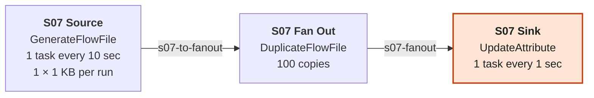

**How it's graded.** The alert fires when the queue `s07-fanout` holds more than 1,000 FlowFiles for a minute. We also chart the size of the queue `s07-to-fanout`. Whether a fix worked is decided by the size of the queue `s07-fanout`. The fix we grade as correct is setting the run schedule of S07 Sink to 0 sec. We also accept setting the run schedule of S07 Sink to 100 ms or shorter or setting the concurrent tasks on S07 Sink to 4 or more. The right fix at less than that is graded as the right lever with the value short.

<details>
<summary>Settings: 3 processors, 2 connections</summary>

| Processor | Type | Schedule | Tasks | State | Auto-terminated | Settings |
|---|---|---|---|---|---|---|
| S07 Source | GenerateFlowFile | 10 sec | 1 | enabled |  | Batch Size: `1`<br>Data Format: `Text`<br>File Size: `1 KB`<br>Unique FlowFiles: `false` |
| S07 Fan Out | DuplicateFlowFile | 0 sec | 1 | enabled |  | Number of Copies: `100` |
| S07 Sink | UpdateAttribute | 1 sec | 1 | enabled | success |  |

| Connection | From | To | Relationships | Back pressure | Notes |
|---|---|---|---|---|---|
| s07-to-fanout | S07 Source | S07 Fan Out | success | 10,000 / 1 GB |  |
| s07-fanout | S07 Fan Out | S07 Sink | success | 10,000 / 1 GB |  |

</details>

### S08 Runaway Producer

*A classic scenario with one fault, fixed with a flow edit. We expect it to be detected within 30 minutes and its KPIs to be healthy within 15 minutes of the last fix.*

S08 Runaway Source is a GenerateFlowFile with a run schedule of 0 sec, so it produces FlowFiles as fast as NiFi will let it, hundreds a second. The consumer has two tasks on a one second schedule. The queue between them is full within moments and stays at its limit.

No consumer setting the agent is allowed to make could keep up with that, since the most it can set is eight tasks. The fix is on the producer. Putting the source back on a one second schedule brings it down to one FlowFile a second, which the consumer handles easily.

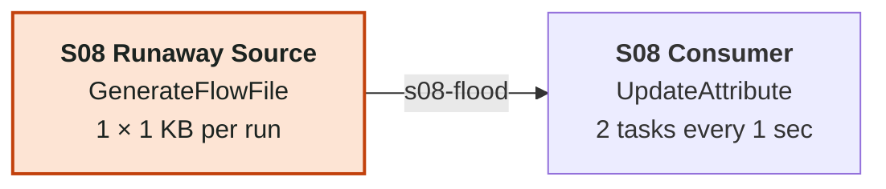

**How it's graded.** The alert fires when `s08-flood` is more than 80% full for a minute. We also chart the size of the queue `s08-flood`. Whether a fix worked is decided by how full `s08-flood` is. The fix we grade as correct is setting the run schedule of S08 Runaway Source to 1 sec or longer. The right fix at less than that is graded as the right lever with the value short.

<details>
<summary>Settings: 2 processors, 1 connection</summary>

| Processor | Type | Schedule | Tasks | State | Auto-terminated | Settings |
|---|---|---|---|---|---|---|
| S08 Runaway Source | GenerateFlowFile | 0 sec | 1 | enabled |  | Batch Size: `1`<br>Data Format: `Text`<br>File Size: `1 KB`<br>Unique FlowFiles: `false` |
| S08 Consumer | UpdateAttribute | 1 sec | 2 | enabled | success |  |

| Connection | From | To | Relationships | Back pressure | Notes |
|---|---|---|---|---|---|
| s08-flood | S08 Runaway Source | S08 Consumer | success | 10,000 / 1 GB |  |

</details>

## p3-errors: Error handling

Deployed as `nfh-p3-errors` on EXTRA_SMALL × 1, in rollout wave 1.

This pack is about error handling. A failure relationship that loops straight back, an endpoint that never answers, a JSON path that matches nothing and a retry policy that stalls the whole processor all look like a slow or stuck flow from the outside. Each one needs a different fix.

### S09 Failure Self-Loop

*A classic scenario with one fault, fixed with a flow edit. We expect it to be detected within 30 minutes and its KPIs to be healthy within 15 minutes of the last fix.*

S09 Validator is a DebugFlow that fails nine times out of ten. Its failure relationship goes straight back into itself through `s09-failure-loop`, with no limit on how many times a FlowFile can go around. On average each FlowFile takes ten attempts to get through, so with one FlowFile arriving each second the validator would need ten runs a second, and it only has one.

The retries crowd out new work. The loop passes 100 FlowFiles quickly, and the input queue backs up behind it until it reaches 500. There's an S09 DLQ on the canvas, but it's disabled and nothing is connected to it.

The fix is to route failure to the DLQ instead of back into the validator. The agent's DLQ edit repoints the self-loop at S09 DLQ and enables it. Adding validator tasks is the obvious mistake, since that only makes the retry storm bigger. Setting a retry policy on its own isn't enough either, because once retries are exhausted the FlowFiles still land back on the self-loop.

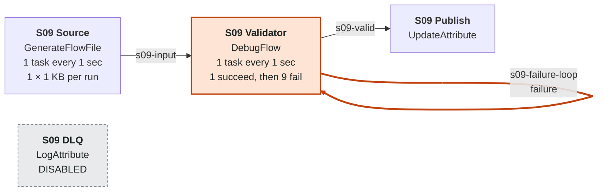

**How it's graded.** The alert fires when the queue `s09-failure-loop` holds more than 100 FlowFiles for a minute or when the queue `s09-input` holds more than 500 FlowFiles for a minute. Whether a fix worked is decided by the size of the queue `s09-failure-loop`. The fix we grade as correct is routing failure from S09 Validator to S09 DLQ.

<details>
<summary>Settings: 4 processors, 3 connections</summary>

| Processor | Type | Schedule | Tasks | State | Auto-terminated | Settings |
|---|---|---|---|---|---|---|
| S09 Source | GenerateFlowFile | 1 sec | 1 | enabled |  | Batch Size: `1`<br>Data Format: `Text`<br>File Size: `1 KB`<br>Unique FlowFiles: `false` |
| S09 Validator | DebugFlow | 1 sec | 1 | enabled |  | FlowFile Success Iterations: `1`<br>FlowFile Failure Iterations: `9`<br>FlowFile Rollback Iterations: `0`<br>FlowFile Exception Iterations: `0` |
| S09 Publish | UpdateAttribute | 0 sec | 1 | enabled | success |  |
| S09 DLQ | LogAttribute | 0 sec | 1 | **DISABLED** | success | Log Level: `warn` |

| Connection | From | To | Relationships | Back pressure | Notes |
|---|---|---|---|---|---|
| s09-input | S09 Source | S09 Validator | success | 10,000 / 1 GB |  |
| s09-failure-loop | S09 Validator | itself | failure | 10,000 / 1 GB | **self-loop** |
| s09-valid | S09 Validator | S09 Publish | success | 10,000 / 1 GB |  |

</details>

### S10 Unreachable Endpoint

*A classic scenario with one fault, fixed with a flow edit. We expect it to be detected within 30 minutes and its KPIs to be healthy within 15 minutes of the last fix.*

S10 Partner Call is an InvokeHTTP that posts orders to a partner at `10.255.255.1`. That address isn't routable, so instead of being refused, every connection just hangs until the 60 second connect timeout runs out. All three of the processor's failure relationships, Failure, No Retry and Retry, go to `s10-retry-loop`, which feeds straight back in. With one task and a request arriving every two seconds, the processor gets through one call a minute while thirty new requests arrive.

We grade the design fix as three changes together. Route the failure relationships to S10 DLQ so failed calls stop coming back, cut the connect timeout to 5 seconds so a dead call fails fast, and give the processor four tasks. That's 0.8 calls a second against 0.5 arriving.

Concurrency on its own doesn't come close. Even eight tasks at one call a minute each is about 0.13 a second. And none of this makes the partner answer, because the endpoint really is down. The aim is a flow that fails quickly and keeps the failed orders somewhere they can be replayed later.

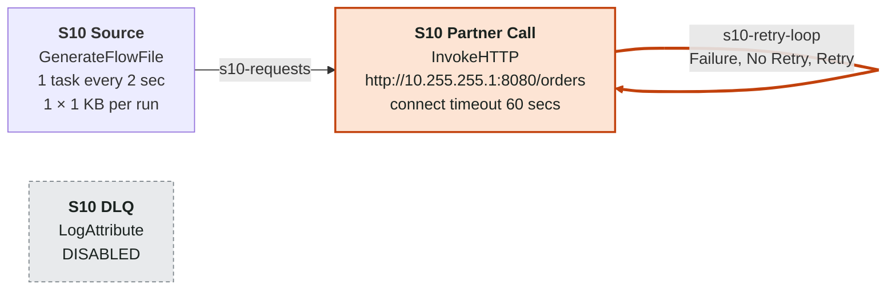

**How it's graded.** The alert fires when the queue `s10-requests` holds more than 100 FlowFiles for a minute. We also chart the size of the queue `s10-retry-loop`. Whether a fix worked is decided by the size of the queue `s10-requests`. The fix we grade as correct is routing Failure, No Retry and Retry from S10 Partner Call to S10 DLQ, setting Connection Timeout on S10 Partner Call to `5 secs` and setting the concurrent tasks on S10 Partner Call to 4 or more, all in one proposal. The right fix at less than that is graded as the right lever with the value short.

<details>
<summary>Settings: 3 processors, 2 connections</summary>

| Processor | Type | Schedule | Tasks | State | Auto-terminated | Settings |
|---|---|---|---|---|---|---|
| S10 Source | GenerateFlowFile | 2 sec | 1 | enabled |  | Batch Size: `1`<br>Data Format: `Text`<br>File Size: `1 KB`<br>Unique FlowFiles: `false` |
| S10 Partner Call | InvokeHTTP | 0 sec | 1 | enabled | Original, Response | HTTP Method: `POST`<br>HTTP URL: `http://10.255.255.1:8080/orders`<br>Connection Timeout: `60 secs`<br>Socket Read Timeout: `15 secs` |
| S10 DLQ | LogAttribute | 0 sec | 1 | **DISABLED** | success | Log Level: `warn` |

| Connection | From | To | Relationships | Back pressure | Notes |
|---|---|---|---|---|---|
| s10-requests | S10 Source | S10 Partner Call | success | 10,000 / 1 GB |  |
| s10-retry-loop | S10 Partner Call | itself | Failure, No Retry, Retry | 10,000 / 1 GB | **self-loop** |

</details>

### S11 Wrong JSON Path

*A classic scenario with one fault, fixed with a flow edit. We expect it to be detected within 30 minutes and its KPIs to be healthy within 15 minutes of the last fix.*

The source generates small order records like `{"order_id": 42, "amount": 10.5}`. S11 Extract Order, an EvaluateJsonPath, is supposed to pull out the order id, but its `orderId` property asks for `$.orderId`, in camel case, and the field is called `order_id`. Not a single record matches.

Everything goes down the unmatched route to S11 Quarantine, a LogAttribute that only runs every ten seconds. So `s11-unmatched` grows by almost one FlowFile a second and crosses 100 within a couple of minutes, while S11 Publish receives nothing at all.

The quarantine looks like the bottleneck, and that's the trap. If the agent speeds it up, the queue clears and the alert goes away, but every order is still being quarantined. The real fix is the path. Setting `orderId` to `$.order_id` sends the records to Publish where they belong, which is why FlowFiles into S11 Publish is one of the KPIs that decide the outcome.

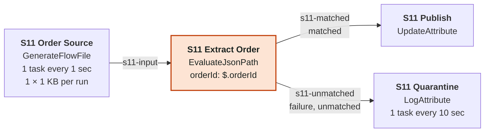

**How it's graded.** The alert fires when the queue `s11-unmatched` holds more than 100 FlowFiles for a minute. We also chart FlowFiles into S11 Publish. Whether a fix worked is decided by the size of the queue `s11-unmatched` and FlowFiles into S11 Publish. The fix we grade as correct is setting orderId on S11 Extract Order to `$.order_id`.

<details>
<summary>Settings: 4 processors, 3 connections</summary>

| Processor | Type | Schedule | Tasks | State | Auto-terminated | Settings |
|---|---|---|---|---|---|---|
| S11 Order Source | GenerateFlowFile | 1 sec | 1 | enabled |  | Batch Size: `1`<br>Data Format: `Text`<br>File Size: `1 KB`<br>Unique FlowFiles: `false`<br>Custom Text: `{"order_id": 42, "amount": 10.5}` |
| S11 Extract Order | EvaluateJsonPath | 0 sec | 1 | enabled |  | Destination: `flowfile-content`<br>Return Type: `auto-detect`<br>orderId: `$.orderId` |
| S11 Publish | UpdateAttribute | 0 sec | 1 | enabled | success |  |
| S11 Quarantine | LogAttribute | 10 sec | 1 | enabled | success | Log Level: `warn` |

| Connection | From | To | Relationships | Back pressure | Notes |
|---|---|---|---|---|---|
| s11-input | S11 Order Source | S11 Extract Order | success | 10,000 / 1 GB |  |
| s11-matched | S11 Extract Order | S11 Publish | matched | 10,000 / 1 GB |  |
| s11-unmatched | S11 Extract Order | S11 Quarantine | failure, unmatched | 10,000 / 1 GB |  |

</details>

### S12 Processor-wide Backoff

*A classic scenario with one fault, fixed with a flow edit. We expect it to be detected within 30 minutes and its KPIs to be healthy within 15 minutes of the last fix.*

S12 Transient Service is a DebugFlow that fails three times in ten, standing in for a service with occasional transient errors. It uses NiFi's built-in retry on the failure relationship, which is a good idea, but the backoff mechanism is YIELD_PROCESSOR with a ten minute ceiling. With that setting a retry doesn't just delay the FlowFile that failed, it yields the whole processor. Both tasks wait, starting at ten seconds and doubling each time the same FlowFile fails again, up to ten minutes.

That works out at about 7.5 seconds of stall per FlowFile on average, while a new FlowFile arrives every second, so `s12-requests` keeps growing even though most requests would succeed on their first try.

The fix is to switch the backoff to PENALIZE_FLOWFILE, which only holds back the FlowFile that failed and lets the processor carry on with the others. We also accept that change with a lower ceiling of one minute. More concurrent tasks is the instinctive response and doesn't help, because a yielded processor holds all of its tasks.

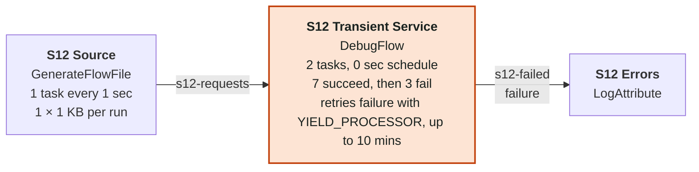

**How it's graded.** The alert fires when the queue `s12-requests` holds more than 200 FlowFiles for a minute. We also chart FlowFiles into S12 Transient Service. Whether a fix worked is decided by the size of the queue `s12-requests`. The fix we grade as correct is switching the retry backoff on S12 Transient Service to PENALIZE_FLOWFILE. We also accept switching the retry backoff on S12 Transient Service to PENALIZE_FLOWFILE with a maximum backoff of 1 min.

<details>
<summary>Settings: 3 processors, 2 connections</summary>

| Processor | Type | Schedule | Tasks | State | Auto-terminated | Settings |
|---|---|---|---|---|---|---|
| S12 Source | GenerateFlowFile | 1 sec | 1 | enabled |  | Batch Size: `1`<br>Data Format: `Text`<br>File Size: `1 KB`<br>Unique FlowFiles: `false` |
| S12 Transient Service | DebugFlow | 0 sec | 2 | enabled | success | FlowFile Success Iterations: `7`<br>FlowFile Failure Iterations: `3`<br>FlowFile Rollback Iterations: `0`<br>FlowFile Exception Iterations: `0`<br>**retry failure ×10, YIELD_PROCESSOR, max 10 mins**<br>**yield 10 sec** |
| S12 Errors | LogAttribute | 0 sec | 1 | enabled | success | Log Level: `warn` |

| Connection | From | To | Relationships | Back pressure | Notes |
|---|---|---|---|---|---|
| s12-requests | S12 Source | S12 Transient Service | success | 10,000 / 1 GB |  |
| s12-failed | S12 Transient Service | S12 Errors | failure | 10,000 / 1 GB |  |

</details>

## p4-dataloss-latency: Data loss and latency

Deployed as `nfh-p4-dataloss-latency` on EXTRA_SMALL × 1, in rollout wave 1.

The faults in this pack are the quiet ones. Two of them lose data without any queue growing, one holds data back for over an hour, and one is just a processor that somebody forgot to turn back on.

### S13 Silent Expiration

*A classic scenario with one fault, fixed with a flow edit. We expect it to be detected within 30 minutes and its KPIs to be healthy within 15 minutes of the last fix.*

This one is about data that disappears. The source sends three FlowFiles a second to S13 Consumer, which only handles one a second. On its own that would be a growing backlog like S01, but `s13-expiring` has a FlowFile expiration of 30 seconds, and anything that has waited longer than that is thrown away. So the queue doesn't grow. It levels off at around 90 FlowFiles, far below anything that would look worrying, and two of every three FlowFiles quietly expire.

No KPI alerts here, and nothing would alert on a queue that looks this healthy. The way to see the problem is to compare what the source sends out with what the consumer takes in. NiFi records expired FlowFiles in provenance but doesn't raise a bulletin.

The fix needs two changes together. Remove the expiration, and give the consumer four tasks so it can keep up. Removing the expiration on its own turns the silent loss into an ordinary backlog growing by two a second, which at least is visible, but it isn't fixed.

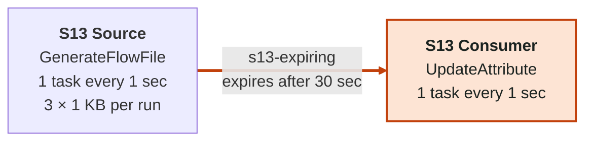

**How it's graded.** No KPI alerts on this one, so the problem has to be spotted in the charts. We chart the size of the queue `s13-expiring`, FlowFiles out of S13 Source and FlowFiles into S13 Consumer. Whether a fix worked is decided by FlowFiles into S13 Consumer. The fix we grade as correct is removing the FlowFile expiration on `s13-expiring` and setting the concurrent tasks on S13 Consumer to 4 or more, all in one proposal. The right fix at less than that is graded as the right lever with the value short.

<details>
<summary>Settings: 2 processors, 1 connection</summary>

| Processor | Type | Schedule | Tasks | State | Auto-terminated | Settings |
|---|---|---|---|---|---|---|
| S13 Source | GenerateFlowFile | 1 sec | 1 | enabled |  | Batch Size: `3`<br>Data Format: `Text`<br>File Size: `1 KB`<br>Unique FlowFiles: `false` |
| S13 Consumer | UpdateAttribute | 1 sec | 1 | enabled | success |  |

| Connection | From | To | Relationships | Back pressure | Notes |
|---|---|---|---|---|---|
| s13-expiring | S13 Source | S13 Consumer | success | 10,000 / 1 GB | **expires after 30 sec** |

</details>

### S14 Auto-terminated Failures

*A classic scenario with one fault, fixed with a flow edit. We expect it to be detected within 30 minutes and its KPIs to be healthy within 15 minutes of the last fix.*

S14 Validator is a DebugFlow that fails one record in five. Its success relationship goes on to S14 Publish, but failure is auto-terminated, so the 20% that fail are simply dropped. There's no queue, no bulletin and nothing in a dead-letter queue. There is an S14 DLQ on the canvas, but it's disabled and nothing is connected to it.

The only sign in the metrics is that the validator sends out fewer FlowFiles than it takes in, and those two numbers are what the KPIs chart. The fix is to route failure to S14 DLQ, so rejected records are kept somewhere a person can look at them.

The tempting alternative is to loop failure back into the validator so the records get another go. That trades silent loss for the retry storm from S09.

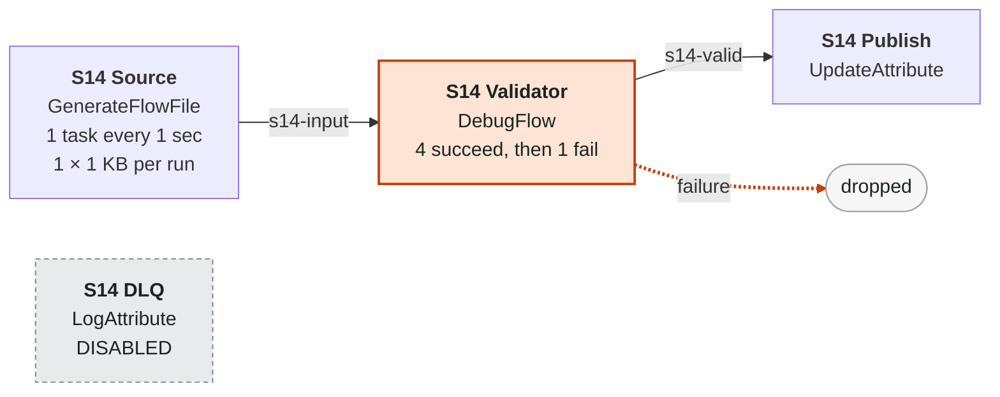

**How it's graded.** No KPI alerts on this one, so the problem has to be spotted in the charts. We chart FlowFiles into S14 Validator and FlowFiles out of S14 Validator. Whether a fix worked is decided by FlowFiles out of S14 Validator. The fix we grade as correct is routing failure from S14 Validator to S14 DLQ.

<details>
<summary>Settings: 4 processors, 2 connections</summary>

| Processor | Type | Schedule | Tasks | State | Auto-terminated | Settings |
|---|---|---|---|---|---|---|
| S14 Source | GenerateFlowFile | 1 sec | 1 | enabled |  | Batch Size: `1`<br>Data Format: `Text`<br>File Size: `1 KB`<br>Unique FlowFiles: `false` |
| S14 Validator | DebugFlow | 0 sec | 1 | enabled | failure | FlowFile Success Iterations: `4`<br>FlowFile Failure Iterations: `1`<br>FlowFile Rollback Iterations: `0`<br>FlowFile Exception Iterations: `0` |
| S14 Publish | UpdateAttribute | 0 sec | 1 | enabled | success |  |
| S14 DLQ | LogAttribute | 0 sec | 1 | **DISABLED** | success | Log Level: `warn` |

| Connection | From | To | Relationships | Back pressure | Notes |
|---|---|---|---|---|---|
| s14-input | S14 Source | S14 Validator | success | 10,000 / 1 GB |  |
| s14-valid | S14 Validator | S14 Publish | success | 10,000 / 1 GB |  |

</details>

### S15 Bin Never Fills

*A classic scenario with one fault, fixed with a flow edit. We expect it to be detected within 30 minutes and its KPIs to be healthy within 15 minutes of the last fix.*

S15 Batcher is a MergeContent that waits for 1,000 entries before it sends a batch, and it has no Max Bin Age. The source produces one FlowFile every five seconds. At that rate the first batch would leave after 5,000 seconds, about 83 minutes, and until then nothing comes out of the merge at all.

The alert is on the merge's output rather than on a queue. If the batcher sends nothing for fifteen minutes, it fires. The queue in front of it is a poor signal here, since it only grows by twelve FlowFiles a minute.

The fix is to give the bin an age limit. With Max Bin Age at 60 seconds (or 5 minutes, which we also accept), MergeContent sends whatever it has when the time runs out. Setting Minimum Number of Entries to 1 would also get data moving, but it ends batching entirely, and the batch size is presumably what the flow's owner wanted.

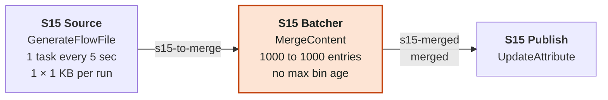

**How it's graded.** The alert fires when S15 Batcher sends nothing out for 15 minutes. We also chart FlowFiles into S15 Batcher. Whether a fix worked is decided by FlowFiles out of S15 Batcher. The fix we grade as correct is setting Max Bin Age on S15 Batcher to `60 sec`. We also accept setting Max Bin Age on S15 Batcher to `5 min`.

<details>
<summary>Settings: 3 processors, 2 connections</summary>

| Processor | Type | Schedule | Tasks | State | Auto-terminated | Settings |
|---|---|---|---|---|---|---|
| S15 Source | GenerateFlowFile | 5 sec | 1 | enabled |  | Batch Size: `1`<br>Data Format: `Text`<br>File Size: `1 KB`<br>Unique FlowFiles: `false` |
| S15 Batcher | MergeContent | 0 sec | 1 | enabled | failure, original | Merge Strategy: `Bin-Packing Algorithm`<br>Merge Format: `Binary Concatenation`<br>Minimum Number of Entries: `1000`<br>Maximum Number of Entries: `1000`<br>Maximum number of Bins: `5` |
| S15 Publish | UpdateAttribute | 0 sec | 1 | enabled | success |  |

| Connection | From | To | Relationships | Back pressure | Notes |
|---|---|---|---|---|---|
| s15-to-merge | S15 Source | S15 Batcher | success | 10,000 / 1 GB |  |
| s15-merged | S15 Batcher | S15 Publish | merged | 10,000 / 1 GB |  |

</details>

### S16 Disabled Processor

*A classic scenario with one fault, fixed with a flow edit. We expect it to be detected within 30 minutes and its KPIs to be healthy within 15 minutes of the last fix.*

Somebody disabled S16 Enricher during maintenance and never turned it back on. FlowFiles keep arriving at one a second and wait in `s16-to-enrich`, which crosses its threshold of 500 a little over eight minutes in.

The fix is just to enable the processor. A disabled processor doesn't run at all, so changing its concurrency or run schedule has no effect, and that's the mistake this scenario is looking for.

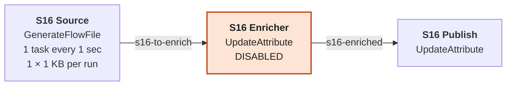

**How it's graded.** The alert fires when the queue `s16-to-enrich` holds more than 500 FlowFiles for a minute. Whether a fix worked is decided by the size of the queue `s16-to-enrich`. The fix we grade as correct is enabling S16 Enricher.

<details>
<summary>Settings: 3 processors, 2 connections</summary>

| Processor | Type | Schedule | Tasks | State | Auto-terminated | Settings |
|---|---|---|---|---|---|---|
| S16 Source | GenerateFlowFile | 1 sec | 1 | enabled |  | Batch Size: `1`<br>Data Format: `Text`<br>File Size: `1 KB`<br>Unique FlowFiles: `false` |
| S16 Enricher | UpdateAttribute | 0 sec | 1 | **DISABLED** |  |  |
| S16 Publish | UpdateAttribute | 0 sec | 1 | enabled | success |  |

| Connection | From | To | Relationships | Back pressure | Notes |
|---|---|---|---|---|---|
| s16-to-enrich | S16 Source | S16 Enricher | success | 10,000 / 1 GB |  |
| s16-enriched | S16 Enricher | S16 Publish | success | 10,000 / 1 GB |  |

</details>

## p5-parameters: Parameters and control

Deployed as `nfh-p5-parameters` on EXTRA_SMALL × 1, with the parameter context `nfh-p5-parameters`, in rollout wave 1.

This pack's deployment has a parameter context, `nfh-p5-parameters`, and two of its scenarios are wrong because of a parameter value rather than anything in the flow itself. The right fix is to change the parameter, not the processor property that refers to it. The third scenario is a healthy control.

### S17 Wrong Endpoint Parameter

*A classic scenario with one fault, fixed with a parameter change. We expect it to be detected within 30 minutes and its KPIs to be healthy within 15 minutes of the last fix.*

S17 Partner Call is an InvokeHTTP whose HTTP URL is `#{s17.target.url}`, a reference to the pack's parameter context. The parameter is set to `http://10.255.255.1:8080/ingest`, an address nothing listens on. The real partner is S17 Partner Stub, a ListenHTTP in the same group on port 9876, standing in for the partner's service.

A request arrives every five seconds and each one waits out a 30 second connect timeout before it fails over to S17 Failed Requests, so about five pile up in `s17-requests` every 30 seconds. Meanwhile the partner stub receives nothing, which raises a second alert after ten minutes.

The fix is to set the parameter to `http://localhost:9876/ingest`. It's also possible to type the right URL straight into the InvokeHTTP property, and the flow would work, but that replaces the parameter reference and the flow would no longer follow its context. Shortening the timeout or adding tasks only makes the failures happen faster.

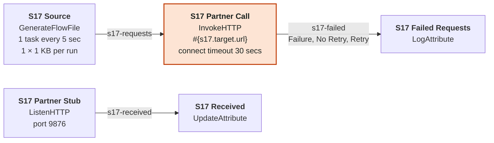

**How it's graded.** The alert fires when the queue `s17-requests` holds more than 50 FlowFiles for a minute or when S17 Partner Stub sends nothing out for 10 minutes. Whether a fix worked is decided by the size of the queue `s17-requests`. The fix we grade as correct is changing the parameter `s17.target.url` to `http://localhost:9876/ingest`.

<details>
<summary>Settings: 5 processors, 3 connections</summary>

Parameters as deployed: `s17.target.url` = `http://10.255.255.1:8080/ingest`.

| Processor | Type | Schedule | Tasks | State | Auto-terminated | Settings |
|---|---|---|---|---|---|---|
| S17 Source | GenerateFlowFile | 5 sec | 1 | enabled |  | Batch Size: `1`<br>Data Format: `Text`<br>File Size: `1 KB`<br>Unique FlowFiles: `false` |
| S17 Partner Call | InvokeHTTP | 0 sec | 1 | enabled | Original, Response | HTTP Method: `POST`<br>HTTP URL: `#{s17.target.url}`<br>Connection Timeout: `30 secs`<br>Socket Read Timeout: `15 secs` |
| S17 Failed Requests | LogAttribute | 0 sec | 1 | enabled | success | Log Level: `warn` |
| S17 Partner Stub | ListenHTTP | 0 sec | 1 | enabled |  | Listening Port: `9876`<br>Base Path: `ingest` |
| S17 Received | UpdateAttribute | 0 sec | 1 | enabled | success |  |

| Connection | From | To | Relationships | Back pressure | Notes |
|---|---|---|---|---|---|
| s17-requests | S17 Source | S17 Partner Call | success | 10,000 / 1 GB |  |
| s17-failed | S17 Partner Call | S17 Failed Requests | Failure, No Retry, Retry | 10,000 / 1 GB |  |
| s17-received | S17 Partner Stub | S17 Received | success | 10,000 / 1 GB |  |

</details>

### S18 Load-test Parameter Left On

*A classic scenario with one fault, fixed with a parameter change. We expect it to be detected within 30 minutes and its KPIs to be healthy within 15 minutes of the last fix.*

S18 Fan Out is a DuplicateFlowFile whose Number of Copies comes from the parameter `s18.copies`. In production it should be 1, but it's still set to 50 from a load test. The source sends one record every ten seconds, so the sink receives about five a second instead of one every ten seconds, and it only handles one a second. `s18-copies` passes 1,000 a few minutes in.

The fix is to set the parameter back to 1. Speeding up S18 Sink would clear the queue too, but every record downstream would then be processed 50 times.

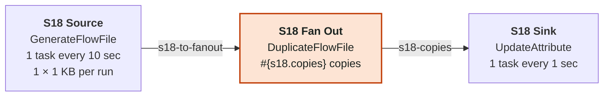

**How it's graded.** The alert fires when the queue `s18-copies` holds more than 1,000 FlowFiles for a minute. Whether a fix worked is decided by the size of the queue `s18-copies`. The fix we grade as correct is changing the parameter `s18.copies` to `1`.

<details>
<summary>Settings: 3 processors, 2 connections</summary>

Parameters as deployed: `s18.copies` = `50`.

| Processor | Type | Schedule | Tasks | State | Auto-terminated | Settings |
|---|---|---|---|---|---|---|
| S18 Source | GenerateFlowFile | 10 sec | 1 | enabled |  | Batch Size: `1`<br>Data Format: `Text`<br>File Size: `1 KB`<br>Unique FlowFiles: `false` |
| S18 Fan Out | DuplicateFlowFile | 0 sec | 1 | enabled |  | Number of Copies: `#{s18.copies}` |
| S18 Sink | UpdateAttribute | 1 sec | 1 | enabled | success |  |

| Connection | From | To | Relationships | Back pressure | Notes |
|---|---|---|---|---|---|
| s18-to-fanout | S18 Source | S18 Fan Out | success | 10,000 / 1 GB |  |
| s18-copies | S18 Fan Out | S18 Sink | success | 10,000 / 1 GB |  |

</details>

### S19 Healthy Control

*A healthy control with nothing to fix. We watch it for 30 minutes and expect no alert.*

Nothing is wrong with this flow, on purpose. One FlowFile a second passes through two stages, Transform and Publish, each with two tasks on a 500 ms schedule, so each can handle four a second and both queues stay close to empty. S19 is here to check that the agent leaves a healthy flow alone.

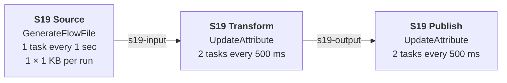

**How it's graded.** Nothing should fire. The alert would go off if the queue `s19-input` holds more than 500 FlowFiles for a minute or when the queue `s19-output` holds more than 500 FlowFiles for a minute. The right answer is to leave it alone, and any change counts as a false positive.

<details>
<summary>Settings: 3 processors, 2 connections</summary>

| Processor | Type | Schedule | Tasks | State | Auto-terminated | Settings |
|---|---|---|---|---|---|---|
| S19 Source | GenerateFlowFile | 1 sec | 1 | enabled |  | Batch Size: `1`<br>Data Format: `Text`<br>File Size: `1 KB`<br>Unique FlowFiles: `false` |
| S19 Transform | UpdateAttribute | 500 ms | 2 | enabled |  |  |
| S19 Publish | UpdateAttribute | 500 ms | 2 | enabled | success |  |

| Connection | From | To | Relationships | Back pressure | Notes |
|---|---|---|---|---|---|
| s19-input | S19 Source | S19 Transform | success | 10,000 / 1 GB |  |
| s19-output | S19 Transform | S19 Publish | success | 10,000 / 1 GB |  |

</details>

## p6-sizing-cpu: CPU sizing

Deployed as `nfh-p6-sizing-cpu` on EXTRA_SMALL × 1, in rollout wave 1.

A flow that is configured correctly but runs on a node that is too small for it. The only real fixes are a bigger deployment or less work per FlowFile.

### S20 CPU Saturated

*A classic scenario with one fault, fixed with resizing the deployment. We expect it to be detected within 30 minutes and its KPIs to be healthy within 15 minutes of the last fix.*

This flow is CPU-bound by design. Every two seconds the source creates three 10 MB files of random bytes, about 15 MB a second. S20 Compress gzips them at level 9, which on random data manages roughly 8 MB a second per core, and S20 Hash then takes a SHA-256 of each one. Together that's about two cores of work, and an EXTRA_SMALL node has two. CPU sits above 85% and the queue in front of the compressor starts to build.

One detail matters for the fix. The source runs on the primary node only, so adding nodes doesn't add load, and the first connection, `s20-to-compress`, uses round robin load balancing, which spreads the files over however many nodes there are. That's why scaling out works here. The design fix is SMALL with two nodes, and EXTRA_SMALL with two nodes is accepted too. Dropping the compression level to 1 is also accepted, since that removes most of the CPU cost.

What doesn't work is giving the compressor more tasks. The node is already saturated, and more threads just compete for the same two cores.

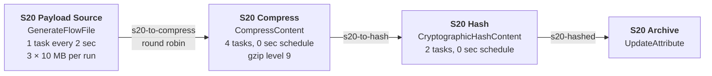

**How it's graded.** The alert fires when node CPU is above 85% for 5 minutes or when the queue `s20-to-compress` holds more than 50 FlowFiles for a minute. Whether a fix worked is decided by node CPU. The fix we grade as correct is scaling the deployment to SMALL with 2 nodes or larger. We also accept scaling the deployment to EXTRA_SMALL with 2 nodes or larger or setting Compression Level on S20 Compress to `1`. The right fix at less than that is graded as the right lever with the value short.

<details>
<summary>Settings: 4 processors, 3 connections</summary>

| Processor | Type | Schedule | Tasks | State | Auto-terminated | Settings |
|---|---|---|---|---|---|---|
| S20 Payload Source | GenerateFlowFile | 2 sec | 1 | enabled |  | Batch Size: `3`<br>Data Format: `Binary`<br>File Size: `10 MB`<br>Unique FlowFiles: `true`<br>**runs on the primary node** |
| S20 Compress | CompressContent | 0 sec | 4 | enabled | failure | Mode: `compress`<br>Compression Format: `gzip`<br>Compression Level: `9` |
| S20 Hash | CryptographicHashContent | 0 sec | 2 | enabled | failure | Hash Algorithm: `SHA-256` |
| S20 Archive | UpdateAttribute | 0 sec | 1 | enabled | success |  |

| Connection | From | To | Relationships | Back pressure | Notes |
|---|---|---|---|---|---|
| s20-to-compress | S20 Payload Source | S20 Compress | success | 10,000 / 1 GB | **round robin** |
| s20-to-hash | S20 Compress | S20 Hash | success | 10,000 / 1 GB |  |
| s20-hashed | S20 Hash | S20 Archive | success | 10,000 / 1 GB |  |

</details>

## p7-sizing-overprov: Over-provisioning

Deployed as `nfh-p7-sizing-overprov` on MEDIUM × 2, in rollout wave 1.

The opposite of p6. Nothing is broken here, but the deployment is much bigger than the flow needs, so the problem is cost. It's the only scenario whose alert is on CPU being too low.

### S21 Over-provisioned

*A classic scenario with one fault, fixed with resizing the deployment. We expect it to be detected within 30 minutes and its KPIs to be healthy within 15 minutes of the last fix.*

This flow barely does anything. One small FlowFile every ten seconds goes through two pass-through stages, and it's deployed on a MEDIUM two-node cluster, far more than it needs. The alert is CPU staying under 5% for half an hour.

The fix is to scale down to EXTRA_SMALL with one node, and SMALL with one node is accepted too. A downsize only counts as a success if the flow still keeps up afterwards, so the input queue has an alert of its own at 100 FlowFiles.

```mermaid
flowchart LR
    p0["<b>S21 Source</b><br/>GenerateFlowFile<br/>1 task every 10 sec<br/>1 × 1 KB per run"]
    p1["<b>S21 Transform</b><br/>UpdateAttribute<br/>1 task every 1 sec"]
    p2["<b>S21 Publish</b><br/>UpdateAttribute<br/>1 task every 1 sec"]
    p0 -->|"s21-input"| p1
    p1 -->|"s21-output"| p2
    classDef fix fill:#fde4d4,stroke:#c2410c,stroke-width:2px,color:#1b2320
    classDef off fill:#e8eaec,stroke:#7a8288,stroke-dasharray:4 3,color:#1b2320
    classDef gone fill:#f6f6f6,stroke:#9aa0a6,color:#1b2320
```

**How it's graded.** The alert fires when node CPU is below 5% for 30 minutes or when the queue `s21-input` holds more than 100 FlowFiles for a minute. Whether a fix worked is decided by node CPU. The fix we grade as correct is scaling the deployment to EXTRA_SMALL with 1 node or smaller. We also accept scaling the deployment to SMALL with 1 node or smaller. The right fix at less than that is graded as the right lever with the value short.

<details>
<summary>Settings: 3 processors, 2 connections</summary>

| Processor | Type | Schedule | Tasks | State | Auto-terminated | Settings |
|---|---|---|---|---|---|---|
| S21 Source | GenerateFlowFile | 10 sec | 1 | enabled |  | Batch Size: `1`<br>Data Format: `Text`<br>File Size: `1 KB`<br>Unique FlowFiles: `false` |
| S21 Transform | UpdateAttribute | 1 sec | 1 | enabled |  |  |
| S21 Publish | UpdateAttribute | 1 sec | 1 | enabled | success |  |

| Connection | From | To | Relationships | Back pressure | Notes |
|---|---|---|---|---|---|
| s21-input | S21 Source | S21 Transform | success | 10,000 / 1 GB |  |
| s21-output | S21 Transform | S21 Publish | success | 10,000 / 1 GB |  |

</details>

## p8-orders: Order pipeline cascades

Deployed as `nfh-p8-orders` on EXTRA_SMALL × 1, in rollout wave 2.

p8 is the first of the cascade packs, where the alert fires several stages away from the actual cause. Both scenarios are order pipelines of about ten processors. In S22 back pressure from a merge works its way back to ingest, and in S23 a throttle lets only a third of the shipments through.

### S22 Order Merge Deadlock

*A cascade, where the alert shows up away from the cause, fixed with a flow edit. We expect it to be detected within 30 minutes and its KPIs to be healthy within 15 minutes of the last fix.*

A ten-processor order pipeline. Orders arrive at 100 a second, have their region extracted with an EvaluateJsonPath, get tagged, have their currency normalised and their card numbers masked by a ReplaceText, and are then batched by S22 Batch Orders, a MergeContent, before being compressed, named and published.

The merge is where it goes wrong. It waits for at least 20,000 orders per batch, but the connection in front of it, `s22-to-batch`, back-pressures at the default 10,000, and the FlowFiles sitting in the merge's bin still count against that connection. The bin can never reach 20,000, so the merge only sends a batch when it hits its 30 minute Max Bin Age. In between, back pressure works its way upstream one queue at a time, about 100 seconds per queue, and roughly 500 seconds after each flush the ingest queue is full. That's where the alert is, five hops away from the cause.

The design fix is to bring Minimum Number of Entries down to 5,000, so a bin can fill well within the connection's limit. Raising the back pressure threshold on `s22-to-batch` to 30,000, or setting a one minute bin age, also clears it. Anything aimed at the alert itself doesn't work. S22 Extract Order isn't slow, it's back-pressured, so more tasks there do nothing, and a higher threshold on ingest only lets a bigger backlog build up.

```mermaid
flowchart TD
    p0["<b>S22 Order Feed</b><br/>GenerateFlowFile<br/>1 task every 1 sec<br/>100 × 1 KB per run"]
    p1["<b>S22 Extract Order</b><br/>EvaluateJsonPath<br/>order.region: $.region"]
    p2["<b>S22 Tag Region</b><br/>UpdateAttribute"]
    p3["<b>S22 Normalize Currency</b><br/>UpdateAttribute"]
    p4["<b>S22 Mask Card</b><br/>ReplaceText"]
    p5["<b>S22 Batch Orders</b><br/>MergeContent<br/>20000 to 25000 entries<br/>max bin age 30 min"]
    p6["<b>S22 Compress Batch</b><br/>CompressContent<br/>gzip level 1"]
    p7["<b>S22 Name Batch File</b><br/>UpdateAttribute"]
    p8["<b>S22 Publish Orders</b><br/>UpdateAttribute"]
    p9["<b>S22 Unparsed DLQ</b><br/>LogAttribute"]
    p0 -->|"s22-ingest"| p1
    p1 -->|"s22-extracted<br/>matched"| p2
    p1 -->|"s22-unparsed<br/>failure, unmatched"| p9
    p2 -->|"s22-tagged"| p3
    p3 -->|"s22-normalized"| p4
    p4 -->|"s22-to-batch"| p5
    p4 -->|"s22-mask-failed<br/>failure"| p9
    p5 -->|"s22-batches<br/>merged"| p6
    p6 -->|"s22-compressed"| p7
    p7 -->|"s22-named"| p8
    classDef fix fill:#fde4d4,stroke:#c2410c,stroke-width:2px,color:#1b2320
    classDef off fill:#e8eaec,stroke:#7a8288,stroke-dasharray:4 3,color:#1b2320
    classDef gone fill:#f6f6f6,stroke:#9aa0a6,color:#1b2320
    class p5 fix
```

**How it's graded.** The alert fires when the queue `s22-ingest` holds more than 8,000 FlowFiles for a minute. We also chart the size of the queue `s22-normalized`, the size of the queue `s22-to-batch` and FlowFiles out of S22 Batch Orders. Whether a fix worked is decided by the size of the queue `s22-ingest`. The fix we grade as correct is setting Minimum Number of Entries on S22 Batch Orders to `5000`. We also accept setting the back pressure on `s22-to-batch` to 30,000 objects or setting Max Bin Age on S22 Batch Orders to `1 min`.

<details>
<summary>Settings: 10 processors, 10 connections</summary>

| Processor | Type | Schedule | Tasks | State | Auto-terminated | Settings |
|---|---|---|---|---|---|---|
| S22 Order Feed | GenerateFlowFile | 1 sec | 1 | enabled |  | Batch Size: `100`<br>Data Format: `Text`<br>File Size: `1 KB`<br>Unique FlowFiles: `false`<br>Custom Text: `{"order_id": "o-1042", "region": "emea", "card": "4111111111111111", "total": 59.90}` |
| S22 Extract Order | EvaluateJsonPath | 0 sec | 1 | enabled |  | Destination: `flowfile-attribute`<br>Return Type: `auto-detect`<br>order.region: `$.region` |
| S22 Tag Region | UpdateAttribute | 0 sec | 1 | enabled |  |  |
| S22 Normalize Currency | UpdateAttribute | 0 sec | 1 | enabled |  |  |
| S22 Mask Card | ReplaceText | 0 sec | 1 | enabled |  | Regular Expression: `[0-9]{12}([0-9]{4})`<br>Replacement Value: `************$1`<br>Replacement Strategy: `Regex Replace`<br>Evaluation Mode: `Line-by-Line` |
| S22 Batch Orders | MergeContent | 0 sec | 1 | enabled | failure, original | Merge Strategy: `Bin-Packing Algorithm`<br>Merge Format: `Binary Concatenation`<br>Minimum Number of Entries: `20000`<br>Maximum Number of Entries: `25000`<br>Max Bin Age: `30 min`<br>Maximum number of Bins: `5` |
| S22 Compress Batch | CompressContent | 0 sec | 1 | enabled | failure | Mode: `compress`<br>Compression Format: `gzip`<br>Compression Level: `1` |
| S22 Name Batch File | UpdateAttribute | 0 sec | 1 | enabled |  |  |
| S22 Publish Orders | UpdateAttribute | 0 sec | 1 | enabled | success |  |
| S22 Unparsed DLQ | LogAttribute | 0 sec | 1 | enabled | success | Log Level: `warn` |

| Connection | From | To | Relationships | Back pressure | Notes |
|---|---|---|---|---|---|
| s22-ingest | S22 Order Feed | S22 Extract Order | success | 10,000 / 1 GB |  |
| s22-extracted | S22 Extract Order | S22 Tag Region | matched | 10,000 / 1 GB |  |
| s22-unparsed | S22 Extract Order | S22 Unparsed DLQ | failure, unmatched | 10,000 / 1 GB |  |
| s22-tagged | S22 Tag Region | S22 Normalize Currency | success | 10,000 / 1 GB |  |
| s22-normalized | S22 Normalize Currency | S22 Mask Card | success | 10,000 / 1 GB |  |
| s22-to-batch | S22 Mask Card | S22 Batch Orders | success | 10,000 / 1 GB |  |
| s22-mask-failed | S22 Mask Card | S22 Unparsed DLQ | failure | 10,000 / 1 GB |  |
| s22-batches | S22 Batch Orders | S22 Compress Batch | merged | 10,000 / 1 GB |  |
| s22-compressed | S22 Compress Batch | S22 Name Batch File | success | 10,000 / 1 GB |  |
| s22-named | S22 Name Batch File | S22 Publish Orders | success | 10,000 / 1 GB |  |

The tests also apply these wrong fixes and check that they don't clear the fault:

- Setting the concurrent tasks on S22 Extract Order to 4.
- Setting the back pressure on `s22-ingest` to 50,000 objects.

</details>

### S23 Throttled Fulfilment

*A cascade, where the alert shows up away from the cause, fixed with a flow edit. We expect it to be detected within 15 minutes and its KPIs to be healthy within 30 minutes of the last fix.*

Shipments come in at 30 a second and go through carrier extraction, address normalisation and pricing before reaching S23 Carrier Throttle, a ControlRate set to 600 FlowFiles a minute. That's ten a second, a third of what arrives. Everything after the throttle runs at ten a second, so confirmations at the end of the pipeline sit well below the 20 a second the alert expects.

The backlog builds in front of the throttle. Its input connection holds 2,000, which fills in about 100 seconds at the surplus of 20 a second. After that each queue upstream fills in turn, roughly 500 seconds apiece at the default 10,000, and the ingest queue reaches its own alert at 8,000 about 25 minutes in. The low confirmation rate fires well before that.

The fix is to raise Maximum Rate to 3,000 a minute, or to keep 600 and shorten Time Duration to ten seconds, which comes to the same thing. Two mistakes are tempting. ControlRate's limit applies per node, not per task, so giving the throttle more concurrent tasks lets no more through. And the stages after the throttle are starved rather than slow, so speeding them up changes nothing.

```mermaid
flowchart TD
    p0["<b>S23 Shipments</b><br/>GenerateFlowFile<br/>1 task every 1 sec<br/>30 × 1 KB per run"]
    p1["<b>S23 Extract Carrier</b><br/>EvaluateJsonPath<br/>shipment.carrier: $.carrier"]
    p2["<b>S23 Normalize Address</b><br/>UpdateAttribute"]
    p3["<b>S23 Price Label</b><br/>UpdateAttribute"]
    p4["<b>S23 Carrier Throttle</b><br/>ControlRate<br/>at most 600 per 1 min"]
    p5["<b>S23 Book Pickup</b><br/>UpdateAttribute"]
    p6["<b>S23 Hash Label</b><br/>CryptographicHashContent"]
    p7["<b>S23 Notify Customer</b><br/>UpdateAttribute"]
    p8["<b>S23 Ship Confirmations</b><br/>UpdateAttribute"]
    p9["<b>S23 Bad Record DLQ</b><br/>LogAttribute"]
    p0 -->|"s23-ingest"| p1
    p1 -->|"s23-extracted<br/>matched"| p2
    p1 -->|"s23-bad-records<br/>failure, unmatched"| p9
    p2 -->|"s23-addressed"| p3
    p3 -->|"s23-to-throttle<br/>limit 2,000"| p4
    p4 -->|"s23-throttled"| p5
    p5 -->|"s23-booked"| p6
    p6 -->|"s23-labelled"| p7
    p7 -->|"s23-notified"| p8
    classDef fix fill:#fde4d4,stroke:#c2410c,stroke-width:2px,color:#1b2320
    classDef off fill:#e8eaec,stroke:#7a8288,stroke-dasharray:4 3,color:#1b2320
    classDef gone fill:#f6f6f6,stroke:#9aa0a6,color:#1b2320
    class p4 fix
```

**How it's graded.** The alert fires when S23 Ship Confirmations takes in fewer than 20 FlowFiles a second for a minute or when the queue `s23-ingest` holds more than 8,000 FlowFiles for a minute. We also chart the size of the queue `s23-to-throttle`. Whether a fix worked is decided by FlowFiles into S23 Ship Confirmations. The fix we grade as correct is setting Maximum Rate on S23 Carrier Throttle to `3000`. We also accept setting Time Duration on S23 Carrier Throttle to `10 sec`.

<details>
<summary>Settings: 10 processors, 9 connections</summary>

| Processor | Type | Schedule | Tasks | State | Auto-terminated | Settings |
|---|---|---|---|---|---|---|
| S23 Shipments | GenerateFlowFile | 1 sec | 1 | enabled |  | Batch Size: `30`<br>Data Format: `Text`<br>File Size: `1 KB`<br>Unique FlowFiles: `false`<br>Custom Text: `{"shipment_id": "sh-77", "carrier": "dhl", "weight_kg": 2.4, "zip": "10115"}` |
| S23 Extract Carrier | EvaluateJsonPath | 0 sec | 1 | enabled |  | Destination: `flowfile-attribute`<br>Return Type: `auto-detect`<br>shipment.carrier: `$.carrier` |
| S23 Normalize Address | UpdateAttribute | 0 sec | 1 | enabled |  |  |
| S23 Price Label | UpdateAttribute | 0 sec | 1 | enabled |  |  |
| S23 Carrier Throttle | ControlRate | 0 sec | 1 | enabled | failure | Rate Control Criteria: `flowfile count`<br>Maximum Rate: `600`<br>Time Duration: `1 min` |
| S23 Book Pickup | UpdateAttribute | 0 sec | 1 | enabled |  |  |
| S23 Hash Label | CryptographicHashContent | 0 sec | 1 | enabled | failure | Hash Algorithm: `SHA-256` |
| S23 Notify Customer | UpdateAttribute | 0 sec | 1 | enabled |  |  |
| S23 Ship Confirmations | UpdateAttribute | 0 sec | 1 | enabled | success |  |
| S23 Bad Record DLQ | LogAttribute | 0 sec | 1 | enabled | success | Log Level: `warn` |

| Connection | From | To | Relationships | Back pressure | Notes |
|---|---|---|---|---|---|
| s23-ingest | S23 Shipments | S23 Extract Carrier | success | 10,000 / 1 GB |  |
| s23-extracted | S23 Extract Carrier | S23 Normalize Address | matched | 10,000 / 1 GB |  |
| s23-bad-records | S23 Extract Carrier | S23 Bad Record DLQ | failure, unmatched | 10,000 / 1 GB |  |
| s23-addressed | S23 Normalize Address | S23 Price Label | success | 10,000 / 1 GB |  |
| s23-to-throttle | S23 Price Label | S23 Carrier Throttle | success | **2,000** / 1 GB |  |
| s23-throttled | S23 Carrier Throttle | S23 Book Pickup | success | 10,000 / 1 GB |  |
| s23-booked | S23 Book Pickup | S23 Hash Label | success | 10,000 / 1 GB |  |
| s23-labelled | S23 Hash Label | S23 Notify Customer | success | 10,000 / 1 GB |  |
| s23-notified | S23 Notify Customer | S23 Ship Confirmations | success | 10,000 / 1 GB |  |

The tests also apply these wrong fixes and check that they don't clear the fault:

- Setting the concurrent tasks on S23 Carrier Throttle to 4.
- Setting the concurrent tasks on S23 Book Pickup to 4.

</details>

## p9-clickstream: Clickstream cascades

Deployed as `nfh-p9-clickstream` on EXTRA_SMALL × 1, in rollout wave 2.

Two clickstream pipelines. In S24 a split multiplies the traffic in front of a single-task sessionizer. S25 has the same kind of slow sessionizer, but its buffer expires FlowFiles, so the data is lost instead of queuing up.

### S24 Fan-out Into One Task

*A cascade, where the alert shows up away from the cause, fixed with a flow edit. We expect it to be detected within 30 minutes and its KPIs to be healthy within 30 minutes of the last fix.*

Click batches arrive two a second, each with 50 clicks as lines of CSV. S24 Split Clicks, a SplitText, breaks them into one FlowFile per click, so 100 clicks a second flow on through parsing, bot filtering and geo enrichment to S24 Sessionize. The sessionizer has one task on a 20 ms schedule, which is 50 a second, half of what arrives.

The surplus of 50 a second fills the sessionizer's input in about 200 seconds, then the queues before it fill one by one, about 200 seconds each. The alert is on `s24-splits`, the queue straight after the split, which is full about 15 minutes in and two hops away from the actual bottleneck.

Four concurrent tasks on the sessionizer, or a 0 sec schedule, fixes it. Adding tasks to S24 Parse Click, where the alert points, does nothing because that stage is back-pressured rather than slow. Splitting into fewer, larger FlowFiles would relieve the pressure too, but every stage after the split expects one click per FlowFile, so it changes what the flow means.

```mermaid
flowchart TD
    p0["<b>S24 Click Batches</b><br/>GenerateFlowFile<br/>1 task every 1 sec<br/>2 × 1 KB per run"]
    p1["<b>S24 Split Clicks</b><br/>SplitText<br/>1 line per split"]
    p2["<b>S24 Parse Click</b><br/>UpdateAttribute"]
    p3["<b>S24 Drop Bots</b><br/>UpdateAttribute"]
    p4["<b>S24 Geo Enrich</b><br/>UpdateAttribute"]
    p5["<b>S24 Sessionize</b><br/>UpdateAttribute<br/>1 task every 20 ms"]
    p6["<b>S24 Score Session</b><br/>UpdateAttribute"]
    p7["<b>S24 Merge Sessions</b><br/>MergeContent<br/>500 to 1000 entries<br/>max bin age 1 min"]
    p8["<b>S24 Compress Sessions</b><br/>CompressContent<br/>gzip level 1"]
    p9["<b>S24 Publish Sessions</b><br/>UpdateAttribute"]
    p0 -->|"s24-batches"| p1
    p1 -->|"s24-splits<br/>splits"| p2
    p2 -->|"s24-parsed"| p3
    p3 -->|"s24-humans"| p4
    p4 -->|"s24-to-sessionize"| p5
    p5 -->|"s24-sessions"| p6
    p6 -->|"s24-scored"| p7
    p7 -->|"s24-merged<br/>merged"| p8
    p8 -->|"s24-compressed"| p9
    classDef fix fill:#fde4d4,stroke:#c2410c,stroke-width:2px,color:#1b2320
    classDef off fill:#e8eaec,stroke:#7a8288,stroke-dasharray:4 3,color:#1b2320
    classDef gone fill:#f6f6f6,stroke:#9aa0a6,color:#1b2320
    class p5 fix
```

**How it's graded.** The alert fires when the queue `s24-splits` holds more than 8,000 FlowFiles for a minute. We also chart the size of the queue `s24-to-sessionize` and FlowFiles out of S24 Sessionize. Whether a fix worked is decided by the size of the queue `s24-splits`. The fix we grade as correct is setting the concurrent tasks on S24 Sessionize to 4 or more. We also accept setting the run schedule of S24 Sessionize to 0 sec. The right fix at less than that is graded as the right lever with the value short.

<details>
<summary>Settings: 10 processors, 9 connections</summary>

| Processor | Type | Schedule | Tasks | State | Auto-terminated | Settings |
|---|---|---|---|---|---|---|
| S24 Click Batches | GenerateFlowFile | 1 sec | 1 | enabled |  | Batch Size: `2`<br>Data Format: `Text`<br>File Size: `1 KB`<br>Unique FlowFiles: `false`<br>Custom Text: `51 lines` |
| S24 Split Clicks | SplitText | 0 sec | 1 | enabled | failure, original | Line Split Count: `1`<br>Header Line Count: `1`<br>Remove Trailing Newlines: `true` |
| S24 Parse Click | UpdateAttribute | 0 sec | 1 | enabled |  |  |
| S24 Drop Bots | UpdateAttribute | 0 sec | 1 | enabled |  |  |
| S24 Geo Enrich | UpdateAttribute | 0 sec | 1 | enabled |  |  |
| S24 Sessionize | UpdateAttribute | 20 ms | 1 | enabled |  |  |
| S24 Score Session | UpdateAttribute | 0 sec | 1 | enabled |  |  |
| S24 Merge Sessions | MergeContent | 0 sec | 1 | enabled | failure, original | Merge Strategy: `Bin-Packing Algorithm`<br>Merge Format: `Binary Concatenation`<br>Minimum Number of Entries: `500`<br>Maximum Number of Entries: `1000`<br>Max Bin Age: `1 min`<br>Maximum number of Bins: `5` |
| S24 Compress Sessions | CompressContent | 0 sec | 1 | enabled | failure | Mode: `compress`<br>Compression Format: `gzip`<br>Compression Level: `1` |
| S24 Publish Sessions | UpdateAttribute | 0 sec | 1 | enabled | success |  |

| Connection | From | To | Relationships | Back pressure | Notes |
|---|---|---|---|---|---|
| s24-batches | S24 Click Batches | S24 Split Clicks | success | 10,000 / 1 GB |  |
| s24-splits | S24 Split Clicks | S24 Parse Click | splits | 10,000 / 1 GB |  |
| s24-parsed | S24 Parse Click | S24 Drop Bots | success | 10,000 / 1 GB |  |
| s24-humans | S24 Drop Bots | S24 Geo Enrich | success | 10,000 / 1 GB |  |
| s24-to-sessionize | S24 Geo Enrich | S24 Sessionize | success | 10,000 / 1 GB |  |
| s24-sessions | S24 Sessionize | S24 Score Session | success | 10,000 / 1 GB |  |
| s24-scored | S24 Score Session | S24 Merge Sessions | success | 10,000 / 1 GB |  |
| s24-merged | S24 Merge Sessions | S24 Compress Sessions | merged | 10,000 / 1 GB |  |
| s24-compressed | S24 Compress Sessions | S24 Publish Sessions | success | 10,000 / 1 GB |  |

The tests also apply these wrong fixes and check that they don't clear the fault:

- Setting the concurrent tasks on S24 Parse Click to 4.
- Setting the concurrent tasks on S24 Split Clicks to 2.

</details>

### S25 Expiring Session Buffer

*A cascade, where the alert shows up away from the cause, fixed with a flow edit. We expect it to be detected within 30 minutes and its KPIs to be healthy within 15 minutes of the last fix.*

Page views arrive at 20 a second. They're parsed, filtered for bots, have their IP masked and get geo-enriched, then wait in `s25-session-buffer` for S25 Sessionize. The sessionizer has one task every 100 ms, so it does ten a second, half of the input. In S24 a gap like that makes a growing queue. Here the buffer has a one minute FlowFile expiration, so it levels off at around 1,300 FlowFiles and ten page views a second expire without a trace.

The buffer's alert at 5,000 is never reached. What gives it away is that S25 Score Engagement, the stage after the sessionizer, takes in half as many FlowFiles as the source sends out, and Score Engagement's input is what decides the outcome.

The fix is to give the sessionizer four tasks, or a 0 sec schedule, so it keeps up and nothing waits long enough to expire. Removing the expiration on its own isn't enough. It just turns the silent loss into a backlog growing by ten a second.

```mermaid
flowchart TD
    p0["<b>S25 Page Views</b><br/>GenerateFlowFile<br/>1 task every 1 sec<br/>20 × 1 KB per run"]
    p1["<b>S25 Parse View</b><br/>EvaluateJsonPath<br/>view.page: $.page"]
    p2["<b>S25 Drop Bots</b><br/>UpdateAttribute"]
    p3["<b>S25 Mask IP</b><br/>UpdateAttribute"]
    p4["<b>S25 Geo Enrich</b><br/>UpdateAttribute"]
    p5["<b>S25 Sessionize</b><br/>UpdateAttribute<br/>1 task every 100 ms"]
    p6["<b>S25 Score Engagement</b><br/>UpdateAttribute"]
    p7["<b>S25 Merge Sessions</b><br/>MergeContent<br/>500 to 1000 entries<br/>max bin age 1 min"]
    p8["<b>S25 Publish Sessions</b><br/>UpdateAttribute"]
    p9["<b>S25 Parse DLQ</b><br/>LogAttribute"]
    p0 -->|"s25-views"| p1
    p1 -->|"s25-parsed<br/>matched"| p2
    p1 -->|"s25-unparsed<br/>failure, unmatched"| p9
    p2 -->|"s25-humans"| p3
    p3 -->|"s25-masked"| p4
    p4 -->|"s25-session-buffer<br/>expires after 1 min"| p5
    p5 -->|"s25-sessions"| p6
    p6 -->|"s25-scored"| p7
    p7 -->|"s25-merged<br/>merged"| p8
    classDef fix fill:#fde4d4,stroke:#c2410c,stroke-width:2px,color:#1b2320
    classDef off fill:#e8eaec,stroke:#7a8288,stroke-dasharray:4 3,color:#1b2320
    classDef gone fill:#f6f6f6,stroke:#9aa0a6,color:#1b2320
    class p5 fix
```

**How it's graded.** The alert fires when the queue `s25-session-buffer` holds more than 5,000 FlowFiles for a minute. We also chart FlowFiles out of S25 Page Views and FlowFiles into S25 Score Engagement. Whether a fix worked is decided by FlowFiles into S25 Score Engagement. The fix we grade as correct is setting the concurrent tasks on S25 Sessionize to 4 or more. We also accept setting the run schedule of S25 Sessionize to 0 sec. The right fix at less than that is graded as the right lever with the value short.

<details>
<summary>Settings: 10 processors, 9 connections</summary>

| Processor | Type | Schedule | Tasks | State | Auto-terminated | Settings |
|---|---|---|---|---|---|---|
| S25 Page Views | GenerateFlowFile | 1 sec | 1 | enabled |  | Batch Size: `20`<br>Data Format: `Text`<br>File Size: `1 KB`<br>Unique FlowFiles: `false`<br>Custom Text: `{"user": "u-9", "page": "/cart", "ms": 412, "agent": "Mozilla/5.0"}` |
| S25 Parse View | EvaluateJsonPath | 0 sec | 1 | enabled |  | Destination: `flowfile-attribute`<br>Return Type: `auto-detect`<br>view.page: `$.page` |
| S25 Drop Bots | UpdateAttribute | 0 sec | 1 | enabled |  |  |
| S25 Mask IP | UpdateAttribute | 0 sec | 1 | enabled |  |  |
| S25 Geo Enrich | UpdateAttribute | 0 sec | 1 | enabled |  |  |
| S25 Sessionize | UpdateAttribute | 100 ms | 1 | enabled |  |  |
| S25 Score Engagement | UpdateAttribute | 0 sec | 1 | enabled |  |  |
| S25 Merge Sessions | MergeContent | 0 sec | 1 | enabled | failure, original | Merge Strategy: `Bin-Packing Algorithm`<br>Merge Format: `Binary Concatenation`<br>Minimum Number of Entries: `500`<br>Maximum Number of Entries: `1000`<br>Max Bin Age: `1 min`<br>Maximum number of Bins: `5` |
| S25 Publish Sessions | UpdateAttribute | 0 sec | 1 | enabled | success |  |
| S25 Parse DLQ | LogAttribute | 0 sec | 1 | enabled | success | Log Level: `warn` |

| Connection | From | To | Relationships | Back pressure | Notes |
|---|---|---|---|---|---|
| s25-views | S25 Page Views | S25 Parse View | success | 10,000 / 1 GB |  |
| s25-parsed | S25 Parse View | S25 Drop Bots | matched | 10,000 / 1 GB |  |
| s25-unparsed | S25 Parse View | S25 Parse DLQ | failure, unmatched | 10,000 / 1 GB |  |
| s25-humans | S25 Drop Bots | S25 Mask IP | success | 10,000 / 1 GB |  |
| s25-masked | S25 Mask IP | S25 Geo Enrich | success | 10,000 / 1 GB |  |
| s25-session-buffer | S25 Geo Enrich | S25 Sessionize | success | 10,000 / 1 GB | **expires after 1 min** |
| s25-sessions | S25 Sessionize | S25 Score Engagement | success | 10,000 / 1 GB |  |
| s25-scored | S25 Score Engagement | S25 Merge Sessions | success | 10,000 / 1 GB |  |
| s25-merged | S25 Merge Sessions | S25 Publish Sessions | merged | 10,000 / 1 GB |  |

The tests also apply these wrong fixes and check that they don't clear the fault:

- Removing the FlowFile expiration on `s25-session-buffer`.
- Setting the concurrent tasks on S25 Geo Enrich to 4.

</details>

## p10-iot: IoT pipeline cascades

Deployed as `nfh-p10-iot` on EXTRA_SMALL × 1, in rollout wave 2.

Two IoT pipelines for sensor readings. In S26 an enrichment call that is always refused retries forever until the whole flow is blocked, and in S27 a validation step quietly drops 15% of the readings.

### S26 Retry Storm On Dead Endpoint

*A cascade, where the alert shows up away from the cause, fixed with a flow edit. We expect it to be detected within 30 minutes and its KPIs to be healthy within 15 minutes of the last fix.*

Sensor readings arrive at 50 a second and are parsed, converted and tagged with their site before S26 Enrich Device, an InvokeHTTP, posts each one to a device lookup service at `localhost:9999`. Nothing listens on that port, so every call is refused immediately. The processor's Failure, Retry and No Retry relationships all go to `s26-retry-loop`, which leads straight back into the same processor.

Since nothing ever succeeds, everything that arrives ends up in the loop, and the loop is full after about 200 seconds. From then on the lookup is back-pressured by its own output and stops taking new readings. The queues upstream fill one after another, about 200 seconds each, and ingest is full roughly 17 minutes in, which is where the alert fires.

The fix is to route those three relationships to S26 Device DLQ. Nothing reaches the store until the lookup service comes back, but the readings are kept in the DLQ and the rest of the flow is no longer jammed. More tasks on the lookup don't help, because it's blocked by its own full loop, and a higher threshold on the loop only buys a little time against an endpoint that refuses everything.

```mermaid
flowchart TD
    p0["<b>S26 Sensor Readings</b><br/>GenerateFlowFile<br/>1 task every 1 sec<br/>50 × 1 KB per run"]
    p1["<b>S26 Parse Reading</b><br/>EvaluateJsonPath<br/>device.id: $.device"]
    p2["<b>S26 Convert Units</b><br/>UpdateAttribute"]
    p3["<b>S26 Tag Site</b><br/>UpdateAttribute"]
    p4["<b>S26 Enrich Device</b><br/>InvokeHTTP<br/>http://localhost:9999/devices<br/>connect timeout 5 secs"]
    p5["<b>S26 Window Stats</b><br/>UpdateAttribute"]
    p6["<b>S26 Detect Anomaly</b><br/>UpdateAttribute"]
    p7["<b>S26 Merge Readings</b><br/>MergeContent<br/>1000 to 5000 entries<br/>max bin age 1 min"]
    p8["<b>S26 Store Readings</b><br/>UpdateAttribute"]
    p9["<b>S26 Device DLQ</b><br/>LogAttribute"]
    p0 -->|"s26-ingest"| p1
    p1 -->|"s26-parsed<br/>matched"| p2
    p1 -->|"s26-unparsed<br/>failure, unmatched"| p9
    p2 -->|"s26-converted"| p3
    p3 -->|"s26-to-enrich"| p4
    p4 -->|"s26-retry-loop<br/>Failure, No Retry, Retry"| p4
    p4 -->|"s26-enriched<br/>Response"| p5
    p5 -->|"s26-windowed"| p6
    p6 -->|"s26-checked"| p7
    p7 -->|"s26-merged<br/>merged"| p8
    classDef fix fill:#fde4d4,stroke:#c2410c,stroke-width:2px,color:#1b2320
    classDef off fill:#e8eaec,stroke:#7a8288,stroke-dasharray:4 3,color:#1b2320
    classDef gone fill:#f6f6f6,stroke:#9aa0a6,color:#1b2320
    class p4 fix
    linkStyle 5 stroke:#c2410c,stroke-width:3px
```

**How it's graded.** The alert fires when the queue `s26-ingest` holds more than 8,000 FlowFiles for a minute. We also chart the size of the queue `s26-retry-loop` and the size of the queue `s26-to-enrich`. Whether a fix worked is decided by the size of the queue `s26-ingest`. The fix we grade as correct is routing Failure, No Retry and Retry from S26 Enrich Device to S26 Device DLQ.

<details>
<summary>Settings: 10 processors, 10 connections</summary>

| Processor | Type | Schedule | Tasks | State | Auto-terminated | Settings |
|---|---|---|---|---|---|---|
| S26 Sensor Readings | GenerateFlowFile | 1 sec | 1 | enabled |  | Batch Size: `50`<br>Data Format: `Text`<br>File Size: `1 KB`<br>Unique FlowFiles: `false`<br>Custom Text: `{"device": "d-17", "site": "plant-3", "temp_c": 21.4, "ts": 1760000000}` |
| S26 Parse Reading | EvaluateJsonPath | 0 sec | 1 | enabled |  | Destination: `flowfile-attribute`<br>Return Type: `auto-detect`<br>device.id: `$.device` |
| S26 Convert Units | UpdateAttribute | 0 sec | 1 | enabled |  |  |
| S26 Tag Site | UpdateAttribute | 0 sec | 1 | enabled |  |  |
| S26 Enrich Device | InvokeHTTP | 0 sec | 1 | enabled | Original | HTTP Method: `POST`<br>HTTP URL: `http://localhost:9999/devices`<br>Connection Timeout: `5 secs`<br>Socket Read Timeout: `15 secs` |
| S26 Window Stats | UpdateAttribute | 0 sec | 1 | enabled |  |  |
| S26 Detect Anomaly | UpdateAttribute | 0 sec | 1 | enabled |  |  |
| S26 Merge Readings | MergeContent | 0 sec | 1 | enabled | failure, original | Merge Strategy: `Bin-Packing Algorithm`<br>Merge Format: `Binary Concatenation`<br>Minimum Number of Entries: `1000`<br>Maximum Number of Entries: `5000`<br>Max Bin Age: `1 min`<br>Maximum number of Bins: `5` |
| S26 Store Readings | UpdateAttribute | 0 sec | 1 | enabled | success |  |
| S26 Device DLQ | LogAttribute | 0 sec | 1 | enabled | success | Log Level: `warn` |

| Connection | From | To | Relationships | Back pressure | Notes |
|---|---|---|---|---|---|
| s26-ingest | S26 Sensor Readings | S26 Parse Reading | success | 10,000 / 1 GB |  |
| s26-parsed | S26 Parse Reading | S26 Convert Units | matched | 10,000 / 1 GB |  |
| s26-unparsed | S26 Parse Reading | S26 Device DLQ | failure, unmatched | 10,000 / 1 GB |  |
| s26-converted | S26 Convert Units | S26 Tag Site | success | 10,000 / 1 GB |  |
| s26-to-enrich | S26 Tag Site | S26 Enrich Device | success | 10,000 / 1 GB |  |
| s26-retry-loop | S26 Enrich Device | itself | Failure, No Retry, Retry | 10,000 / 1 GB | **self-loop** |
| s26-enriched | S26 Enrich Device | S26 Window Stats | Response | 10,000 / 1 GB |  |
| s26-windowed | S26 Window Stats | S26 Detect Anomaly | success | 10,000 / 1 GB |  |
| s26-checked | S26 Detect Anomaly | S26 Merge Readings | success | 10,000 / 1 GB |  |
| s26-merged | S26 Merge Readings | S26 Store Readings | merged | 10,000 / 1 GB |  |

The tests also apply these wrong fixes and check that they don't clear the fault:

- Setting the concurrent tasks on S26 Enrich Device to 4.
- Setting the concurrent tasks on S26 Parse Reading to 4.

</details>

### S27 Silent Drop In Validation

*A cascade, where the alert shows up away from the cause, fixed with a flow edit. We expect it to be detected within 30 minutes and its KPIs to be healthy within 15 minutes of the last fix.*

Meter readings arrive at ten a second and pass through five stages before S27 Schema Check, a DebugFlow that rejects three in every 20, or 15%. Its failure relationship is auto-terminated, so rejected readings are dropped on the spot. An S27 Reject DLQ is on the canvas, disabled, with nothing routed to it. The store at the end receives 8.5 readings a second instead of ten.

No queue grows anywhere, and the stages between the check and the store are perfectly healthy. The loss only shows when you compare what the source sends out with what the store takes in, three stages after the cause. The KPI that decides the outcome is FlowFiles into the reject DLQ, which should go from zero to about 1.5 a second once the fix is in.

The fix is to route failure to S27 Reject DLQ. More tasks on the schema check wouldn't change anything, since it rejects the same share however fast it runs.

```mermaid
flowchart TD
    p0["<b>S27 Meter Readings</b><br/>GenerateFlowFile<br/>1 task every 1 sec<br/>10 × 1 KB per run"]
    p1["<b>S27 Parse Meter</b><br/>EvaluateJsonPath<br/>meter.id: $.device"]
    p2["<b>S27 Convert Units</b><br/>UpdateAttribute"]
    p3["<b>S27 Tag Site</b><br/>UpdateAttribute"]
    p4["<b>S27 Dedupe Readings</b><br/>UpdateAttribute"]
    p5["<b>S27 Schema Check</b><br/>DebugFlow<br/>17 succeed, then 3 fail"]
    p6["<b>S27 Window Stats</b><br/>UpdateAttribute"]
    p7["<b>S27 Detect Anomaly</b><br/>UpdateAttribute"]
    p8["<b>S27 Store Readings</b><br/>UpdateAttribute"]
    p9["<b>S27 Parse DLQ</b><br/>LogAttribute"]
    p10["<b>S27 Reject DLQ</b><br/>LogAttribute<br/>DISABLED"]
    p5_failure(["dropped"])
    p0 -->|"s27-ingest"| p1
    p1 -->|"s27-parsed<br/>matched"| p2
    p1 -->|"s27-unparsed<br/>failure, unmatched"| p9
    p2 -->|"s27-converted"| p3
    p3 -->|"s27-tagged"| p4
    p4 -->|"s27-to-check"| p5
    p5 -->|"s27-valid"| p6
    p6 -->|"s27-windowed"| p7
    p7 -->|"s27-checked"| p8
    p5 -.->|"failure"| p5_failure
    classDef fix fill:#fde4d4,stroke:#c2410c,stroke-width:2px,color:#1b2320
    classDef off fill:#e8eaec,stroke:#7a8288,stroke-dasharray:4 3,color:#1b2320
    classDef gone fill:#f6f6f6,stroke:#9aa0a6,color:#1b2320
    class p10 off
    class p5 fix
    class p5_failure gone
    linkStyle 9 stroke:#c2410c,stroke-width:3px
```

**How it's graded.** No KPI alerts on this one, so the problem has to be spotted in the charts. We chart FlowFiles out of S27 Meter Readings, FlowFiles into S27 Store Readings and FlowFiles into S27 Reject DLQ. Whether a fix worked is decided by FlowFiles into S27 Reject DLQ. The fix we grade as correct is routing failure from S27 Schema Check to S27 Reject DLQ.

<details>
<summary>Settings: 11 processors, 9 connections</summary>

| Processor | Type | Schedule | Tasks | State | Auto-terminated | Settings |
|---|---|---|---|---|---|---|
| S27 Meter Readings | GenerateFlowFile | 1 sec | 1 | enabled |  | Batch Size: `10`<br>Data Format: `Text`<br>File Size: `1 KB`<br>Unique FlowFiles: `false`<br>Custom Text: `{"device": "d-17", "site": "plant-3", "temp_c": 21.4, "ts": 1760000000}` |
| S27 Parse Meter | EvaluateJsonPath | 0 sec | 1 | enabled |  | Destination: `flowfile-attribute`<br>Return Type: `auto-detect`<br>meter.id: `$.device` |
| S27 Convert Units | UpdateAttribute | 0 sec | 1 | enabled |  |  |
| S27 Tag Site | UpdateAttribute | 0 sec | 1 | enabled |  |  |
| S27 Dedupe Readings | UpdateAttribute | 0 sec | 1 | enabled |  |  |
| S27 Schema Check | DebugFlow | 0 sec | 1 | enabled | failure | FlowFile Success Iterations: `17`<br>FlowFile Failure Iterations: `3`<br>FlowFile Rollback Iterations: `0`<br>FlowFile Exception Iterations: `0` |
| S27 Window Stats | UpdateAttribute | 0 sec | 1 | enabled |  |  |
| S27 Detect Anomaly | UpdateAttribute | 0 sec | 1 | enabled |  |  |
| S27 Store Readings | UpdateAttribute | 0 sec | 1 | enabled | success |  |
| S27 Parse DLQ | LogAttribute | 0 sec | 1 | enabled | success | Log Level: `warn` |
| S27 Reject DLQ | LogAttribute | 0 sec | 1 | **DISABLED** | success | Log Level: `warn` |

| Connection | From | To | Relationships | Back pressure | Notes |
|---|---|---|---|---|---|
| s27-ingest | S27 Meter Readings | S27 Parse Meter | success | 10,000 / 1 GB |  |
| s27-parsed | S27 Parse Meter | S27 Convert Units | matched | 10,000 / 1 GB |  |
| s27-unparsed | S27 Parse Meter | S27 Parse DLQ | failure, unmatched | 10,000 / 1 GB |  |
| s27-converted | S27 Convert Units | S27 Tag Site | success | 10,000 / 1 GB |  |
| s27-tagged | S27 Tag Site | S27 Dedupe Readings | success | 10,000 / 1 GB |  |
| s27-to-check | S27 Dedupe Readings | S27 Schema Check | success | 10,000 / 1 GB |  |
| s27-valid | S27 Schema Check | S27 Window Stats | success | 10,000 / 1 GB |  |
| s27-windowed | S27 Window Stats | S27 Detect Anomaly | success | 10,000 / 1 GB |  |
| s27-checked | S27 Detect Anomaly | S27 Store Readings | success | 10,000 / 1 GB |  |

The tests also apply these wrong fixes and check that they don't clear the fault:

- Setting the concurrent tasks on S27 Schema Check to 4.
- Setting the concurrent tasks on S27 Store Readings to 4.

</details>

## p11-payments: Payment pipeline cascades

Deployed as `nfh-p11-payments` on EXTRA_SMALL × 1, in rollout wave 2.

Two payment pipelines. In S28 one of three load-balanced lanes has stopped and the other two cover for it, so the totals look normal. In S29 the compression level is the bottleneck, and the backlog it causes reaches ingest.

### S28 Lane Stopped Behind Load Balancer

*A cascade, where the alert shows up away from the cause, fixed with a flow edit. We expect it to be detected within 30 minutes and its KPIs to be healthy within 15 minutes of the last fix.*

Payments arrive at twelve a second and, after parsing and fraud scoring, S28 Balance Lanes, a DistributeLoad in round robin mode, spreads them over three lanes. Each lane has an authorize step and a tokenize step, both running one task every 100 ms, so each lane can do ten a second. The lanes join again at S28 Capture Payment before the ledger write. Lane 3's tokenizer is disabled.

With lane 3 stopped, its authorizer's output fills at four a second and reaches its limit of 2,000 in about 500 seconds. Then the authorizer itself is blocked, and the balancer's queue for lane 3 fills up over another 500 seconds, so the alert on `s28-to-lane-3` comes about 17 minutes in. After that DistributeLoad skips the full lane, and lanes 1 and 2 carry six a second each, which they handle easily. The ledger rate looks completely normal, which is why this one is easy to miss, but several thousand payments are stuck in lane 3.

The fix is to enable S28 Tokenize Lane 3. The alert is on the balancer's queue, and the processor right after it, S28 Authorize Lane 3, is the obvious suspect, but it's back-pressured rather than slow. The stopped processor is one stage further on.

```mermaid
flowchart TD
    p0["<b>S28 Payment Requests</b><br/>GenerateFlowFile<br/>1 task every 1 sec<br/>12 × 1 KB per run"]
    p1["<b>S28 Parse Payment</b><br/>EvaluateJsonPath<br/>payment.id: $.payment"]
    p2["<b>S28 Fraud Score</b><br/>UpdateAttribute"]
    p3["<b>S28 Balance Lanes</b><br/>DistributeLoad<br/>3 lanes, round robin"]
    p4["<b>S28 Capture Payment</b><br/>UpdateAttribute"]
    p5["<b>S28 Ledger Write</b><br/>UpdateAttribute"]
    p6["<b>S28 Parse DLQ</b><br/>LogAttribute"]
    p7["<b>S28 Authorize Lane 1</b><br/>UpdateAttribute<br/>1 task every 100 ms"]
    p8["<b>S28 Tokenize Lane 1</b><br/>UpdateAttribute<br/>1 task every 100 ms"]
    p9["<b>S28 Authorize Lane 2</b><br/>UpdateAttribute<br/>1 task every 100 ms"]
    p10["<b>S28 Tokenize Lane 2</b><br/>UpdateAttribute<br/>1 task every 100 ms"]
    p11["<b>S28 Authorize Lane 3</b><br/>UpdateAttribute<br/>1 task every 100 ms"]
    p12["<b>S28 Tokenize Lane 3</b><br/>UpdateAttribute<br/>1 task every 100 ms<br/>DISABLED"]
    p0 -->|"s28-ingest"| p1
    p1 -->|"s28-parsed<br/>matched"| p2
    p1 -->|"s28-unparsed<br/>failure, unmatched"| p6
    p2 -->|"s28-scored"| p3
    p3 -->|"s28-to-lane-1<br/>relationship 1<br/>limit 2,000"| p7
    p7 -->|"s28-lane-1-authorized<br/>limit 2,000"| p8
    p8 -->|"s28-lane-1-tokenized"| p4
    p3 -->|"s28-to-lane-2<br/>relationship 2<br/>limit 2,000"| p9
    p9 -->|"s28-lane-2-authorized<br/>limit 2,000"| p10
    p10 -->|"s28-lane-2-tokenized"| p4
    p3 -->|"s28-to-lane-3<br/>relationship 3<br/>limit 2,000"| p11
    p11 -->|"s28-lane-3-authorized<br/>limit 2,000"| p12
    p12 -->|"s28-lane-3-tokenized"| p4
    p4 -->|"s28-captured"| p5
    classDef fix fill:#fde4d4,stroke:#c2410c,stroke-width:2px,color:#1b2320
    classDef off fill:#e8eaec,stroke:#7a8288,stroke-dasharray:4 3,color:#1b2320
    classDef gone fill:#f6f6f6,stroke:#9aa0a6,color:#1b2320
    class p12 fix
```

**How it's graded.** The alert fires when the queue `s28-to-lane-3` holds more than 1,500 FlowFiles for a minute. We also chart the size of the queue `s28-lane-3-authorized`, the size of the queue `s28-to-lane-1` and FlowFiles into S28 Ledger Write. Whether a fix worked is decided by the size of the queue `s28-to-lane-3`. The fix we grade as correct is enabling S28 Tokenize Lane 3.

<details>
<summary>Settings: 13 processors, 14 connections</summary>

| Processor | Type | Schedule | Tasks | State | Auto-terminated | Settings |
|---|---|---|---|---|---|---|
| S28 Payment Requests | GenerateFlowFile | 1 sec | 1 | enabled |  | Batch Size: `12`<br>Data Format: `Text`<br>File Size: `1 KB`<br>Unique FlowFiles: `false`<br>Custom Text: `{"payment": "pay-5521", "merchant": "m-88", "amount": 42.10, "currency": "EUR"}` |
| S28 Parse Payment | EvaluateJsonPath | 0 sec | 1 | enabled |  | Destination: `flowfile-attribute`<br>Return Type: `auto-detect`<br>payment.id: `$.payment` |
| S28 Fraud Score | UpdateAttribute | 0 sec | 1 | enabled |  |  |
| S28 Balance Lanes | DistributeLoad | 0 sec | 1 | enabled |  | Number of Relationships: `3`<br>Distribution Strategy: `round robin` |
| S28 Capture Payment | UpdateAttribute | 0 sec | 1 | enabled |  |  |
| S28 Ledger Write | UpdateAttribute | 0 sec | 1 | enabled | success |  |
| S28 Parse DLQ | LogAttribute | 0 sec | 1 | enabled | success | Log Level: `warn` |
| S28 Authorize Lane 1 | UpdateAttribute | 100 ms | 1 | enabled |  |  |
| S28 Tokenize Lane 1 | UpdateAttribute | 100 ms | 1 | enabled |  |  |
| S28 Authorize Lane 2 | UpdateAttribute | 100 ms | 1 | enabled |  |  |
| S28 Tokenize Lane 2 | UpdateAttribute | 100 ms | 1 | enabled |  |  |
| S28 Authorize Lane 3 | UpdateAttribute | 100 ms | 1 | enabled |  |  |
| S28 Tokenize Lane 3 | UpdateAttribute | 100 ms | 1 | **DISABLED** |  |  |

| Connection | From | To | Relationships | Back pressure | Notes |
|---|---|---|---|---|---|
| s28-ingest | S28 Payment Requests | S28 Parse Payment | success | 10,000 / 1 GB |  |
| s28-parsed | S28 Parse Payment | S28 Fraud Score | matched | 10,000 / 1 GB |  |
| s28-unparsed | S28 Parse Payment | S28 Parse DLQ | failure, unmatched | 10,000 / 1 GB |  |
| s28-scored | S28 Fraud Score | S28 Balance Lanes | success | 10,000 / 1 GB |  |
| s28-to-lane-1 | S28 Balance Lanes | S28 Authorize Lane 1 | 1 | **2,000** / 1 GB |  |
| s28-lane-1-authorized | S28 Authorize Lane 1 | S28 Tokenize Lane 1 | success | **2,000** / 1 GB |  |
| s28-lane-1-tokenized | S28 Tokenize Lane 1 | S28 Capture Payment | success | 10,000 / 1 GB |  |
| s28-to-lane-2 | S28 Balance Lanes | S28 Authorize Lane 2 | 2 | **2,000** / 1 GB |  |
| s28-lane-2-authorized | S28 Authorize Lane 2 | S28 Tokenize Lane 2 | success | **2,000** / 1 GB |  |
| s28-lane-2-tokenized | S28 Tokenize Lane 2 | S28 Capture Payment | success | 10,000 / 1 GB |  |
| s28-to-lane-3 | S28 Balance Lanes | S28 Authorize Lane 3 | 3 | **2,000** / 1 GB |  |
| s28-lane-3-authorized | S28 Authorize Lane 3 | S28 Tokenize Lane 3 | success | **2,000** / 1 GB |  |
| s28-lane-3-tokenized | S28 Tokenize Lane 3 | S28 Capture Payment | success | 10,000 / 1 GB |  |
| s28-captured | S28 Capture Payment | S28 Ledger Write | success | 10,000 / 1 GB |  |

The tests also apply these wrong fixes and check that they don't clear the fault:

- Setting the concurrent tasks on S28 Authorize Lane 3 to 4.
- Setting the back pressure on `s28-to-lane-3` to 10,000 objects.

</details>

### S29 Compression Level Bottleneck

*A cascade, where the alert shows up away from the cause, fixed with a flow edit. We expect it to be detected within 30 minutes and its KPIs to be healthy within 15 minutes of the last fix.*

Bank statements of 200 KB each arrive at 100 a second, which is 20 MB a second, and go through validation, account tagging and rendering before S29 Compress Statement gzips them at level 9. At that level gzip manages about 8 MB a second on one core, or 40 statements a second, so 60 a second pile up. Each queue upstream hits its 1 GB size limit, about 5,000 statements, in under 90 seconds, and the backlog reaches ingest within six minutes.

At level 1 gzip does about 60 MB a second, or 300 statements, which is plenty, and that's the design fix. Level 3 is accepted too.

A second compress task is tempting, but it only doubles the compressor to 16 MB a second, still short of 20, and it takes the node's other core. The stages before the compressor are back-pressured, not slow, so they don't need anything.

```mermaid
flowchart TD
    p0["<b>S29 Statement Batches</b><br/>GenerateFlowFile<br/>1 task every 1 sec<br/>100 × 200 KB per run"]
    p1["<b>S29 Validate Statement</b><br/>UpdateAttribute"]
    p2["<b>S29 Tag Account</b><br/>UpdateAttribute"]
    p3["<b>S29 Render Statement</b><br/>UpdateAttribute"]
    p4["<b>S29 Compress Statement</b><br/>CompressContent<br/>gzip level 9"]
    p5["<b>S29 Hash Statement</b><br/>CryptographicHashContent"]
    p6["<b>S29 Index Statement</b><br/>UpdateAttribute"]
    p7["<b>S29 Route By Region</b><br/>UpdateAttribute"]
    p8["<b>S29 Record Delivery</b><br/>UpdateAttribute"]
    p9["<b>S29 Archive Statements</b><br/>UpdateAttribute"]
    p0 -->|"s29-ingest"| p1
    p1 -->|"s29-validated"| p2
    p2 -->|"s29-tagged"| p3
    p3 -->|"s29-to-compress"| p4
    p4 -->|"s29-compressed"| p5
    p5 -->|"s29-hashed"| p6
    p6 -->|"s29-indexed"| p7
    p7 -->|"s29-routed"| p8
    p8 -->|"s29-delivered"| p9
    classDef fix fill:#fde4d4,stroke:#c2410c,stroke-width:2px,color:#1b2320
    classDef off fill:#e8eaec,stroke:#7a8288,stroke-dasharray:4 3,color:#1b2320
    classDef gone fill:#f6f6f6,stroke:#9aa0a6,color:#1b2320
    class p4 fix
```

**How it's graded.** The alert fires when the queue `s29-ingest` holds more than 4,000 FlowFiles for a minute. We also chart the size of the queue `s29-to-compress`, FlowFiles out of S29 Compress Statement and node CPU. Whether a fix worked is decided by the size of the queue `s29-ingest`. The fix we grade as correct is setting Compression Level on S29 Compress Statement to `1`. We also accept setting Compression Level on S29 Compress Statement to `3`.

<details>
<summary>Settings: 10 processors, 9 connections</summary>

| Processor | Type | Schedule | Tasks | State | Auto-terminated | Settings |
|---|---|---|---|---|---|---|
| S29 Statement Batches | GenerateFlowFile | 1 sec | 1 | enabled |  | Batch Size: `100`<br>Data Format: `Text`<br>File Size: `200 KB`<br>Unique FlowFiles: `false` |
| S29 Validate Statement | UpdateAttribute | 0 sec | 1 | enabled |  |  |
| S29 Tag Account | UpdateAttribute | 0 sec | 1 | enabled |  |  |
| S29 Render Statement | UpdateAttribute | 0 sec | 1 | enabled |  |  |
| S29 Compress Statement | CompressContent | 0 sec | 1 | enabled | failure | Mode: `compress`<br>Compression Format: `gzip`<br>Compression Level: `9` |
| S29 Hash Statement | CryptographicHashContent | 0 sec | 1 | enabled | failure | Hash Algorithm: `SHA-256` |
| S29 Index Statement | UpdateAttribute | 0 sec | 1 | enabled |  |  |
| S29 Route By Region | UpdateAttribute | 0 sec | 1 | enabled |  |  |
| S29 Record Delivery | UpdateAttribute | 0 sec | 1 | enabled |  |  |
| S29 Archive Statements | UpdateAttribute | 0 sec | 1 | enabled | success |  |

| Connection | From | To | Relationships | Back pressure | Notes |
|---|---|---|---|---|---|
| s29-ingest | S29 Statement Batches | S29 Validate Statement | success | 10,000 / 1 GB |  |
| s29-validated | S29 Validate Statement | S29 Tag Account | success | 10,000 / 1 GB |  |
| s29-tagged | S29 Tag Account | S29 Render Statement | success | 10,000 / 1 GB |  |
| s29-to-compress | S29 Render Statement | S29 Compress Statement | success | 10,000 / 1 GB |  |
| s29-compressed | S29 Compress Statement | S29 Hash Statement | success | 10,000 / 1 GB |  |
| s29-hashed | S29 Hash Statement | S29 Index Statement | success | 10,000 / 1 GB |  |
| s29-indexed | S29 Index Statement | S29 Route By Region | success | 10,000 / 1 GB |  |
| s29-routed | S29 Route By Region | S29 Record Delivery | success | 10,000 / 1 GB |  |
| s29-delivered | S29 Record Delivery | S29 Archive Statements | success | 10,000 / 1 GB |  |

The tests also apply these wrong fixes and check that they don't clear the fault:

- Setting the concurrent tasks on S29 Compress Statement to 2.
- Setting the concurrent tasks on S29 Validate Statement to 4.

</details>

## p12-warehouse: Warehouse compound faults

Deployed as `nfh-p12-warehouse` on EXTRA_SMALL × 1, in rollout wave 2.

p12 starts the compound scenarios, which have more than one fault and aren't fixed until all of them are. In S30 two stages are both too slow. In S31 a stalled stage hides a second fault further down that only shows up once data is flowing again.

### S30 Two Slow Stages In Series

*A compound scenario with more than one fault, fixed with a flow edit. We expect it to be detected within 30 minutes and its KPIs to be healthy within 15 minutes of the last fix.*

A warehouse order flow with 20 orders a second coming in and two stages that are too slow. S30 Pick Items runs one task every 125 ms, which is eight a second, and S30 Label Parcel, three stages later, runs one task every 200 ms, five a second. The queue in front of picking fills at twelve a second and reaches its limit of 2,000 in under three minutes. The labeller only receives eight a second from picking, so its queue fills more slowly, at three a second, and is full in about eleven minutes.

Fixing one stage only moves the problem. If picking runs at full speed, the labeller gets all 20 orders a second and falls further behind. If labelling is fixed first, picking is still as slow as it was. Both run schedules have to change before the KPIs clear, and the replay checks that the agent gets there over two rounds.

The stages in between are back-pressured, not slow, and a bigger queue in front of picking only holds a bigger backlog.

```mermaid
flowchart TD
    p0["<b>S30 Order Feed</b><br/>GenerateFlowFile<br/>1 task every 1 sec<br/>20 × 1 KB per run"]
    p1["<b>S30 Parse Order</b><br/>EvaluateJsonPath<br/>order.zone: $.zone"]
    p2["<b>S30 Assign Slot</b><br/>UpdateAttribute"]
    p3["<b>S30 Pick Items</b><br/>UpdateAttribute<br/>1 task every 125 ms"]
    p4["<b>S30 Pack Order</b><br/>UpdateAttribute"]
    p5["<b>S30 Weigh Parcel</b><br/>UpdateAttribute"]
    p6["<b>S30 Label Parcel</b><br/>UpdateAttribute<br/>1 task every 200 ms"]
    p7["<b>S30 Route Carrier</b><br/>UpdateAttribute"]
    p8["<b>S30 Notify Dispatch</b><br/>UpdateAttribute"]
    p9["<b>S30 Ship Parcels</b><br/>UpdateAttribute"]
    p10["<b>S30 Unparsed DLQ</b><br/>LogAttribute"]
    p0 -->|"s30-ingest"| p1
    p1 -->|"s30-parsed<br/>matched"| p2
    p1 -->|"s30-unparsed<br/>failure, unmatched"| p10
    p2 -->|"s30-to-pick<br/>limit 2,000"| p3
    p3 -->|"s30-picked<br/>limit 2,000"| p4
    p4 -->|"s30-packed<br/>limit 2,000"| p5
    p5 -->|"s30-to-label<br/>limit 2,000"| p6
    p6 -->|"s30-labelled"| p7
    p7 -->|"s30-routed"| p8
    p8 -->|"s30-notified"| p9
    classDef fix fill:#fde4d4,stroke:#c2410c,stroke-width:2px,color:#1b2320
    classDef off fill:#e8eaec,stroke:#7a8288,stroke-dasharray:4 3,color:#1b2320
    classDef gone fill:#f6f6f6,stroke:#9aa0a6,color:#1b2320
    class p3,p6 fix
```

**How it's graded.** The alert fires when the queue `s30-to-pick` holds more than 1,500 FlowFiles for a minute or when the queue `s30-to-label` holds more than 1,500 FlowFiles for a minute. We also chart FlowFiles into S30 Ship Parcels. Whether a fix worked is decided by the size of the queue `s30-to-pick` and the size of the queue `s30-to-label`. Its KPIs only clear once both fixes are in, setting the run schedule of S30 Pick Items to 0 sec and setting the run schedule of S30 Label Parcel to 0 sec. For the first proposal we grade setting the run schedule of S30 Pick Items to 0 sec as the design fix. We also accept setting the run schedule of S30 Label Parcel to 0 sec, setting the concurrent tasks on S30 Pick Items to 4 or more or setting the concurrent tasks on S30 Label Parcel to 8 or more. The right fix at less than that is graded as the right lever with the value short.

<details>
<summary>Settings: 11 processors, 10 connections</summary>

| Processor | Type | Schedule | Tasks | State | Auto-terminated | Settings |
|---|---|---|---|---|---|---|
| S30 Order Feed | GenerateFlowFile | 1 sec | 1 | enabled |  | Batch Size: `20`<br>Data Format: `Text`<br>File Size: `1 KB`<br>Unique FlowFiles: `false`<br>Custom Text: `{"order_id": "wo-311", "lines": 3, "zone": "B4", "priority": "standard"}` |
| S30 Parse Order | EvaluateJsonPath | 0 sec | 1 | enabled |  | Destination: `flowfile-attribute`<br>Return Type: `auto-detect`<br>order.zone: `$.zone` |
| S30 Assign Slot | UpdateAttribute | 0 sec | 1 | enabled |  |  |
| S30 Pick Items | UpdateAttribute | 125 ms | 1 | enabled |  |  |
| S30 Pack Order | UpdateAttribute | 0 sec | 1 | enabled |  |  |
| S30 Weigh Parcel | UpdateAttribute | 0 sec | 1 | enabled |  |  |
| S30 Label Parcel | UpdateAttribute | 200 ms | 1 | enabled |  |  |
| S30 Route Carrier | UpdateAttribute | 0 sec | 1 | enabled |  |  |
| S30 Notify Dispatch | UpdateAttribute | 0 sec | 1 | enabled |  |  |
| S30 Ship Parcels | UpdateAttribute | 0 sec | 1 | enabled | success |  |
| S30 Unparsed DLQ | LogAttribute | 0 sec | 1 | enabled | success | Log Level: `warn` |

| Connection | From | To | Relationships | Back pressure | Notes |
|---|---|---|---|---|---|
| s30-ingest | S30 Order Feed | S30 Parse Order | success | 10,000 / 1 GB |  |
| s30-parsed | S30 Parse Order | S30 Assign Slot | matched | 10,000 / 1 GB |  |
| s30-unparsed | S30 Parse Order | S30 Unparsed DLQ | failure, unmatched | 10,000 / 1 GB |  |
| s30-to-pick | S30 Assign Slot | S30 Pick Items | success | **2,000** / 1 GB |  |
| s30-picked | S30 Pick Items | S30 Pack Order | success | **2,000** / 1 GB |  |
| s30-packed | S30 Pack Order | S30 Weigh Parcel | success | **2,000** / 1 GB |  |
| s30-to-label | S30 Weigh Parcel | S30 Label Parcel | success | **2,000** / 1 GB |  |
| s30-labelled | S30 Label Parcel | S30 Route Carrier | success | 10,000 / 1 GB |  |
| s30-routed | S30 Route Carrier | S30 Notify Dispatch | success | 10,000 / 1 GB |  |
| s30-notified | S30 Notify Dispatch | S30 Ship Parcels | success | 10,000 / 1 GB |  |

The tests also apply these wrong fixes and check that they don't clear the fault:

- Setting the back pressure on `s30-to-pick` to 10,000 objects.
- Setting the concurrent tasks on S30 Parse Order to 4.

</details>

### S31 Masked Failure Behind A Stall

*A compound scenario with more than one fault, fixed with a flow edit. We expect it to be detected within 30 minutes and its KPIs to be healthy within 15 minutes of the last fix.*

Shipping manifests arrive at ten a second. The first processor they reach, S31 Validate Manifest, is disabled, so its queue fills in about 200 seconds and the feed stops. Nothing gets through to the rest of the flow, and that's what raises the alert.

Hidden behind it is a second fault. Further down, S31 Check Customs, a DebugFlow, rejects three manifests in 20 and auto-terminates them. While the validator is disabled nothing reaches the customs check, so this loss doesn't exist yet. Once the validator is enabled the manifests flow again, and 15% of them disappear at the customs check, just as in S27. Its Customs DLQ is there but disabled and not connected.

So the scenario needs two fixes, enabling the validator and then routing the customs check's failure to S31 Customs DLQ. More tasks, or a bigger queue in front of the disabled processor, move nothing, and more tasks on the customs check reject just as many.

```mermaid
flowchart TD
    p0["<b>S31 Manifest Feed</b><br/>GenerateFlowFile<br/>1 task every 1 sec<br/>10 × 1 KB per run"]
    p1["<b>S31 Validate Manifest</b><br/>UpdateAttribute<br/>DISABLED"]
    p2["<b>S31 Parse Manifest</b><br/>EvaluateJsonPath<br/>manifest.country: $.country"]
    p3["<b>S31 Assign Dock</b><br/>UpdateAttribute"]
    p4["<b>S31 Check Customs</b><br/>DebugFlow<br/>17 succeed, then 3 fail"]
    p5["<b>S31 Tag Carrier</b><br/>UpdateAttribute"]
    p6["<b>S31 Rate Freight</b><br/>UpdateAttribute"]
    p7["<b>S31 Book Slot</b><br/>UpdateAttribute"]
    p8["<b>S31 Store Manifest</b><br/>UpdateAttribute"]
    p9["<b>S31 Parse DLQ</b><br/>LogAttribute"]
    p10["<b>S31 Customs DLQ</b><br/>LogAttribute<br/>DISABLED"]
    p4_failure(["dropped"])
    p0 -->|"s31-to-validate<br/>limit 2,000"| p1
    p1 -->|"s31-validated"| p2
    p2 -->|"s31-parsed<br/>matched"| p3
    p2 -->|"s31-unparsed<br/>failure, unmatched"| p9
    p3 -->|"s31-to-customs"| p4
    p4 -->|"s31-cleared"| p5
    p5 -->|"s31-tagged"| p6
    p6 -->|"s31-rated"| p7
    p7 -->|"s31-booked"| p8
    p4 -.->|"failure"| p4_failure
    classDef fix fill:#fde4d4,stroke:#c2410c,stroke-width:2px,color:#1b2320
    classDef off fill:#e8eaec,stroke:#7a8288,stroke-dasharray:4 3,color:#1b2320
    classDef gone fill:#f6f6f6,stroke:#9aa0a6,color:#1b2320
    class p10 off
    class p1,p4 fix
    class p4_failure gone
    linkStyle 9 stroke:#c2410c,stroke-width:3px
```

**How it's graded.** The alert fires when the queue `s31-to-validate` holds more than 1,500 FlowFiles for a minute. We also chart FlowFiles out of S31 Assign Dock, FlowFiles into S31 Store Manifest and FlowFiles into S31 Customs DLQ. Whether a fix worked is decided by the size of the queue `s31-to-validate` and FlowFiles into S31 Customs DLQ. Its KPIs only clear once both fixes are in, enabling S31 Validate Manifest and routing failure from S31 Check Customs to S31 Customs DLQ. For the first proposal we grade enabling S31 Validate Manifest as the design fix. We also accept routing failure from S31 Check Customs to S31 Customs DLQ.

<details>
<summary>Settings: 11 processors, 9 connections</summary>

| Processor | Type | Schedule | Tasks | State | Auto-terminated | Settings |
|---|---|---|---|---|---|---|
| S31 Manifest Feed | GenerateFlowFile | 1 sec | 1 | enabled |  | Batch Size: `10`<br>Data Format: `Text`<br>File Size: `1 KB`<br>Unique FlowFiles: `false`<br>Custom Text: `{"manifest": "mf-904", "dock": 7, "country": "CH", "hs_code": "8471.30"}` |
| S31 Validate Manifest | UpdateAttribute | 0 sec | 1 | **DISABLED** |  |  |
| S31 Parse Manifest | EvaluateJsonPath | 0 sec | 1 | enabled |  | Destination: `flowfile-attribute`<br>Return Type: `auto-detect`<br>manifest.country: `$.country` |
| S31 Assign Dock | UpdateAttribute | 0 sec | 1 | enabled |  |  |
| S31 Check Customs | DebugFlow | 0 sec | 1 | enabled | failure | FlowFile Success Iterations: `17`<br>FlowFile Failure Iterations: `3`<br>FlowFile Rollback Iterations: `0`<br>FlowFile Exception Iterations: `0` |
| S31 Tag Carrier | UpdateAttribute | 0 sec | 1 | enabled |  |  |
| S31 Rate Freight | UpdateAttribute | 0 sec | 1 | enabled |  |  |
| S31 Book Slot | UpdateAttribute | 0 sec | 1 | enabled |  |  |
| S31 Store Manifest | UpdateAttribute | 0 sec | 1 | enabled | success |  |
| S31 Parse DLQ | LogAttribute | 0 sec | 1 | enabled | success | Log Level: `warn` |
| S31 Customs DLQ | LogAttribute | 0 sec | 1 | **DISABLED** | success | Log Level: `warn` |

| Connection | From | To | Relationships | Back pressure | Notes |
|---|---|---|---|---|---|
| s31-to-validate | S31 Manifest Feed | S31 Validate Manifest | success | **2,000** / 1 GB |  |
| s31-validated | S31 Validate Manifest | S31 Parse Manifest | success | 10,000 / 1 GB |  |
| s31-parsed | S31 Parse Manifest | S31 Assign Dock | matched | 10,000 / 1 GB |  |
| s31-unparsed | S31 Parse Manifest | S31 Parse DLQ | failure, unmatched | 10,000 / 1 GB |  |
| s31-to-customs | S31 Assign Dock | S31 Check Customs | success | 10,000 / 1 GB |  |
| s31-cleared | S31 Check Customs | S31 Tag Carrier | success | 10,000 / 1 GB |  |
| s31-tagged | S31 Tag Carrier | S31 Rate Freight | success | 10,000 / 1 GB |  |
| s31-rated | S31 Rate Freight | S31 Book Slot | success | 10,000 / 1 GB |  |
| s31-booked | S31 Book Slot | S31 Store Manifest | success | 10,000 / 1 GB |  |

The tests also apply these wrong fixes and check that they don't clear the fault:

- Setting the concurrent tasks on S31 Validate Manifest to 4.
- Setting the back pressure on `s31-to-validate` to 10,000 objects.

</details>

## p13-billing: Billing compound faults

Deployed as `nfh-p13-billing` on EXTRA_SMALL × 1, with the parameter context `nfh-p13-billing`, in rollout wave 2.

Two more compound scenarios, in a billing flow with its own parameter context, `nfh-p13-billing`. Each one mixes a parameter fault with a flow fault, so it takes at least two separate proposals to fix.

### S32 Throttle Parameter And Slow Poster

*A compound scenario with more than one fault, fixed with a parameter change and a flow edit. We expect it to be detected within 30 minutes and its KPIs to be healthy within 15 minutes of the last fix.*

Invoices arrive at ten a second. After parsing, tax and currency conversion they reach S32 Billing Throttle, a ControlRate whose Maximum Rate is the parameter `s32.max.rate`. It's set to 5 a second, where production uses 50. After numbering, S32 Post Invoice runs one task every 500 ms, two a second. So there are two bottlenecks of different kinds. The throttle's queue fills at five a second and reaches 2,000 in under seven minutes, and the poster's queue fills at three a second and is full in about eleven.

One proposal can't fix both, because the throttle's rate is a parameter and the poster's schedule is a flow edit, and the agent proposes those separately. Raising the rate alone sends all ten a second at the poster, and speeding up the poster alone leaves the throttle where it was.

Editing Maximum Rate in the flow would replace the parameter reference, and more tasks on a ControlRate let no more through, since its limit is per node.

```mermaid
flowchart TD
    p0["<b>S32 Invoice Feed</b><br/>GenerateFlowFile<br/>1 task every 1 sec<br/>10 × 1 KB per run"]
    p1["<b>S32 Parse Invoice</b><br/>EvaluateJsonPath<br/>invoice.account: $.account"]
    p2["<b>S32 Apply Tax</b><br/>UpdateAttribute"]
    p3["<b>S32 Convert Currency</b><br/>UpdateAttribute"]
    p4["<b>S32 Billing Throttle</b><br/>ControlRate<br/>at most #35;{s32.max.rate} per 1 sec"]
    p5["<b>S32 Number Invoice</b><br/>UpdateAttribute"]
    p6["<b>S32 Post Invoice</b><br/>UpdateAttribute<br/>1 task every 500 ms"]
    p7["<b>S32 Render Statement</b><br/>UpdateAttribute"]
    p8["<b>S32 Notify Account</b><br/>UpdateAttribute"]
    p9["<b>S32 Ledger Entries</b><br/>UpdateAttribute"]
    p10["<b>S32 Unparsed DLQ</b><br/>LogAttribute"]
    p0 -->|"s32-ingest"| p1
    p1 -->|"s32-parsed<br/>matched"| p2
    p1 -->|"s32-unparsed<br/>failure, unmatched"| p10
    p2 -->|"s32-taxed"| p3
    p3 -->|"s32-to-throttle<br/>limit 2,000"| p4
    p4 -->|"s32-throttled"| p5
    p5 -->|"s32-to-post<br/>limit 2,000"| p6
    p6 -->|"s32-posted"| p7
    p7 -->|"s32-rendered"| p8
    p8 -->|"s32-notified"| p9
    classDef fix fill:#fde4d4,stroke:#c2410c,stroke-width:2px,color:#1b2320
    classDef off fill:#e8eaec,stroke:#7a8288,stroke-dasharray:4 3,color:#1b2320
    classDef gone fill:#f6f6f6,stroke:#9aa0a6,color:#1b2320
    class p4,p6 fix
```

**How it's graded.** The alert fires when the queue `s32-to-throttle` holds more than 1,500 FlowFiles for a minute or when the queue `s32-to-post` holds more than 1,500 FlowFiles for a minute. We also chart FlowFiles into S32 Ledger Entries. Whether a fix worked is decided by the size of the queue `s32-to-throttle` and the size of the queue `s32-to-post`. Its KPIs only clear once both fixes are in, changing the parameter `s32.max.rate` to `50` and setting the run schedule of S32 Post Invoice to 0 sec. For the first proposal we grade changing the parameter `s32.max.rate` to `50` as the design fix. We also accept setting the run schedule of S32 Post Invoice to 0 sec or setting the concurrent tasks on S32 Post Invoice to 8 or more. The right fix at less than that is graded as the right lever with the value short.

<details>
<summary>Settings: 11 processors, 10 connections</summary>

Parameters as deployed: `s32.max.rate` = `5`.

| Processor | Type | Schedule | Tasks | State | Auto-terminated | Settings |
|---|---|---|---|---|---|---|
| S32 Invoice Feed | GenerateFlowFile | 1 sec | 1 | enabled |  | Batch Size: `10`<br>Data Format: `Text`<br>File Size: `1 KB`<br>Unique FlowFiles: `false`<br>Custom Text: `{"invoice": "inv-20931", "account": "acc-118", "amount": 310.00, "terms": "net30"}` |
| S32 Parse Invoice | EvaluateJsonPath | 0 sec | 1 | enabled |  | Destination: `flowfile-attribute`<br>Return Type: `auto-detect`<br>invoice.account: `$.account` |
| S32 Apply Tax | UpdateAttribute | 0 sec | 1 | enabled |  |  |
| S32 Convert Currency | UpdateAttribute | 0 sec | 1 | enabled |  |  |
| S32 Billing Throttle | ControlRate | 0 sec | 1 | enabled | failure | Rate Control Criteria: `flowfile count`<br>Maximum Rate: `#{s32.max.rate}`<br>Time Duration: `1 sec` |
| S32 Number Invoice | UpdateAttribute | 0 sec | 1 | enabled |  |  |
| S32 Post Invoice | UpdateAttribute | 500 ms | 1 | enabled |  |  |
| S32 Render Statement | UpdateAttribute | 0 sec | 1 | enabled |  |  |
| S32 Notify Account | UpdateAttribute | 0 sec | 1 | enabled |  |  |
| S32 Ledger Entries | UpdateAttribute | 0 sec | 1 | enabled | success |  |
| S32 Unparsed DLQ | LogAttribute | 0 sec | 1 | enabled | success | Log Level: `warn` |

| Connection | From | To | Relationships | Back pressure | Notes |
|---|---|---|---|---|---|
| s32-ingest | S32 Invoice Feed | S32 Parse Invoice | success | 10,000 / 1 GB |  |
| s32-parsed | S32 Parse Invoice | S32 Apply Tax | matched | 10,000 / 1 GB |  |
| s32-unparsed | S32 Parse Invoice | S32 Unparsed DLQ | failure, unmatched | 10,000 / 1 GB |  |
| s32-taxed | S32 Apply Tax | S32 Convert Currency | success | 10,000 / 1 GB |  |
| s32-to-throttle | S32 Convert Currency | S32 Billing Throttle | success | **2,000** / 1 GB |  |
| s32-throttled | S32 Billing Throttle | S32 Number Invoice | success | 10,000 / 1 GB |  |
| s32-to-post | S32 Number Invoice | S32 Post Invoice | success | **2,000** / 1 GB |  |
| s32-posted | S32 Post Invoice | S32 Render Statement | success | 10,000 / 1 GB |  |
| s32-rendered | S32 Render Statement | S32 Notify Account | success | 10,000 / 1 GB |  |
| s32-notified | S32 Notify Account | S32 Ledger Entries | success | 10,000 / 1 GB |  |

The tests also apply these wrong fixes and check that they don't clear the fault:

- Setting the concurrent tasks on S32 Billing Throttle to 4.
- Setting the back pressure on `s32-to-post` to 10,000 objects.

</details>

### S33 Masked Copy Flood

*A compound scenario with more than one fault, fixed with a flow edit and a parameter change. We expect it to be detected within 30 minutes and its KPIs to be healthy within 15 minutes of the last fix.*

Two usage records arrive each second. The first stage, S33 Meter Gate, is disabled, so its queue fills to 2,000 in a little under 17 minutes and the feed stops there. That's the first alert.

Behind the gate is a parameter left at its load-test value. S33 Fan Out Usage copies each record `#{s33.copies}` times, and `s33.copies` is still 50 when production expects 1. While the gate is disabled that doesn't matter, because nothing reaches the fan-out. Once it's enabled, 100 records a second land on S33 Rate Usage, which handles 20 a second, and its queue fills in well under a minute.

It takes both fixes, enabling the gate and setting the parameter back to 1. Speeding up the rater is the wrong answer, since it would process 50 times as many records as it should.

```mermaid
flowchart TD
    p0["<b>S33 Usage Feed</b><br/>GenerateFlowFile<br/>1 task every 1 sec<br/>2 × 1 KB per run"]
    p1["<b>S33 Meter Gate</b><br/>UpdateAttribute<br/>DISABLED"]
    p2["<b>S33 Parse Usage</b><br/>EvaluateJsonPath<br/>usage.meter: $.meter"]
    p3["<b>S33 Fan Out Usage</b><br/>DuplicateFlowFile<br/>#35;{s33.copies} copies"]
    p4["<b>S33 Rate Usage</b><br/>UpdateAttribute<br/>1 task every 50 ms"]
    p5["<b>S33 Apply Tier</b><br/>UpdateAttribute"]
    p6["<b>S33 Apply Credits</b><br/>UpdateAttribute"]
    p7["<b>S33 Aggregate Account</b><br/>UpdateAttribute"]
    p8["<b>S33 Usage Invoiced</b><br/>UpdateAttribute"]
    p9["<b>S33 Unparsed DLQ</b><br/>LogAttribute"]
    p0 -->|"s33-to-gate<br/>limit 2,000"| p1
    p1 -->|"s33-gated"| p2
    p2 -->|"s33-parsed<br/>matched"| p3
    p2 -->|"s33-unparsed<br/>failure, unmatched"| p9
    p3 -->|"s33-copies<br/>limit 2,000"| p4
    p4 -->|"s33-rated"| p5
    p5 -->|"s33-tiered"| p6
    p6 -->|"s33-credited"| p7
    p7 -->|"s33-aggregated"| p8
    classDef fix fill:#fde4d4,stroke:#c2410c,stroke-width:2px,color:#1b2320
    classDef off fill:#e8eaec,stroke:#7a8288,stroke-dasharray:4 3,color:#1b2320
    classDef gone fill:#f6f6f6,stroke:#9aa0a6,color:#1b2320
    class p1,p3 fix
```

**How it's graded.** The alert fires when the queue `s33-to-gate` holds more than 1,500 FlowFiles for a minute or when the queue `s33-copies` holds more than 1,500 FlowFiles for a minute. Whether a fix worked is decided by the size of the queue `s33-to-gate`. Its KPIs only clear once both fixes are in, enabling S33 Meter Gate and changing the parameter `s33.copies` to `1`. For the first proposal we grade enabling S33 Meter Gate as the design fix. We also accept changing the parameter `s33.copies` to `1`.

<details>
<summary>Settings: 10 processors, 9 connections</summary>

Parameters as deployed: `s33.copies` = `50`.

| Processor | Type | Schedule | Tasks | State | Auto-terminated | Settings |
|---|---|---|---|---|---|---|
| S33 Usage Feed | GenerateFlowFile | 1 sec | 1 | enabled |  | Batch Size: `2`<br>Data Format: `Text`<br>File Size: `1 KB`<br>Unique FlowFiles: `false`<br>Custom Text: `{"account": "acc-118", "meter": "api-calls", "units": 1200, "period": "2026-10"}` |
| S33 Meter Gate | UpdateAttribute | 0 sec | 1 | **DISABLED** |  |  |
| S33 Parse Usage | EvaluateJsonPath | 0 sec | 1 | enabled |  | Destination: `flowfile-attribute`<br>Return Type: `auto-detect`<br>usage.meter: `$.meter` |
| S33 Fan Out Usage | DuplicateFlowFile | 0 sec | 1 | enabled |  | Number of Copies: `#{s33.copies}` |
| S33 Rate Usage | UpdateAttribute | 50 ms | 1 | enabled |  |  |
| S33 Apply Tier | UpdateAttribute | 0 sec | 1 | enabled |  |  |
| S33 Apply Credits | UpdateAttribute | 0 sec | 1 | enabled |  |  |
| S33 Aggregate Account | UpdateAttribute | 0 sec | 1 | enabled |  |  |
| S33 Usage Invoiced | UpdateAttribute | 0 sec | 1 | enabled | success |  |
| S33 Unparsed DLQ | LogAttribute | 0 sec | 1 | enabled | success | Log Level: `warn` |

| Connection | From | To | Relationships | Back pressure | Notes |
|---|---|---|---|---|---|
| s33-to-gate | S33 Usage Feed | S33 Meter Gate | success | **2,000** / 1 GB |  |
| s33-gated | S33 Meter Gate | S33 Parse Usage | success | 10,000 / 1 GB |  |
| s33-parsed | S33 Parse Usage | S33 Fan Out Usage | matched | 10,000 / 1 GB |  |
| s33-unparsed | S33 Parse Usage | S33 Unparsed DLQ | failure, unmatched | 10,000 / 1 GB |  |
| s33-copies | S33 Fan Out Usage | S33 Rate Usage | success | **2,000** / 1 GB |  |
| s33-rated | S33 Rate Usage | S33 Apply Tier | success | 10,000 / 1 GB |  |
| s33-tiered | S33 Apply Tier | S33 Apply Credits | success | 10,000 / 1 GB |  |
| s33-credited | S33 Apply Credits | S33 Aggregate Account | success | 10,000 / 1 GB |  |
| s33-aggregated | S33 Aggregate Account | S33 Usage Invoiced | success | 10,000 / 1 GB |  |

The tests also apply these wrong fixes and check that they don't clear the fault:

- Setting the concurrent tasks on S33 Meter Gate to 4.
- Setting the concurrent tasks on S33 Rate Usage to 8.

</details>

## p14-capacity: Capacity and flow compound fault

Deployed as `nfh-p14-capacity` on EXTRA_SMALL × 1, in rollout wave 2.

One compound scenario that mixes sizing with a flow fault. Part of the group needs a bigger node, and a different part has a slow processor that no amount of hardware will speed up.

### S34 CPU Starved And Slow Sender

*A compound scenario with more than one fault, fixed with resizing the deployment and a flow edit. We expect it to be detected within 30 minutes and its KPIs to be healthy within 15 minutes of the last fix.*

This group holds two separate flows. One is an archive flow like S20. Three 10 MB files of random bytes arrive every two seconds, are gzipped at level 9 and then hashed with SHA-256, which is about two cores of work, enough to saturate an EXTRA_SMALL node and keep a SMALL one near 80%. The other is a notice flow, where requests come in at four a second and S34 Send Notice runs once a second, so its queue grows by three a second and is full at 2,000 in about eleven minutes, whatever the CPU is doing.

The two faults need separate fixes. A bigger node takes care of the CPU, and the sender needs a faster schedule or more tasks, which is a flow edit that no amount of hardware replaces.

Two nodes don't help, unlike in S20, because nothing load-balances the archives across them. More compress tasks on a saturated node just add contention.

```mermaid
flowchart TD
    p0["<b>S34 Archive Source</b><br/>GenerateFlowFile<br/>1 task every 2 sec<br/>3 × 10 MB per run"]
    p1["<b>S34 Compress Archive</b><br/>CompressContent<br/>4 tasks, 0 sec schedule<br/>gzip level 9"]
    p2["<b>S34 Hash Archive</b><br/>CryptographicHashContent<br/>2 tasks, 0 sec schedule"]
    p3["<b>S34 Name Archive</b><br/>UpdateAttribute"]
    p4["<b>S34 Index Archive</b><br/>UpdateAttribute"]
    p5["<b>S34 Store Archive</b><br/>UpdateAttribute"]
    p6["<b>S34 Notice Requests</b><br/>GenerateFlowFile<br/>1 task every 1 sec<br/>4 × 1 KB per run"]
    p7["<b>S34 Format Notice</b><br/>UpdateAttribute"]
    p8["<b>S34 Render Notice</b><br/>UpdateAttribute"]
    p9["<b>S34 Send Notice</b><br/>UpdateAttribute<br/>1 task every 1 sec"]
    p10["<b>S34 Notices Sent</b><br/>UpdateAttribute"]
    p0 -->|"s34-to-compress"| p1
    p1 -->|"s34-to-hash"| p2
    p2 -->|"s34-hashed"| p3
    p3 -->|"s34-named"| p4
    p4 -->|"s34-indexed"| p5
    p6 -->|"s34-notices"| p7
    p7 -->|"s34-formatted"| p8
    p8 -->|"s34-to-send<br/>limit 2,000"| p9
    p9 -->|"s34-sent"| p10
    classDef fix fill:#fde4d4,stroke:#c2410c,stroke-width:2px,color:#1b2320
    classDef off fill:#e8eaec,stroke:#7a8288,stroke-dasharray:4 3,color:#1b2320
    classDef gone fill:#f6f6f6,stroke:#9aa0a6,color:#1b2320
    class p9 fix
```

**How it's graded.** The alert fires when node CPU is above 85% for 5 minutes or when the queue `s34-to-compress` holds more than 50 FlowFiles for a minute or when the queue `s34-to-send` holds more than 1,500 FlowFiles for a minute. Whether a fix worked is decided by node CPU and the size of the queue `s34-to-send`. Its KPIs only clear once both fixes are in, scaling the deployment to SMALL with 1 node and setting the run schedule of S34 Send Notice to 0 sec. For the first proposal we grade scaling the deployment to SMALL with 1 node or larger as the design fix. We also accept setting the run schedule of S34 Send Notice to 0 sec, scaling the deployment to MEDIUM with 1 node or larger, setting Compression Level on S34 Compress Archive to `1` or setting the concurrent tasks on S34 Send Notice to 8 or more. The right fix at less than that is graded as the right lever with the value short.

<details>
<summary>Settings: 11 processors, 9 connections</summary>

| Processor | Type | Schedule | Tasks | State | Auto-terminated | Settings |
|---|---|---|---|---|---|---|
| S34 Archive Source | GenerateFlowFile | 2 sec | 1 | enabled |  | Batch Size: `3`<br>Data Format: `Binary`<br>File Size: `10 MB`<br>Unique FlowFiles: `true` |
| S34 Compress Archive | CompressContent | 0 sec | 4 | enabled | failure | Mode: `compress`<br>Compression Format: `gzip`<br>Compression Level: `9` |
| S34 Hash Archive | CryptographicHashContent | 0 sec | 2 | enabled | failure | Hash Algorithm: `SHA-256` |
| S34 Name Archive | UpdateAttribute | 0 sec | 1 | enabled |  |  |
| S34 Index Archive | UpdateAttribute | 0 sec | 1 | enabled |  |  |
| S34 Store Archive | UpdateAttribute | 0 sec | 1 | enabled | success |  |
| S34 Notice Requests | GenerateFlowFile | 1 sec | 1 | enabled |  | Batch Size: `4`<br>Data Format: `Text`<br>File Size: `1 KB`<br>Unique FlowFiles: `false`<br>Custom Text: `{"notice": "n-5120", "account": "acc-118", "channel": "email", "template": "archive-ready"}` |
| S34 Format Notice | UpdateAttribute | 0 sec | 1 | enabled |  |  |
| S34 Render Notice | UpdateAttribute | 0 sec | 1 | enabled |  |  |
| S34 Send Notice | UpdateAttribute | 1 sec | 1 | enabled |  |  |
| S34 Notices Sent | UpdateAttribute | 0 sec | 1 | enabled | success |  |

| Connection | From | To | Relationships | Back pressure | Notes |
|---|---|---|---|---|---|
| s34-to-compress | S34 Archive Source | S34 Compress Archive | success | 10,000 / 1 GB |  |
| s34-to-hash | S34 Compress Archive | S34 Hash Archive | success | 10,000 / 1 GB |  |
| s34-hashed | S34 Hash Archive | S34 Name Archive | success | 10,000 / 1 GB |  |
| s34-named | S34 Name Archive | S34 Index Archive | success | 10,000 / 1 GB |  |
| s34-indexed | S34 Index Archive | S34 Store Archive | success | 10,000 / 1 GB |  |
| s34-notices | S34 Notice Requests | S34 Format Notice | success | 10,000 / 1 GB |  |
| s34-formatted | S34 Format Notice | S34 Render Notice | success | 10,000 / 1 GB |  |
| s34-to-send | S34 Render Notice | S34 Send Notice | success | **2,000** / 1 GB |  |
| s34-sent | S34 Send Notice | S34 Notices Sent | success | 10,000 / 1 GB |  |

The tests also apply these wrong fixes and check that they don't clear the fault:

- Setting the concurrent tasks on S34 Compress Archive to 8.
- Setting the back pressure on `s34-to-send` to 10,000 objects.

</details>

## p15-bursts: Intermittent faults on a schedule

Deployed as `nfh-p15-bursts` on EXTRA_SMALL × 1, in rollout wave 2.

Intermittent faults. These flows are fine most of the time and only go wrong on a schedule, driven by CRON generators, so a fix can't be judged on what the flow looks like at an arbitrary moment.

### S35 Bursts Overwhelm The Loader

*An intermittent fault that comes and goes on a schedule, fixed with a flow edit. We expect it to be detected within 2 hours and its KPIs to be healthy within 30 minutes of the last fix.*

Web events trickle in at two a second all day. For the first 20 minutes of every second hour, a CRON driven campaign generator (`* 0-19 */2 * * ?`) adds 20 a second on top. S35 Load Events, one task every 100 ms, handles ten a second, so during a burst its queue grows by twelve a second. It crosses the alert at 8,000 about eleven minutes into the burst and is full at fourteen.

When the burst ends the loader catches up at eight a second. The queue falls back under the threshold about four minutes later and is empty well before the next burst. Anyone who looks during the quiet part of the cycle sees a perfectly healthy flow.

The fix is four tasks on the loader, or a 0 sec schedule, which keeps up even at the peak. Two things make this one tricky to judge. An empty queue an hour after a change proves nothing, because it would have been empty anyway, so the verdict has to wait for the next burst. And raising the threshold just holds a bigger backlog for longer.

```mermaid
flowchart TD
    p0["<b>S35 Campaign Burst</b><br/>GenerateFlowFile<br/>cron * 0-19 */2 * * ?<br/>20 × 1 KB per run"]
    p1["<b>S35 Web Events</b><br/>GenerateFlowFile<br/>1 task every 1 sec<br/>2 × 1 KB per run"]
    p2["<b>S35 Parse Event</b><br/>UpdateAttribute"]
    p3["<b>S35 Tag Campaign</b><br/>UpdateAttribute"]
    p4["<b>S35 Dedupe Events</b><br/>UpdateAttribute"]
    p5["<b>S35 Enrich User</b><br/>UpdateAttribute"]
    p6["<b>S35 Load Events</b><br/>UpdateAttribute<br/>1 task every 100 ms"]
    p7["<b>S35 Index Events</b><br/>UpdateAttribute"]
    p8["<b>S35 Aggregate Campaign</b><br/>UpdateAttribute"]
    p9["<b>S35 Publish Metrics</b><br/>UpdateAttribute"]
    p0 -->|"s35-burst"| p2
    p1 -->|"s35-web"| p2
    p2 -->|"s35-parsed"| p3
    p3 -->|"s35-tagged"| p4
    p4 -->|"s35-unique"| p5
    p5 -->|"s35-to-load"| p6
    p6 -->|"s35-loaded"| p7
    p7 -->|"s35-indexed"| p8
    p8 -->|"s35-aggregated"| p9
    classDef fix fill:#fde4d4,stroke:#c2410c,stroke-width:2px,color:#1b2320
    classDef off fill:#e8eaec,stroke:#7a8288,stroke-dasharray:4 3,color:#1b2320
    classDef gone fill:#f6f6f6,stroke:#9aa0a6,color:#1b2320
    class p6 fix
```

**How it's graded.** The alert fires when the queue `s35-to-load` holds more than 8,000 FlowFiles for a minute. We also chart the size of the queue `s35-unique` and FlowFiles out of S35 Load Events. Whether a fix worked is decided by the size of the queue `s35-to-load`. The fix we grade as correct is setting the concurrent tasks on S35 Load Events to 4 or more. We also accept setting the run schedule of S35 Load Events to 0 sec. The right fix at less than that is graded as the right lever with the value short.

<details>
<summary>Settings: 10 processors, 9 connections</summary>

| Processor | Type | Schedule | Tasks | State | Auto-terminated | Settings |
|---|---|---|---|---|---|---|
| S35 Campaign Burst | GenerateFlowFile | **cron `* 0-19 */2 * * ?`** | 1 | enabled |  | Batch Size: `20`<br>Data Format: `Text`<br>File Size: `1 KB`<br>Unique FlowFiles: `false`<br>Custom Text: `{"event": "click", "campaign": "fall-24", "user": "u-4410", "ts": 1760000000}` |
| S35 Web Events | GenerateFlowFile | 1 sec | 1 | enabled |  | Batch Size: `2`<br>Data Format: `Text`<br>File Size: `1 KB`<br>Unique FlowFiles: `false`<br>Custom Text: `{"event": "click", "campaign": "fall-24", "user": "u-4410", "ts": 1760000000}` |
| S35 Parse Event | UpdateAttribute | 0 sec | 1 | enabled |  |  |
| S35 Tag Campaign | UpdateAttribute | 0 sec | 1 | enabled |  |  |
| S35 Dedupe Events | UpdateAttribute | 0 sec | 1 | enabled |  |  |
| S35 Enrich User | UpdateAttribute | 0 sec | 1 | enabled |  |  |
| S35 Load Events | UpdateAttribute | 100 ms | 1 | enabled |  |  |
| S35 Index Events | UpdateAttribute | 0 sec | 1 | enabled |  |  |
| S35 Aggregate Campaign | UpdateAttribute | 0 sec | 1 | enabled |  |  |
| S35 Publish Metrics | UpdateAttribute | 0 sec | 1 | enabled | success |  |

| Connection | From | To | Relationships | Back pressure | Notes |
|---|---|---|---|---|---|
| s35-burst | S35 Campaign Burst | S35 Parse Event | success | 10,000 / 1 GB |  |
| s35-web | S35 Web Events | S35 Parse Event | success | 10,000 / 1 GB |  |
| s35-parsed | S35 Parse Event | S35 Tag Campaign | success | 10,000 / 1 GB |  |
| s35-tagged | S35 Tag Campaign | S35 Dedupe Events | success | 10,000 / 1 GB |  |
| s35-unique | S35 Dedupe Events | S35 Enrich User | success | 10,000 / 1 GB |  |
| s35-to-load | S35 Enrich User | S35 Load Events | success | 10,000 / 1 GB |  |
| s35-loaded | S35 Load Events | S35 Index Events | success | 10,000 / 1 GB |  |
| s35-indexed | S35 Index Events | S35 Aggregate Campaign | success | 10,000 / 1 GB |  |
| s35-aggregated | S35 Aggregate Campaign | S35 Publish Metrics | success | 10,000 / 1 GB |  |

The tests also apply these wrong fixes and check that they don't clear the fault:

- Setting the back pressure on `s35-to-load` to 20,000 objects.
- Setting the concurrent tasks on S35 Enrich User to 4.

</details>

### S36 Hourly Bad Partner Records

*An intermittent fault that comes and goes on a schedule, fixed with a flow edit. We expect it to be detected within an hour and its KPIs to be healthy within 15 minutes of the last fix.*

Store orders arrive at five a second around the clock. For the first ten minutes of every hour a partner export adds ten a second through its own branch, where S36 Validate Partner Order fails one record in four. Its failure relationship is auto-terminated, so while the export runs, 2.5 records a second vanish. For the other 50 minutes of the hour nothing is lost at all. As in S27, the reject DLQ is on the canvas, disabled, with nothing routed to it.

This is the silent drop from S14 and S27 with a schedule on top. Compare the validator's input and output at the wrong time of the hour and they agree. The fix is to route failure to S36 Reject DLQ, and what decides it is the validator's output and the DLQ's input, read while the export is running. More tasks on the validator don't help, since it rejects the same share at any speed.

```mermaid
flowchart TD
    p0["<b>S36 Partner Export</b><br/>GenerateFlowFile<br/>cron * 0-9 * * * ?<br/>10 × 1 KB per run"]
    p1["<b>S36 Map Partner Fields</b><br/>UpdateAttribute"]
    p2["<b>S36 Validate Partner Order</b><br/>DebugFlow<br/>3 succeed, then 1 fail"]
    p3["<b>S36 Enrich Partner Order</b><br/>UpdateAttribute"]
    p4["<b>S36 Store Orders</b><br/>GenerateFlowFile<br/>1 task every 1 sec<br/>5 × 1 KB per run"]
    p5["<b>S36 Parse Store Order</b><br/>UpdateAttribute"]
    p6["<b>S36 Route By Region</b><br/>UpdateAttribute"]
    p7["<b>S36 Price Order</b><br/>UpdateAttribute"]
    p8["<b>S36 Load Orders</b><br/>UpdateAttribute"]
    p9["<b>S36 Reject DLQ</b><br/>LogAttribute<br/>DISABLED"]
    p2_failure(["dropped"])
    p0 -->|"s36-partner"| p1
    p1 -->|"s36-mapped"| p2
    p2 -->|"s36-valid"| p3
    p3 -->|"s36-partner-enriched"| p6
    p4 -->|"s36-store"| p5
    p5 -->|"s36-store-parsed"| p6
    p6 -->|"s36-routed"| p7
    p7 -->|"s36-priced"| p8
    p2 -.->|"failure"| p2_failure
    classDef fix fill:#fde4d4,stroke:#c2410c,stroke-width:2px,color:#1b2320
    classDef off fill:#e8eaec,stroke:#7a8288,stroke-dasharray:4 3,color:#1b2320
    classDef gone fill:#f6f6f6,stroke:#9aa0a6,color:#1b2320
    class p9 off
    class p2 fix
    class p2_failure gone
    linkStyle 8 stroke:#c2410c,stroke-width:3px
```

**How it's graded.** No KPI alerts on this one, so the problem has to be spotted in the charts. We chart FlowFiles into S36 Validate Partner Order, FlowFiles out of S36 Validate Partner Order and FlowFiles into S36 Reject DLQ. Whether a fix worked is decided by FlowFiles out of S36 Validate Partner Order and FlowFiles into S36 Reject DLQ. The fix we grade as correct is routing failure from S36 Validate Partner Order to S36 Reject DLQ.

<details>
<summary>Settings: 10 processors, 8 connections</summary>

| Processor | Type | Schedule | Tasks | State | Auto-terminated | Settings |
|---|---|---|---|---|---|---|
| S36 Partner Export | GenerateFlowFile | **cron `* 0-9 * * * ?`** | 1 | enabled |  | Batch Size: `10`<br>Data Format: `Text`<br>File Size: `1 KB`<br>Unique FlowFiles: `false`<br>Custom Text: `{"order": "o-88120", "store": "st-12", "sku": "sku-301", "qty": 2}` |
| S36 Map Partner Fields | UpdateAttribute | 0 sec | 1 | enabled |  |  |
| S36 Validate Partner Order | DebugFlow | 0 sec | 1 | enabled | failure | FlowFile Success Iterations: `3`<br>FlowFile Failure Iterations: `1`<br>FlowFile Rollback Iterations: `0`<br>FlowFile Exception Iterations: `0` |
| S36 Enrich Partner Order | UpdateAttribute | 0 sec | 1 | enabled |  |  |
| S36 Store Orders | GenerateFlowFile | 1 sec | 1 | enabled |  | Batch Size: `5`<br>Data Format: `Text`<br>File Size: `1 KB`<br>Unique FlowFiles: `false`<br>Custom Text: `{"order": "o-88120", "store": "st-12", "sku": "sku-301", "qty": 2}` |
| S36 Parse Store Order | UpdateAttribute | 0 sec | 1 | enabled |  |  |
| S36 Route By Region | UpdateAttribute | 0 sec | 1 | enabled |  |  |
| S36 Price Order | UpdateAttribute | 0 sec | 1 | enabled |  |  |
| S36 Load Orders | UpdateAttribute | 0 sec | 1 | enabled | success |  |
| S36 Reject DLQ | LogAttribute | 0 sec | 1 | **DISABLED** | success | Log Level: `warn` |

| Connection | From | To | Relationships | Back pressure | Notes |
|---|---|---|---|---|---|
| s36-partner | S36 Partner Export | S36 Map Partner Fields | success | 10,000 / 1 GB |  |
| s36-mapped | S36 Map Partner Fields | S36 Validate Partner Order | success | 10,000 / 1 GB |  |
| s36-valid | S36 Validate Partner Order | S36 Enrich Partner Order | success | 10,000 / 1 GB |  |
| s36-partner-enriched | S36 Enrich Partner Order | S36 Route By Region | success | 10,000 / 1 GB |  |
| s36-store | S36 Store Orders | S36 Parse Store Order | success | 10,000 / 1 GB |  |
| s36-store-parsed | S36 Parse Store Order | S36 Route By Region | success | 10,000 / 1 GB |  |
| s36-routed | S36 Route By Region | S36 Price Order | success | 10,000 / 1 GB |  |
| s36-priced | S36 Price Order | S36 Load Orders | success | 10,000 / 1 GB |  |

The tests also apply these wrong fixes and check that they don't clear the fault:

- Setting the concurrent tasks on S36 Validate Partner Order to 4.
- Setting the concurrent tasks on S36 Map Partner Fields to 4.

</details>

## p16-slow-burn: Slow-burn faults

Deployed as `nfh-p16-slow-burn` on EXTRA_SMALL × 1, in rollout wave 2.

Slow burns. Both flows look healthy for hours after they're deployed, and each takes two to three hours to reach its alert. They check whether the agent can spot a trend before it becomes an outage.

### S37 Producer Just Over Capacity

*A slow burn that takes hours to show, fixed with a flow edit. We expect it to be detected within 4 hours and its KPIs to be healthy within 15 minutes of the last fix.*

The trade feed sends 41 trades every two seconds, 20.5 a second, through parsing, validation, account enrichment and currency conversion to S37 Write Ledger, which runs one task every 50 ms, so 20 a second. The writer is busy all the time and almost keeps up. Half a trade a second, 30 a minute, gets left behind.

Nothing else looks wrong. The writer's output rate is normal, no processor is stalled, and the queue in front of it grows so slowly that it takes nearly three hours to cross 5,000. A trend on that queue is the only early warning, and the scenario is here to see whether the agent catches it before the breach.

The fix is a second task on the writer, or a 0 sec schedule. Raising the threshold only moves the breach a few hours further out, because the queue never stops growing.

```mermaid
flowchart TD
    p0["<b>S37 Trade Feed</b><br/>GenerateFlowFile<br/>1 task every 2 sec<br/>41 × 1 KB per run"]
    p1["<b>S37 Parse Trade</b><br/>UpdateAttribute"]
    p2["<b>S37 Validate Trade</b><br/>UpdateAttribute"]
    p3["<b>S37 Enrich Account</b><br/>UpdateAttribute"]
    p4["<b>S37 Convert Currency</b><br/>UpdateAttribute"]
    p5["<b>S37 Write Ledger</b><br/>UpdateAttribute<br/>1 task every 50 ms"]
    p6["<b>S37 Reconcile Position</b><br/>UpdateAttribute"]
    p7["<b>S37 Post Settlement</b><br/>UpdateAttribute"]
    p8["<b>S37 Index Trade</b><br/>UpdateAttribute"]
    p9["<b>S37 Publish Confirmation</b><br/>UpdateAttribute"]
    p0 -->|"s37-trades"| p1
    p1 -->|"s37-parsed"| p2
    p2 -->|"s37-valid"| p3
    p3 -->|"s37-enriched"| p4
    p4 -->|"s37-to-ledger"| p5
    p5 -->|"s37-written"| p6
    p6 -->|"s37-reconciled"| p7
    p7 -->|"s37-posted"| p8
    p8 -->|"s37-indexed"| p9
    classDef fix fill:#fde4d4,stroke:#c2410c,stroke-width:2px,color:#1b2320
    classDef off fill:#e8eaec,stroke:#7a8288,stroke-dasharray:4 3,color:#1b2320
    classDef gone fill:#f6f6f6,stroke:#9aa0a6,color:#1b2320
    class p5 fix
```

**How it's graded.** The alert fires when the queue `s37-to-ledger` holds more than 5,000 FlowFiles for a minute. We also chart FlowFiles out of S37 Write Ledger. Whether a fix worked is decided by the size of the queue `s37-to-ledger`. The fix we grade as correct is setting the concurrent tasks on S37 Write Ledger to 2 or more. We also accept setting the run schedule of S37 Write Ledger to 0 sec. The right fix at less than that is graded as the right lever with the value short.

<details>
<summary>Settings: 10 processors, 9 connections</summary>

| Processor | Type | Schedule | Tasks | State | Auto-terminated | Settings |
|---|---|---|---|---|---|---|
| S37 Trade Feed | GenerateFlowFile | 2 sec | 1 | enabled |  | Batch Size: `41`<br>Data Format: `Text`<br>File Size: `1 KB`<br>Unique FlowFiles: `false`<br>Custom Text: `{"trade": "t-55102", "account": "acc-310", "ccy": "EUR", "amount": 1250.00}` |
| S37 Parse Trade | UpdateAttribute | 0 sec | 1 | enabled |  |  |
| S37 Validate Trade | UpdateAttribute | 0 sec | 1 | enabled |  |  |
| S37 Enrich Account | UpdateAttribute | 0 sec | 1 | enabled |  |  |
| S37 Convert Currency | UpdateAttribute | 0 sec | 1 | enabled |  |  |
| S37 Write Ledger | UpdateAttribute | 50 ms | 1 | enabled |  |  |
| S37 Reconcile Position | UpdateAttribute | 0 sec | 1 | enabled |  |  |
| S37 Post Settlement | UpdateAttribute | 0 sec | 1 | enabled |  |  |
| S37 Index Trade | UpdateAttribute | 0 sec | 1 | enabled |  |  |
| S37 Publish Confirmation | UpdateAttribute | 0 sec | 1 | enabled | success |  |

| Connection | From | To | Relationships | Back pressure | Notes |
|---|---|---|---|---|---|
| s37-trades | S37 Trade Feed | S37 Parse Trade | success | 10,000 / 1 GB |  |
| s37-parsed | S37 Parse Trade | S37 Validate Trade | success | 10,000 / 1 GB |  |
| s37-valid | S37 Validate Trade | S37 Enrich Account | success | 10,000 / 1 GB |  |
| s37-enriched | S37 Enrich Account | S37 Convert Currency | success | 10,000 / 1 GB |  |
| s37-to-ledger | S37 Convert Currency | S37 Write Ledger | success | 10,000 / 1 GB |  |
| s37-written | S37 Write Ledger | S37 Reconcile Position | success | 10,000 / 1 GB |  |
| s37-reconciled | S37 Reconcile Position | S37 Post Settlement | success | 10,000 / 1 GB |  |
| s37-posted | S37 Post Settlement | S37 Index Trade | success | 10,000 / 1 GB |  |
| s37-indexed | S37 Index Trade | S37 Publish Confirmation | success | 10,000 / 1 GB |  |

The tests also apply these wrong fixes and check that they don't clear the fault:

- Setting the back pressure on `s37-to-ledger` to 20,000 objects.
- Setting the concurrent tasks on S37 Convert Currency to 4.

</details>

### S38 Forgotten Retry Queue

*A slow burn that takes hours to show, fixed with a flow edit. We expect it to be detected within 3 hours and its KPIs to be healthy within 15 minutes of the last fix.*

Claims arrive at ten a second. S38 Validate Claim, a DebugFlow, passes 49 in 50 and sends the rest to failure, which goes to S38 Retry Claim. That retry step is disabled, so the one claim in 50 that fails, 0.2 a second, piles up in `s38-retry`.

For a long time this doesn't affect anything. The retry queue crosses 1,500 after about two hours and is full at 2,000 some 40 minutes later. At that point the validator has nowhere to send its failures, NiFi stops scheduling it, and the whole flow backs up behind it.

The fix is to enable S38 Retry Claim. The validator itself is healthy, and a higher threshold on the retry queue only postpones the stall, since nothing ever drains it while the retry step is disabled.

```mermaid
flowchart TD
    p0["<b>S38 Claim Intake</b><br/>GenerateFlowFile<br/>1 task every 1 sec<br/>10 × 1 KB per run"]
    p1["<b>S38 Parse Claim</b><br/>UpdateAttribute"]
    p2["<b>S38 Lookup Policy</b><br/>UpdateAttribute"]
    p3["<b>S38 Validate Claim</b><br/>DebugFlow<br/>49 succeed, then 1 fail"]
    p4["<b>S38 Retry Claim</b><br/>UpdateAttribute<br/>1 task every 1 sec<br/>DISABLED"]
    p5["<b>S38 Score Fraud</b><br/>UpdateAttribute"]
    p6["<b>S38 Route Claim</b><br/>UpdateAttribute"]
    p7["<b>S38 Set Reserve</b><br/>UpdateAttribute"]
    p8["<b>S38 Notify Adjuster</b><br/>UpdateAttribute"]
    p9["<b>S38 Store Claim</b><br/>UpdateAttribute"]
    p0 -->|"s38-intake"| p1
    p1 -->|"s38-parsed"| p2
    p2 -->|"s38-to-validate"| p3
    p3 -->|"s38-retry<br/>failure<br/>limit 2,000"| p4
    p4 -->|"s38-retried"| p5
    p3 -->|"s38-valid"| p5
    p5 -->|"s38-scored"| p6
    p6 -->|"s38-routed"| p7
    p7 -->|"s38-reserved"| p8
    p8 -->|"s38-notified"| p9
    classDef fix fill:#fde4d4,stroke:#c2410c,stroke-width:2px,color:#1b2320
    classDef off fill:#e8eaec,stroke:#7a8288,stroke-dasharray:4 3,color:#1b2320
    classDef gone fill:#f6f6f6,stroke:#9aa0a6,color:#1b2320
    class p4 fix
```

**How it's graded.** The alert fires when the queue `s38-retry` holds more than 1,500 FlowFiles for a minute or when the queue `s38-to-validate` holds more than 8,000 FlowFiles for a minute. We also chart FlowFiles into S38 Store Claim. Whether a fix worked is decided by the size of the queue `s38-retry`. The fix we grade as correct is enabling S38 Retry Claim.

<details>
<summary>Settings: 10 processors, 10 connections</summary>

| Processor | Type | Schedule | Tasks | State | Auto-terminated | Settings |
|---|---|---|---|---|---|---|
| S38 Claim Intake | GenerateFlowFile | 1 sec | 1 | enabled |  | Batch Size: `10`<br>Data Format: `Text`<br>File Size: `1 KB`<br>Unique FlowFiles: `false`<br>Custom Text: `{"claim": "c-20817", "policy": "pol-7731", "amount": 640.00, "code": "R-14"}` |
| S38 Parse Claim | UpdateAttribute | 0 sec | 1 | enabled |  |  |
| S38 Lookup Policy | UpdateAttribute | 0 sec | 1 | enabled |  |  |
| S38 Validate Claim | DebugFlow | 0 sec | 1 | enabled |  | FlowFile Success Iterations: `49`<br>FlowFile Failure Iterations: `1`<br>FlowFile Rollback Iterations: `0`<br>FlowFile Exception Iterations: `0` |
| S38 Retry Claim | UpdateAttribute | 1 sec | 1 | **DISABLED** |  |  |
| S38 Score Fraud | UpdateAttribute | 0 sec | 1 | enabled |  |  |
| S38 Route Claim | UpdateAttribute | 0 sec | 1 | enabled |  |  |
| S38 Set Reserve | UpdateAttribute | 0 sec | 1 | enabled |  |  |
| S38 Notify Adjuster | UpdateAttribute | 0 sec | 1 | enabled |  |  |
| S38 Store Claim | UpdateAttribute | 0 sec | 1 | enabled | success |  |

| Connection | From | To | Relationships | Back pressure | Notes |
|---|---|---|---|---|---|
| s38-intake | S38 Claim Intake | S38 Parse Claim | success | 10,000 / 1 GB |  |
| s38-parsed | S38 Parse Claim | S38 Lookup Policy | success | 10,000 / 1 GB |  |
| s38-to-validate | S38 Lookup Policy | S38 Validate Claim | success | 10,000 / 1 GB |  |
| s38-retry | S38 Validate Claim | S38 Retry Claim | failure | **2,000** / 1 GB |  |
| s38-retried | S38 Retry Claim | S38 Score Fraud | success | 10,000 / 1 GB |  |
| s38-valid | S38 Validate Claim | S38 Score Fraud | success | 10,000 / 1 GB |  |
| s38-scored | S38 Score Fraud | S38 Route Claim | success | 10,000 / 1 GB |  |
| s38-routed | S38 Route Claim | S38 Set Reserve | success | 10,000 / 1 GB |  |
| s38-reserved | S38 Set Reserve | S38 Notify Adjuster | success | 10,000 / 1 GB |  |
| s38-notified | S38 Notify Adjuster | S38 Store Claim | success | 10,000 / 1 GB |  |

The tests also apply these wrong fixes and check that they don't clear the fault:

- Setting the back pressure on `s38-retry` to 20,000 objects.
- Setting the concurrent tasks on S38 Validate Claim to 4.

</details>

## p17-nightly-batch: Nightly batch sizing fault

Deployed as `nfh-p17-nightly-batch` on EXTRA_SMALL × 1, in rollout wave 2.

A sizing fault that only shows up for 40 minutes a night. The rest of the day the node is nearly idle, so the alert, and the proof that a fix worked, both depend on the time of day.

### S39 Nightly Batch Starves The CPU

*An intermittent fault that comes and goes on a schedule, fixed with resizing the deployment. We expect it to be detected within a day and its KPIs to be healthy within 30 minutes of the last fix.*

From 02:00 to 02:39 UTC every night, a CRON driven export (`*/2 0-39 2 * * ?`) produces three 10 MB files every two seconds, which are gzipped at level 9 and hashed, the same two cores of work as in S20. That pins an EXTRA_SMALL node for 40 minutes. The rest of the day only a small audit trickle runs, two events a second, and the node is nearly idle.

A SMALL node would sit around 70% during the export, which is why that's the fix. The hard part is timing. A fix judged at noon shows nothing either way, so the verdict has to come from the next night's run, and the scenario's detection window is a full day.

As in S34, more compress tasks only add contention, and two nodes don't help because nothing load-balances the export across them.

```mermaid
flowchart TD
    p0["<b>S39 Nightly Export</b><br/>GenerateFlowFile<br/>cron */2 0-39 2 * * ?<br/>3 × 10 MB per run"]
    p1["<b>S39 Compress Export</b><br/>CompressContent<br/>4 tasks, 0 sec schedule<br/>gzip level 9"]
    p2["<b>S39 Hash Export</b><br/>CryptographicHashContent<br/>2 tasks, 0 sec schedule"]
    p3["<b>S39 Name Archive</b><br/>UpdateAttribute"]
    p4["<b>S39 Catalog Archive</b><br/>UpdateAttribute"]
    p5["<b>S39 Store Archive</b><br/>UpdateAttribute"]
    p6["<b>S39 Audit Events</b><br/>GenerateFlowFile<br/>1 task every 1 sec<br/>2 × 1 KB per run"]
    p7["<b>S39 Parse Audit</b><br/>UpdateAttribute"]
    p8["<b>S39 Mask Audit</b><br/>UpdateAttribute"]
    p9["<b>S39 Index Audit</b><br/>UpdateAttribute"]
    p0 -->|"s39-to-compress"| p1
    p1 -->|"s39-to-hash"| p2
    p2 -->|"s39-hashed"| p3
    p3 -->|"s39-named"| p4
    p4 -->|"s39-cataloged"| p5
    p6 -->|"s39-audit"| p7
    p7 -->|"s39-parsed"| p8
    p8 -->|"s39-masked"| p9
    classDef fix fill:#fde4d4,stroke:#c2410c,stroke-width:2px,color:#1b2320
    classDef off fill:#e8eaec,stroke:#7a8288,stroke-dasharray:4 3,color:#1b2320
    classDef gone fill:#f6f6f6,stroke:#9aa0a6,color:#1b2320
```

**How it's graded.** The alert fires when node CPU is above 85% for 5 minutes. We also chart the size of the queue `s39-to-compress` and FlowFiles into S39 Index Audit. Whether a fix worked is decided by node CPU. The fix we grade as correct is scaling the deployment to SMALL with 1 node or larger. We also accept scaling the deployment to MEDIUM with 1 node or larger or setting Compression Level on S39 Compress Export to `1`. The right fix at less than that is graded as the right lever with the value short.

<details>
<summary>Settings: 10 processors, 8 connections</summary>

| Processor | Type | Schedule | Tasks | State | Auto-terminated | Settings |
|---|---|---|---|---|---|---|
| S39 Nightly Export | GenerateFlowFile | **cron `*/2 0-39 2 * * ?`** | 1 | enabled |  | Batch Size: `3`<br>Data Format: `Binary`<br>File Size: `10 MB`<br>Unique FlowFiles: `true` |
| S39 Compress Export | CompressContent | 0 sec | 4 | enabled | failure | Mode: `compress`<br>Compression Format: `gzip`<br>Compression Level: `9` |
| S39 Hash Export | CryptographicHashContent | 0 sec | 2 | enabled | failure | Hash Algorithm: `SHA-256` |
| S39 Name Archive | UpdateAttribute | 0 sec | 1 | enabled |  |  |
| S39 Catalog Archive | UpdateAttribute | 0 sec | 1 | enabled |  |  |
| S39 Store Archive | UpdateAttribute | 0 sec | 1 | enabled | success |  |
| S39 Audit Events | GenerateFlowFile | 1 sec | 1 | enabled |  | Batch Size: `2`<br>Data Format: `Text`<br>File Size: `1 KB`<br>Unique FlowFiles: `false`<br>Custom Text: `{"audit": "a-77310", "user": "svc-batch", "action": "export", "ts": 1760000000}` |
| S39 Parse Audit | UpdateAttribute | 0 sec | 1 | enabled |  |  |
| S39 Mask Audit | UpdateAttribute | 0 sec | 1 | enabled |  |  |
| S39 Index Audit | UpdateAttribute | 0 sec | 1 | enabled | success |  |

| Connection | From | To | Relationships | Back pressure | Notes |
|---|---|---|---|---|---|
| s39-to-compress | S39 Nightly Export | S39 Compress Export | success | 10,000 / 1 GB |  |
| s39-to-hash | S39 Compress Export | S39 Hash Export | success | 10,000 / 1 GB |  |
| s39-hashed | S39 Hash Export | S39 Name Archive | success | 10,000 / 1 GB |  |
| s39-named | S39 Name Archive | S39 Catalog Archive | success | 10,000 / 1 GB |  |
| s39-cataloged | S39 Catalog Archive | S39 Store Archive | success | 10,000 / 1 GB |  |
| s39-audit | S39 Audit Events | S39 Parse Audit | success | 10,000 / 1 GB |  |
| s39-parsed | S39 Parse Audit | S39 Mask Audit | success | 10,000 / 1 GB |  |
| s39-masked | S39 Mask Audit | S39 Index Audit | success | 10,000 / 1 GB |  |

The tests also apply these wrong fixes and check that they don't clear the fault:

- Setting the concurrent tasks on S39 Compress Export to 8.
- Setting the concurrent tasks on S39 Hash Export to 4.

</details>

## p18-noisy-bursts: Controls: bursts and expected rejects

Deployed as `nfh-p18-noisy-bursts` on EXTRA_SMALL × 1, in rollout wave 2.

The first of the control packs. Nothing here is broken, but both flows have behaviour that looks alarming at first glance: a queue that climbs steeply twice an hour, and a dead-letter queue that fills up every hour.

### S40 Bursts Within Capacity

*A healthy control with nothing to fix. We watch it for 2 hours and expect no alert.*

Nothing is broken here. Web events trickle in at two a second, and twice an hour, in minutes 0 to 2 and 30 to 32, a flash sale generator adds 30 a second. S40 Load Events handles ten a second, so during the three minute burst its queue grows by 22 a second to about 4,000, against a threshold of 5,000. Then it drains at eight a second and is empty about eight minutes later, long before the next sale.

A queue climbing that steeply will set off a trend warning, and this scenario checks that the agent waits to see it level off instead of acting on the slope. More tasks on the loader would only be used for a few minutes an hour.

```mermaid
flowchart TD
    p0["<b>S40 Flash Sale Burst</b><br/>GenerateFlowFile<br/>cron * 0-2,30-32 * * * ?<br/>30 × 1 KB per run"]
    p1["<b>S40 Web Events</b><br/>GenerateFlowFile<br/>1 task every 1 sec<br/>2 × 1 KB per run"]
    p2["<b>S40 Parse Event</b><br/>UpdateAttribute"]
    p3["<b>S40 Tag Sale</b><br/>UpdateAttribute"]
    p4["<b>S40 Dedupe Events</b><br/>UpdateAttribute"]
    p5["<b>S40 Enrich User</b><br/>UpdateAttribute"]
    p6["<b>S40 Load Events</b><br/>UpdateAttribute<br/>1 task every 100 ms"]
    p7["<b>S40 Index Events</b><br/>UpdateAttribute"]
    p8["<b>S40 Aggregate Sale</b><br/>UpdateAttribute"]
    p9["<b>S40 Publish Metrics</b><br/>UpdateAttribute"]
    p0 -->|"s40-burst"| p2
    p1 -->|"s40-web"| p2
    p2 -->|"s40-parsed"| p3
    p3 -->|"s40-tagged"| p4
    p4 -->|"s40-unique"| p5
    p5 -->|"s40-to-load"| p6
    p6 -->|"s40-loaded"| p7
    p7 -->|"s40-indexed"| p8
    p8 -->|"s40-aggregated"| p9
    classDef fix fill:#fde4d4,stroke:#c2410c,stroke-width:2px,color:#1b2320
    classDef off fill:#e8eaec,stroke:#7a8288,stroke-dasharray:4 3,color:#1b2320
    classDef gone fill:#f6f6f6,stroke:#9aa0a6,color:#1b2320
```

**How it's graded.** Nothing should fire. The alert would go off if the queue `s40-to-load` holds more than 5,000 FlowFiles for a minute. We also chart the size of the queue `s40-unique` and FlowFiles out of S40 Load Events. The right answer is to leave it alone, and any change counts as a false positive.

<details>
<summary>Settings: 10 processors, 9 connections</summary>

| Processor | Type | Schedule | Tasks | State | Auto-terminated | Settings |
|---|---|---|---|---|---|---|
| S40 Flash Sale Burst | GenerateFlowFile | **cron `* 0-2,30-32 * * * ?`** | 1 | enabled |  | Batch Size: `30`<br>Data Format: `Text`<br>File Size: `1 KB`<br>Unique FlowFiles: `false`<br>Custom Text: `{"event": "view", "sale": "flash-12", "user": "u-2071", "ts": 1760000000}` |
| S40 Web Events | GenerateFlowFile | 1 sec | 1 | enabled |  | Batch Size: `2`<br>Data Format: `Text`<br>File Size: `1 KB`<br>Unique FlowFiles: `false`<br>Custom Text: `{"event": "view", "sale": "flash-12", "user": "u-2071", "ts": 1760000000}` |
| S40 Parse Event | UpdateAttribute | 0 sec | 1 | enabled |  |  |
| S40 Tag Sale | UpdateAttribute | 0 sec | 1 | enabled |  |  |
| S40 Dedupe Events | UpdateAttribute | 0 sec | 1 | enabled |  |  |
| S40 Enrich User | UpdateAttribute | 0 sec | 1 | enabled |  |  |
| S40 Load Events | UpdateAttribute | 100 ms | 1 | enabled |  |  |
| S40 Index Events | UpdateAttribute | 0 sec | 1 | enabled |  |  |
| S40 Aggregate Sale | UpdateAttribute | 0 sec | 1 | enabled |  |  |
| S40 Publish Metrics | UpdateAttribute | 0 sec | 1 | enabled | success |  |

| Connection | From | To | Relationships | Back pressure | Notes |
|---|---|---|---|---|---|
| s40-burst | S40 Flash Sale Burst | S40 Parse Event | success | 10,000 / 1 GB |  |
| s40-web | S40 Web Events | S40 Parse Event | success | 10,000 / 1 GB |  |
| s40-parsed | S40 Parse Event | S40 Tag Sale | success | 10,000 / 1 GB |  |
| s40-tagged | S40 Tag Sale | S40 Dedupe Events | success | 10,000 / 1 GB |  |
| s40-unique | S40 Dedupe Events | S40 Enrich User | success | 10,000 / 1 GB |  |
| s40-to-load | S40 Enrich User | S40 Load Events | success | 10,000 / 1 GB |  |
| s40-loaded | S40 Load Events | S40 Index Events | success | 10,000 / 1 GB |  |
| s40-indexed | S40 Index Events | S40 Aggregate Sale | success | 10,000 / 1 GB |  |
| s40-aggregated | S40 Aggregate Sale | S40 Publish Metrics | success | 10,000 / 1 GB |  |

</details>

### S41 Expected Rejects In The DLQ

*A healthy control with nothing to fix. We watch it for 2 hours and expect no alert.*

This is the healthy twin of S36. Store orders arrive at five a second, and for ten minutes each hour a partner export adds ten a second. Its validator fails three records in ten, but here failure is connected to S41 Reject DLQ, as designed. While the export runs, three records a second go to the DLQ, and every FlowFile that enters the validator leaves by one of its relationships.

The DLQ filling up every hour can look like a problem, and the sink takes in less than the sources send while the export runs. Both are expected. The difference is sitting in the DLQ, accounted for.

```mermaid
flowchart TD
    p0["<b>S41 Partner Export</b><br/>GenerateFlowFile<br/>cron * 0-9 * * * ?<br/>10 × 1 KB per run"]
    p1["<b>S41 Map Partner Fields</b><br/>UpdateAttribute"]
    p2["<b>S41 Validate Partner Order</b><br/>DebugFlow<br/>7 succeed, then 3 fail"]
    p3["<b>S41 Enrich Partner Order</b><br/>UpdateAttribute"]
    p4["<b>S41 Store Orders</b><br/>GenerateFlowFile<br/>1 task every 1 sec<br/>5 × 1 KB per run"]
    p5["<b>S41 Parse Store Order</b><br/>UpdateAttribute"]
    p6["<b>S41 Route By Region</b><br/>UpdateAttribute"]
    p7["<b>S41 Price Order</b><br/>UpdateAttribute"]
    p8["<b>S41 Load Orders</b><br/>UpdateAttribute"]
    p9["<b>S41 Reject DLQ</b><br/>LogAttribute"]
    p0 -->|"s41-partner"| p1
    p1 -->|"s41-mapped"| p2
    p2 -->|"s41-valid"| p3
    p2 -->|"s41-rejected<br/>failure"| p9
    p3 -->|"s41-partner-enriched"| p6
    p4 -->|"s41-store"| p5
    p5 -->|"s41-store-parsed"| p6
    p6 -->|"s41-routed"| p7
    p7 -->|"s41-priced"| p8
    classDef fix fill:#fde4d4,stroke:#c2410c,stroke-width:2px,color:#1b2320
    classDef off fill:#e8eaec,stroke:#7a8288,stroke-dasharray:4 3,color:#1b2320
    classDef gone fill:#f6f6f6,stroke:#9aa0a6,color:#1b2320
```

**How it's graded.** Nothing should fire. The alert would go off if the queue `s41-priced` holds more than 5,000 FlowFiles for a minute. We also chart FlowFiles into S41 Validate Partner Order, FlowFiles out of S41 Validate Partner Order and FlowFiles into S41 Reject DLQ. The right answer is to leave it alone, and any change counts as a false positive.

<details>
<summary>Settings: 10 processors, 9 connections</summary>

| Processor | Type | Schedule | Tasks | State | Auto-terminated | Settings |
|---|---|---|---|---|---|---|
| S41 Partner Export | GenerateFlowFile | **cron `* 0-9 * * * ?`** | 1 | enabled |  | Batch Size: `10`<br>Data Format: `Text`<br>File Size: `1 KB`<br>Unique FlowFiles: `false`<br>Custom Text: `{"order": "o-91402", "store": "st-08", "sku": "sku-117", "qty": 1}` |
| S41 Map Partner Fields | UpdateAttribute | 0 sec | 1 | enabled |  |  |
| S41 Validate Partner Order | DebugFlow | 0 sec | 1 | enabled |  | FlowFile Success Iterations: `7`<br>FlowFile Failure Iterations: `3`<br>FlowFile Rollback Iterations: `0`<br>FlowFile Exception Iterations: `0` |
| S41 Enrich Partner Order | UpdateAttribute | 0 sec | 1 | enabled |  |  |
| S41 Store Orders | GenerateFlowFile | 1 sec | 1 | enabled |  | Batch Size: `5`<br>Data Format: `Text`<br>File Size: `1 KB`<br>Unique FlowFiles: `false`<br>Custom Text: `{"order": "o-91402", "store": "st-08", "sku": "sku-117", "qty": 1}` |
| S41 Parse Store Order | UpdateAttribute | 0 sec | 1 | enabled |  |  |
| S41 Route By Region | UpdateAttribute | 0 sec | 1 | enabled |  |  |
| S41 Price Order | UpdateAttribute | 0 sec | 1 | enabled |  |  |
| S41 Load Orders | UpdateAttribute | 0 sec | 1 | enabled | success |  |
| S41 Reject DLQ | LogAttribute | 0 sec | 1 | enabled | success | Log Level: `warn` |

| Connection | From | To | Relationships | Back pressure | Notes |
|---|---|---|---|---|---|
| s41-partner | S41 Partner Export | S41 Map Partner Fields | success | 10,000 / 1 GB |  |
| s41-mapped | S41 Map Partner Fields | S41 Validate Partner Order | success | 10,000 / 1 GB |  |
| s41-valid | S41 Validate Partner Order | S41 Enrich Partner Order | success | 10,000 / 1 GB |  |
| s41-rejected | S41 Validate Partner Order | S41 Reject DLQ | failure | 10,000 / 1 GB |  |
| s41-partner-enriched | S41 Enrich Partner Order | S41 Route By Region | success | 10,000 / 1 GB |  |
| s41-store | S41 Store Orders | S41 Parse Store Order | success | 10,000 / 1 GB |  |
| s41-store-parsed | S41 Parse Store Order | S41 Route By Region | success | 10,000 / 1 GB |  |
| s41-routed | S41 Route By Region | S41 Price Order | success | 10,000 / 1 GB |  |
| s41-priced | S41 Price Order | S41 Load Orders | success | 10,000 / 1 GB |  |

</details>

## p19-daily-cycle: Controls: load that follows the clock

Deployed as `nfh-p19-daily-cycle` on EXTRA_SMALL × 1, in rollout wave 2.

Two more controls, both with load that follows the clock. One rises and falls over the working day, and the other is idle for 23 hours and busy for one.

### S42 Daily Cycle Load

*A healthy control with nothing to fix. We watch it for a day and expect no alert.*

Meters report at one a second around the clock. During business hours, 08:00 to 19:59 UTC, a second CRON generator adds six a second, and through the lunch hour a third adds five more, so the load runs from one a second at night to twelve at lunch. S42 Load Readings handles 20 a second and its queue stays near empty all day.

What could fool an agent here is the shape of the rate. Throughput drops sevenfold at 20:00 UTC every evening, which looks as if something upstream broke but is just the end of the working day, and the lunch peak is the busiest hour, which the loader handles easily.

```mermaid
flowchart TD
    p0["<b>S42 Meter Readings</b><br/>GenerateFlowFile<br/>1 task every 1 sec<br/>1 × 1 KB per run"]
    p1["<b>S42 Business Hours</b><br/>GenerateFlowFile<br/>cron * * 8-19 * * ?<br/>6 × 1 KB per run"]
    p2["<b>S42 Lunch Peak</b><br/>GenerateFlowFile<br/>cron * * 12 * * ?<br/>5 × 1 KB per run"]
    p3["<b>S42 Parse Reading</b><br/>UpdateAttribute"]
    p4["<b>S42 Convert Units</b><br/>UpdateAttribute"]
    p5["<b>S42 Enrich Site</b><br/>UpdateAttribute"]
    p6["<b>S42 Aggregate Interval</b><br/>UpdateAttribute"]
    p7["<b>S42 Load Readings</b><br/>UpdateAttribute<br/>1 task every 50 ms"]
    p8["<b>S42 Index Readings</b><br/>UpdateAttribute"]
    p9["<b>S42 Publish Usage</b><br/>UpdateAttribute"]
    p0 -->|"s42-meters"| p3
    p1 -->|"s42-day"| p3
    p2 -->|"s42-lunch"| p3
    p3 -->|"s42-parsed"| p4
    p4 -->|"s42-converted"| p5
    p5 -->|"s42-enriched"| p6
    p6 -->|"s42-to-load"| p7
    p7 -->|"s42-loaded"| p8
    p8 -->|"s42-indexed"| p9
    classDef fix fill:#fde4d4,stroke:#c2410c,stroke-width:2px,color:#1b2320
    classDef off fill:#e8eaec,stroke:#7a8288,stroke-dasharray:4 3,color:#1b2320
    classDef gone fill:#f6f6f6,stroke:#9aa0a6,color:#1b2320
```

**How it's graded.** Nothing should fire. The alert would go off if the queue `s42-to-load` holds more than 2,000 FlowFiles for a minute. We also chart FlowFiles into S42 Load Readings and FlowFiles out of S42 Load Readings. The right answer is to leave it alone, and any change counts as a false positive.

<details>
<summary>Settings: 10 processors, 9 connections</summary>

| Processor | Type | Schedule | Tasks | State | Auto-terminated | Settings |
|---|---|---|---|---|---|---|
| S42 Meter Readings | GenerateFlowFile | 1 sec | 1 | enabled |  | Batch Size: `1`<br>Data Format: `Text`<br>File Size: `1 KB`<br>Unique FlowFiles: `false`<br>Custom Text: `{"meter": "m-30418", "site": "plant-3", "kwh": 4.71, "ts": 1760000000}` |
| S42 Business Hours | GenerateFlowFile | **cron `* * 8-19 * * ?`** | 1 | enabled |  | Batch Size: `6`<br>Data Format: `Text`<br>File Size: `1 KB`<br>Unique FlowFiles: `false`<br>Custom Text: `{"meter": "m-30418", "site": "plant-3", "kwh": 4.71, "ts": 1760000000}` |
| S42 Lunch Peak | GenerateFlowFile | **cron `* * 12 * * ?`** | 1 | enabled |  | Batch Size: `5`<br>Data Format: `Text`<br>File Size: `1 KB`<br>Unique FlowFiles: `false`<br>Custom Text: `{"meter": "m-30418", "site": "plant-3", "kwh": 4.71, "ts": 1760000000}` |
| S42 Parse Reading | UpdateAttribute | 0 sec | 1 | enabled |  |  |
| S42 Convert Units | UpdateAttribute | 0 sec | 1 | enabled |  |  |
| S42 Enrich Site | UpdateAttribute | 0 sec | 1 | enabled |  |  |
| S42 Aggregate Interval | UpdateAttribute | 0 sec | 1 | enabled |  |  |
| S42 Load Readings | UpdateAttribute | 50 ms | 1 | enabled |  |  |
| S42 Index Readings | UpdateAttribute | 0 sec | 1 | enabled |  |  |
| S42 Publish Usage | UpdateAttribute | 0 sec | 1 | enabled | success |  |

| Connection | From | To | Relationships | Back pressure | Notes |
|---|---|---|---|---|---|
| s42-meters | S42 Meter Readings | S42 Parse Reading | success | 10,000 / 1 GB |  |
| s42-day | S42 Business Hours | S42 Parse Reading | success | 10,000 / 1 GB |  |
| s42-lunch | S42 Lunch Peak | S42 Parse Reading | success | 10,000 / 1 GB |  |
| s42-parsed | S42 Parse Reading | S42 Convert Units | success | 10,000 / 1 GB |  |
| s42-converted | S42 Convert Units | S42 Enrich Site | success | 10,000 / 1 GB |  |
| s42-enriched | S42 Enrich Site | S42 Aggregate Interval | success | 10,000 / 1 GB |  |
| s42-to-load | S42 Aggregate Interval | S42 Load Readings | success | 10,000 / 1 GB |  |
| s42-loaded | S42 Load Readings | S42 Index Readings | success | 10,000 / 1 GB |  |
| s42-indexed | S42 Index Readings | S42 Publish Usage | success | 10,000 / 1 GB |  |

</details>

### S43 Long Idle Periods

*A healthy control with nothing to fix. We watch it for a day and expect no alert.*

The nightly bank file arrives between 01:00 and 01:59 UTC as 20 statements every five seconds, four a second. It goes through decryption, parsing, a totals check, payment matching and reconciliation before S43 Post Ledger, which can do ten a second. For the other 23 hours nothing flows at all.

A rate of zero for most of the day is the schedule, not a stalled feed. The agent shouldn't treat the silence as a fault, and starting or speeding up the source would only post statements that don't exist yet.

```mermaid
flowchart TD
    p0["<b>S43 Bank File Drop</b><br/>GenerateFlowFile<br/>cron */5 * 1 * * ?<br/>20 × 1 KB per run"]
    p1["<b>S43 Decrypt File</b><br/>UpdateAttribute"]
    p2["<b>S43 Parse Statement</b><br/>UpdateAttribute"]
    p3["<b>S43 Check Totals</b><br/>UpdateAttribute"]
    p4["<b>S43 Match Payments</b><br/>UpdateAttribute"]
    p5["<b>S43 Reconcile Account</b><br/>UpdateAttribute"]
    p6["<b>S43 Post Ledger</b><br/>UpdateAttribute<br/>1 task every 100 ms"]
    p7["<b>S43 Notify Treasury</b><br/>UpdateAttribute"]
    p8["<b>S43 Index Entries</b><br/>UpdateAttribute"]
    p9["<b>S43 Archive Statement</b><br/>UpdateAttribute"]
    p0 -->|"s43-file"| p1
    p1 -->|"s43-decrypted"| p2
    p2 -->|"s43-parsed"| p3
    p3 -->|"s43-checked"| p4
    p4 -->|"s43-matched"| p5
    p5 -->|"s43-to-post"| p6
    p6 -->|"s43-posted"| p7
    p7 -->|"s43-notified"| p8
    p8 -->|"s43-indexed"| p9
    classDef fix fill:#fde4d4,stroke:#c2410c,stroke-width:2px,color:#1b2320
    classDef off fill:#e8eaec,stroke:#7a8288,stroke-dasharray:4 3,color:#1b2320
    classDef gone fill:#f6f6f6,stroke:#9aa0a6,color:#1b2320
```

**How it's graded.** Nothing should fire. The alert would go off if the queue `s43-to-post` holds more than 2,000 FlowFiles for a minute. We also chart FlowFiles into S43 Post Ledger and FlowFiles out of S43 Post Ledger. The right answer is to leave it alone, and any change counts as a false positive.

<details>
<summary>Settings: 10 processors, 9 connections</summary>

| Processor | Type | Schedule | Tasks | State | Auto-terminated | Settings |
|---|---|---|---|---|---|---|
| S43 Bank File Drop | GenerateFlowFile | **cron `*/5 * 1 * * ?`** | 1 | enabled |  | Batch Size: `20`<br>Data Format: `Text`<br>File Size: `1 KB`<br>Unique FlowFiles: `false`<br>Custom Text: `{"account": "acct-5520", "entries": 1, "balance": 18234.10, "date": "2026-10-14"}` |
| S43 Decrypt File | UpdateAttribute | 0 sec | 1 | enabled |  |  |
| S43 Parse Statement | UpdateAttribute | 0 sec | 1 | enabled |  |  |
| S43 Check Totals | UpdateAttribute | 0 sec | 1 | enabled |  |  |
| S43 Match Payments | UpdateAttribute | 0 sec | 1 | enabled |  |  |
| S43 Reconcile Account | UpdateAttribute | 0 sec | 1 | enabled |  |  |
| S43 Post Ledger | UpdateAttribute | 100 ms | 1 | enabled |  |  |
| S43 Notify Treasury | UpdateAttribute | 0 sec | 1 | enabled |  |  |
| S43 Index Entries | UpdateAttribute | 0 sec | 1 | enabled |  |  |
| S43 Archive Statement | UpdateAttribute | 0 sec | 1 | enabled | success |  |

| Connection | From | To | Relationships | Back pressure | Notes |
|---|---|---|---|---|---|
| s43-file | S43 Bank File Drop | S43 Decrypt File | success | 10,000 / 1 GB |  |
| s43-decrypted | S43 Decrypt File | S43 Parse Statement | success | 10,000 / 1 GB |  |
| s43-parsed | S43 Parse Statement | S43 Check Totals | success | 10,000 / 1 GB |  |
| s43-checked | S43 Check Totals | S43 Match Payments | success | 10,000 / 1 GB |  |
| s43-matched | S43 Match Payments | S43 Reconcile Account | success | 10,000 / 1 GB |  |
| s43-to-post | S43 Reconcile Account | S43 Post Ledger | success | 10,000 / 1 GB |  |
| s43-posted | S43 Post Ledger | S43 Notify Treasury | success | 10,000 / 1 GB |  |
| s43-notified | S43 Notify Treasury | S43 Index Entries | success | 10,000 / 1 GB |  |
| s43-indexed | S43 Index Entries | S43 Archive Statement | success | 10,000 / 1 GB |  |

</details>

## p20-big-healthy: Controls: large and busy

Deployed as `nfh-p20-big-healthy` on EXTRA_SMALL × 1, in rollout wave 2.

The last controls are the biggest and busiest flows in the set. S44 is a 30-processor pipeline that uses most of the patterns from the other packs, and S45 keeps the CPU busy all day without being undersized.

### S44 Thirty-Stage Healthy Pipeline

*A healthy control with nothing to fix. We watch it for 2 hours and expect no alert.*

The biggest flow in the set, with 30 processors, and nothing wrong with it. Sensor batches of 20 CSV readings arrive two a second and are split into single readings, 40 a second, with the original batch archived. A validator sends one reading in 20 to a connected DLQ. A ControlRate limits the stream to 6,000 a minute, which is 100 a second and far above the load, and a DistributeLoad spreads it over three regional lanes of about 13 a second each, where each scoring stage can do 20. The lanes join and pass through windowing, anomaly detection and formatting, and are merged into batches of 500 to 1,000, about one every 13 seconds, which are compressed, checksummed and stored. The merge's originals go to an audit sink. A small heartbeat flow runs alongside at one a second.

It uses most of the processor types from the other scenarios, so it tests whether their warning signs get mistaken for faults in a flow where they're harmless. The merge sends out one FlowFile for every 500 or more it takes in, which is batching, not loss. The rate limit and the lanes are comfortably within capacity.

```mermaid
flowchart TD
    p0["<b>S44 Sensor Batches</b><br/>GenerateFlowFile<br/>1 task every 1 sec<br/>2 × 1 KB per run"]
    p1["<b>S44 Split Readings</b><br/>SplitText<br/>1 line per split"]
    p2["<b>S44 Archive Raw Batch</b><br/>UpdateAttribute"]
    p3["<b>S44 Parse Reading</b><br/>UpdateAttribute"]
    p4["<b>S44 Validate Reading</b><br/>DebugFlow<br/>19 succeed, then 1 fail"]
    p5["<b>S44 Invalid DLQ</b><br/>LogAttribute"]
    p6["<b>S44 Convert Units</b><br/>UpdateAttribute"]
    p7["<b>S44 Tag Site</b><br/>UpdateAttribute"]
    p8["<b>S44 Dedupe Readings</b><br/>UpdateAttribute"]
    p9["<b>S44 Smooth Rate</b><br/>ControlRate<br/>at most 6000 per 1 min"]
    p10["<b>S44 Balance Regions</b><br/>DistributeLoad<br/>3 lanes, round robin"]
    p11["<b>S44 Join Regions</b><br/>UpdateAttribute"]
    p12["<b>S44 Enrich Region 1</b><br/>UpdateAttribute"]
    p13["<b>S44 Score Region 1</b><br/>UpdateAttribute<br/>1 task every 50 ms"]
    p14["<b>S44 Enrich Region 2</b><br/>UpdateAttribute"]
    p15["<b>S44 Score Region 2</b><br/>UpdateAttribute<br/>1 task every 50 ms"]
    p16["<b>S44 Enrich Region 3</b><br/>UpdateAttribute"]
    p17["<b>S44 Score Region 3</b><br/>UpdateAttribute<br/>1 task every 50 ms"]
    p18["<b>S44 Window Stats</b><br/>UpdateAttribute"]
    p19["<b>S44 Detect Anomalies</b><br/>UpdateAttribute"]
    p20["<b>S44 Format Output</b><br/>UpdateAttribute"]
    p21["<b>S44 Batch Readings</b><br/>MergeContent<br/>500 to 1000 entries<br/>max bin age 1 min"]
    p22["<b>S44 Audit Originals</b><br/>UpdateAttribute"]
    p23["<b>S44 Compress Batch</b><br/>CompressContent<br/>gzip level 1"]
    p24["<b>S44 Checksum Batch</b><br/>CryptographicHashContent"]
    p25["<b>S44 Name Batch</b><br/>UpdateAttribute"]
    p26["<b>S44 Store Batch</b><br/>UpdateAttribute"]
    p27["<b>S44 Gateway Heartbeats</b><br/>GenerateFlowFile<br/>1 task every 1 sec<br/>1 × 1 KB per run"]
    p28["<b>S44 Check Heartbeat</b><br/>UpdateAttribute"]
    p29["<b>S44 Log Heartbeat</b><br/>UpdateAttribute"]
    p10 -->|"s44-to-region-1<br/>relationship 1"| p12
    p12 -->|"s44-enriched-1"| p13
    p13 -->|"s44-scored-1"| p11
    p10 -->|"s44-to-region-2<br/>relationship 2"| p14
    p14 -->|"s44-enriched-2"| p15
    p15 -->|"s44-scored-2"| p11
    p10 -->|"s44-to-region-3<br/>relationship 3"| p16
    p16 -->|"s44-enriched-3"| p17
    p17 -->|"s44-scored-3"| p11
    p0 -->|"s44-batches"| p1
    p1 -->|"s44-raw<br/>original"| p2
    p1 -->|"s44-splits<br/>splits"| p3
    p3 -->|"s44-parsed"| p4
    p4 -->|"s44-invalid<br/>failure"| p5
    p4 -->|"s44-valid"| p6
    p6 -->|"s44-converted"| p7
    p7 -->|"s44-tagged"| p8
    p8 -->|"s44-unique"| p9
    p9 -->|"s44-smoothed"| p10
    p11 -->|"s44-joined"| p18
    p18 -->|"s44-windowed"| p19
    p19 -->|"s44-checked"| p20
    p20 -->|"s44-to-merge"| p21
    p21 -->|"s44-originals<br/>original"| p22
    p21 -->|"s44-merged<br/>merged"| p23
    p23 -->|"s44-compressed"| p24
    p24 -->|"s44-hashed"| p25
    p25 -->|"s44-named"| p26
    p27 -->|"s44-heartbeats"| p28
    p28 -->|"s44-beats-checked"| p29
    classDef fix fill:#fde4d4,stroke:#c2410c,stroke-width:2px,color:#1b2320
    classDef off fill:#e8eaec,stroke:#7a8288,stroke-dasharray:4 3,color:#1b2320
    classDef gone fill:#f6f6f6,stroke:#9aa0a6,color:#1b2320
```

**How it's graded.** Nothing should fire. The alert would go off if the queue `s44-splits` holds more than 8,000 FlowFiles for a minute or when the queue `s44-to-region-1` holds more than 2,000 FlowFiles for a minute or when the queue `s44-to-merge` holds more than 5,000 FlowFiles for a minute. We also chart FlowFiles into S44 Validate Reading and FlowFiles out of S44 Validate Reading. The right answer is to leave it alone, and any change counts as a false positive.

<details>
<summary>Settings: 30 processors, 30 connections</summary>

| Processor | Type | Schedule | Tasks | State | Auto-terminated | Settings |
|---|---|---|---|---|---|---|
| S44 Sensor Batches | GenerateFlowFile | 1 sec | 1 | enabled |  | Batch Size: `2`<br>Data Format: `Text`<br>File Size: `1 KB`<br>Unique FlowFiles: `false`<br>Custom Text: `21 lines` |
| S44 Split Readings | SplitText | 0 sec | 1 | enabled | failure | Line Split Count: `1`<br>Header Line Count: `1`<br>Remove Trailing Newlines: `true` |
| S44 Archive Raw Batch | UpdateAttribute | 0 sec | 1 | enabled | success |  |
| S44 Parse Reading | UpdateAttribute | 0 sec | 1 | enabled |  |  |
| S44 Validate Reading | DebugFlow | 0 sec | 1 | enabled |  | FlowFile Success Iterations: `19`<br>FlowFile Failure Iterations: `1`<br>FlowFile Rollback Iterations: `0`<br>FlowFile Exception Iterations: `0` |
| S44 Invalid DLQ | LogAttribute | 0 sec | 1 | enabled | success | Log Level: `warn` |
| S44 Convert Units | UpdateAttribute | 0 sec | 1 | enabled |  |  |
| S44 Tag Site | UpdateAttribute | 0 sec | 1 | enabled |  |  |
| S44 Dedupe Readings | UpdateAttribute | 0 sec | 1 | enabled |  |  |
| S44 Smooth Rate | ControlRate | 0 sec | 1 | enabled | failure | Rate Control Criteria: `flowfile count`<br>Maximum Rate: `6000`<br>Time Duration: `1 min` |
| S44 Balance Regions | DistributeLoad | 0 sec | 1 | enabled |  | Number of Relationships: `3`<br>Distribution Strategy: `round robin` |
| S44 Join Regions | UpdateAttribute | 0 sec | 1 | enabled |  |  |
| S44 Enrich Region 1 | UpdateAttribute | 0 sec | 1 | enabled |  |  |
| S44 Score Region 1 | UpdateAttribute | 50 ms | 1 | enabled |  |  |
| S44 Enrich Region 2 | UpdateAttribute | 0 sec | 1 | enabled |  |  |
| S44 Score Region 2 | UpdateAttribute | 50 ms | 1 | enabled |  |  |
| S44 Enrich Region 3 | UpdateAttribute | 0 sec | 1 | enabled |  |  |
| S44 Score Region 3 | UpdateAttribute | 50 ms | 1 | enabled |  |  |
| S44 Window Stats | UpdateAttribute | 0 sec | 1 | enabled |  |  |
| S44 Detect Anomalies | UpdateAttribute | 0 sec | 1 | enabled |  |  |
| S44 Format Output | UpdateAttribute | 0 sec | 1 | enabled |  |  |
| S44 Batch Readings | MergeContent | 0 sec | 1 | enabled | failure | Merge Strategy: `Bin-Packing Algorithm`<br>Merge Format: `Binary Concatenation`<br>Minimum Number of Entries: `500`<br>Maximum Number of Entries: `1000`<br>Max Bin Age: `1 min`<br>Maximum number of Bins: `5` |
| S44 Audit Originals | UpdateAttribute | 0 sec | 1 | enabled | success |  |
| S44 Compress Batch | CompressContent | 0 sec | 1 | enabled | failure | Mode: `compress`<br>Compression Format: `gzip`<br>Compression Level: `1` |
| S44 Checksum Batch | CryptographicHashContent | 0 sec | 1 | enabled | failure | Hash Algorithm: `SHA-256` |
| S44 Name Batch | UpdateAttribute | 0 sec | 1 | enabled |  |  |
| S44 Store Batch | UpdateAttribute | 0 sec | 1 | enabled | success |  |
| S44 Gateway Heartbeats | GenerateFlowFile | 1 sec | 1 | enabled |  | Batch Size: `1`<br>Data Format: `Text`<br>File Size: `1 KB`<br>Unique FlowFiles: `false`<br>Custom Text: `{"gateway": "gw-14", "status": "ok", "ts": 1760000000}` |
| S44 Check Heartbeat | UpdateAttribute | 0 sec | 1 | enabled |  |  |
| S44 Log Heartbeat | UpdateAttribute | 0 sec | 1 | enabled | success |  |

| Connection | From | To | Relationships | Back pressure | Notes |
|---|---|---|---|---|---|
| s44-to-region-1 | S44 Balance Regions | S44 Enrich Region 1 | 1 | 10,000 / 1 GB |  |
| s44-enriched-1 | S44 Enrich Region 1 | S44 Score Region 1 | success | 10,000 / 1 GB |  |
| s44-scored-1 | S44 Score Region 1 | S44 Join Regions | success | 10,000 / 1 GB |  |
| s44-to-region-2 | S44 Balance Regions | S44 Enrich Region 2 | 2 | 10,000 / 1 GB |  |
| s44-enriched-2 | S44 Enrich Region 2 | S44 Score Region 2 | success | 10,000 / 1 GB |  |
| s44-scored-2 | S44 Score Region 2 | S44 Join Regions | success | 10,000 / 1 GB |  |
| s44-to-region-3 | S44 Balance Regions | S44 Enrich Region 3 | 3 | 10,000 / 1 GB |  |
| s44-enriched-3 | S44 Enrich Region 3 | S44 Score Region 3 | success | 10,000 / 1 GB |  |
| s44-scored-3 | S44 Score Region 3 | S44 Join Regions | success | 10,000 / 1 GB |  |
| s44-batches | S44 Sensor Batches | S44 Split Readings | success | 10,000 / 1 GB |  |
| s44-raw | S44 Split Readings | S44 Archive Raw Batch | original | 10,000 / 1 GB |  |
| s44-splits | S44 Split Readings | S44 Parse Reading | splits | 10,000 / 1 GB |  |
| s44-parsed | S44 Parse Reading | S44 Validate Reading | success | 10,000 / 1 GB |  |
| s44-invalid | S44 Validate Reading | S44 Invalid DLQ | failure | 10,000 / 1 GB |  |
| s44-valid | S44 Validate Reading | S44 Convert Units | success | 10,000 / 1 GB |  |
| s44-converted | S44 Convert Units | S44 Tag Site | success | 10,000 / 1 GB |  |
| s44-tagged | S44 Tag Site | S44 Dedupe Readings | success | 10,000 / 1 GB |  |
| s44-unique | S44 Dedupe Readings | S44 Smooth Rate | success | 10,000 / 1 GB |  |
| s44-smoothed | S44 Smooth Rate | S44 Balance Regions | success | 10,000 / 1 GB |  |
| s44-joined | S44 Join Regions | S44 Window Stats | success | 10,000 / 1 GB |  |
| s44-windowed | S44 Window Stats | S44 Detect Anomalies | success | 10,000 / 1 GB |  |
| s44-checked | S44 Detect Anomalies | S44 Format Output | success | 10,000 / 1 GB |  |
| s44-to-merge | S44 Format Output | S44 Batch Readings | success | 10,000 / 1 GB |  |
| s44-originals | S44 Batch Readings | S44 Audit Originals | original | 10,000 / 1 GB |  |
| s44-merged | S44 Batch Readings | S44 Compress Batch | merged | 10,000 / 1 GB |  |
| s44-compressed | S44 Compress Batch | S44 Checksum Batch | success | 10,000 / 1 GB |  |
| s44-hashed | S44 Checksum Batch | S44 Name Batch | success | 10,000 / 1 GB |  |
| s44-named | S44 Name Batch | S44 Store Batch | success | 10,000 / 1 GB |  |
| s44-heartbeats | S44 Gateway Heartbeats | S44 Check Heartbeat | success | 10,000 / 1 GB |  |
| s44-beats-checked | S44 Check Heartbeat | S44 Log Heartbeat | success | 10,000 / 1 GB |  |

</details>

### S45 Busy But Sized Right

*A healthy control with nothing to fix. We watch it for a day and expect no alert.*

Devices upload 14 MB a second of random data all day, and 20 MB a second during the lunch hour, 12:00 to 12:59 UTC. S45 Compress Upload gzips it at level 6, about 25 MB a second per core, with two tasks, and the uploads are then hashed with SHA-256. Together with the rest of the pack that's about 1.1 of the EXTRA_SMALL node's two cores most of the day and 1.5 at lunch, so CPU runs around 60% and rises to about 75% at lunch, with no backlog and headroom to spare.

High CPU on its own isn't a fault. A bigger node would cost more and change nothing, and a lower compression level would cut CPU at the price of bigger archives that nobody asked for. The alert is at 85% for five minutes, and it shouldn't fire.

```mermaid
flowchart TD
    p0["<b>S45 Device Uploads</b><br/>GenerateFlowFile<br/>1 task every 1 sec<br/>14 × 1 MB per run"]
    p1["<b>S45 Lunch Uploads</b><br/>GenerateFlowFile<br/>cron * * 12 * * ?<br/>6 × 1 MB per run"]
    p2["<b>S45 Compress Upload</b><br/>CompressContent<br/>2 tasks, 0 sec schedule<br/>gzip level 6"]
    p3["<b>S45 Hash Upload</b><br/>CryptographicHashContent"]
    p4["<b>S45 Name Upload</b><br/>UpdateAttribute"]
    p5["<b>S45 Catalog Upload</b><br/>UpdateAttribute"]
    p6["<b>S45 Store Upload</b><br/>UpdateAttribute"]
    p7["<b>S45 Device Events</b><br/>GenerateFlowFile<br/>1 task every 1 sec<br/>2 × 1 KB per run"]
    p8["<b>S45 Parse Event</b><br/>UpdateAttribute"]
    p9["<b>S45 Index Event</b><br/>UpdateAttribute"]
    p0 -->|"s45-uploads"| p2
    p1 -->|"s45-lunch"| p2
    p2 -->|"s45-compressed"| p3
    p3 -->|"s45-hashed"| p4
    p4 -->|"s45-named"| p5
    p5 -->|"s45-cataloged"| p6
    p7 -->|"s45-events"| p8
    p8 -->|"s45-parsed"| p9
    classDef fix fill:#fde4d4,stroke:#c2410c,stroke-width:2px,color:#1b2320
    classDef off fill:#e8eaec,stroke:#7a8288,stroke-dasharray:4 3,color:#1b2320
    classDef gone fill:#f6f6f6,stroke:#9aa0a6,color:#1b2320
```

**How it's graded.** Nothing should fire. The alert would go off if node CPU is above 85% for 5 minutes or when the queue `s45-uploads` holds more than 2,000 FlowFiles for a minute. We also chart FlowFiles out of S45 Compress Upload. The right answer is to leave it alone, and any change counts as a false positive.

<details>
<summary>Settings: 10 processors, 8 connections</summary>

| Processor | Type | Schedule | Tasks | State | Auto-terminated | Settings |
|---|---|---|---|---|---|---|
| S45 Device Uploads | GenerateFlowFile | 1 sec | 1 | enabled |  | Batch Size: `14`<br>Data Format: `Binary`<br>File Size: `1 MB`<br>Unique FlowFiles: `true` |
| S45 Lunch Uploads | GenerateFlowFile | **cron `* * 12 * * ?`** | 1 | enabled |  | Batch Size: `6`<br>Data Format: `Binary`<br>File Size: `1 MB`<br>Unique FlowFiles: `true` |
| S45 Compress Upload | CompressContent | 0 sec | 2 | enabled | failure | Mode: `compress`<br>Compression Format: `gzip`<br>Compression Level: `6` |
| S45 Hash Upload | CryptographicHashContent | 0 sec | 1 | enabled | failure | Hash Algorithm: `SHA-256` |
| S45 Name Upload | UpdateAttribute | 0 sec | 1 | enabled |  |  |
| S45 Catalog Upload | UpdateAttribute | 0 sec | 1 | enabled |  |  |
| S45 Store Upload | UpdateAttribute | 0 sec | 1 | enabled | success |  |
| S45 Device Events | GenerateFlowFile | 1 sec | 1 | enabled |  | Batch Size: `2`<br>Data Format: `Text`<br>File Size: `1 KB`<br>Unique FlowFiles: `false`<br>Custom Text: `{"device": "d-6012", "event": "upload", "bytes": 1048576, "ts": 1760000000}` |
| S45 Parse Event | UpdateAttribute | 0 sec | 1 | enabled |  |  |
| S45 Index Event | UpdateAttribute | 0 sec | 1 | enabled | success |  |

| Connection | From | To | Relationships | Back pressure | Notes |
|---|---|---|---|---|---|
| s45-uploads | S45 Device Uploads | S45 Compress Upload | success | 10,000 / 1 GB |  |
| s45-lunch | S45 Lunch Uploads | S45 Compress Upload | success | 10,000 / 1 GB |  |
| s45-compressed | S45 Compress Upload | S45 Hash Upload | success | 10,000 / 1 GB |  |
| s45-hashed | S45 Hash Upload | S45 Name Upload | success | 10,000 / 1 GB |  |
| s45-named | S45 Name Upload | S45 Catalog Upload | success | 10,000 / 1 GB |  |
| s45-cataloged | S45 Catalog Upload | S45 Store Upload | success | 10,000 / 1 GB |  |
| s45-events | S45 Device Events | S45 Parse Event | success | 10,000 / 1 GB |  |
| s45-parsed | S45 Parse Event | S45 Index Event | success | 10,000 / 1 GB |  |

</details>
